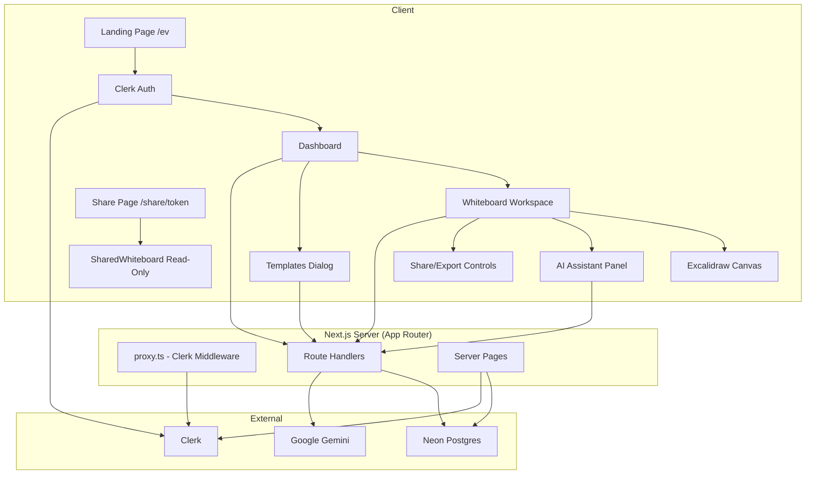

# AI Whiteboard - Detailed Documentation

## Table of Contents

- [Overview](#overview)
- [Architecture Overview](#architecture-overview)
- [System Architecture Diagram](#system-architecture-diagram)
- [Tech Stack](#tech-stack)
- [Application Structure](#application-structure)
- [Authentication Flow](#authentication-flow)
- [Database Schema](#database-schema)
- [API Routes (End-to-End)](#api-routes-end-to-end)
- [Whiteboard & Canvas Flow](#whiteboard--canvas-flow)
- [AI Generation Flow](#ai-generation-flow)
- [Sharing & Read-Only Flow](#sharing--read-only-flow)
- [Exports (PNG/SVG/PDF)](#exports-pngsvgpdf)
- [Dashboard & Board Management](#dashboard--board-management)
- [Templates Flow](#templates-flow)
- [Credits System](#credits-system)
- [State Management](#state-management)
- [Styling & Design System](#styling--design-system)
- [Environment Configuration](#environment-configuration)
- [Deployment Considerations](#deployment-considerations)
- [Troubleshooting](#troubleshooting)
- [Security Notes](#security-notes)

## Overview

AI Whiteboard is a full-stack SaaS application that combines a collaborative-style whiteboard (powered by Excalidraw) with AI-assisted diagram generation. Users can create, edit, autosave, organize, share, and export whiteboards. The UI follows a Swiss/Evenkeel minimalist aesthetic with a black/white palette and a single red accent (`#d12a1e`).

## Architecture Overview

The application follows a modern Next.js App Router architecture with server components where possible and client components for interactive features (canvas, animations, modals).

```text
┌─────────────────────────────────────────────────────────────────────────────┐
│                                Client (Browser)                              │
│  Next.js App Router (RSC + Client Components) | Excalidraw Canvas | GSAP/Lenis│
└─────────────────────────────────────────────────────────────────────────────┘
                                      │ HTTP/JSON
                                      ▼
┌─────────────────────────────────────────────────────────────────────────────┐
│                              Next.js Server (Node/Edge)                      │
│  Route Handlers (/api/*) | Server Actions/Pages | Clerk Middleware (proxy.ts) │
└─────────────────────────────────────────────────────────────────────────────┘
                    │                    │                    │
                    ▼                    ▼                    ▼
                ┌─────────┐      ┌─────────────┐      ┌─────────────────┐
                │  Clerk   │      │  Neon PG     │      │  Google Gemini  │
                │  Auth    │      │  Drizzle ORM │      │  API (@google/genai)│
                └─────────┘      └─────────────┘      └─────────────────┘
```

## System Architecture Diagram



## Tech Stack

| Layer | Technology | Purpose |
| --- | --- | --- |
| Framework | Next.js 16.4.2, React 19.3.0 | App Router, SSR/RSC, routing |
| Language | TypeScript 5 | Type safety |
| Styling | Tailwind CSS v4 | Utility-first styling |
| UI Components | shadcn/ui + Base UI | Primitives and composed components |
| Auth | @clerk/nextjs 7.9.18 | Authentication, sessions, user management |
| Database | @neondatabase/serverless, drizzle-orm 0.45.4 | Postgres access + ORM |
| Canvas | @excalidraw/excalidraw 0.18.1 | Infinite canvas, shapes, arrows, export |
| AI | @google/genai 2.30.0 | Diagram generation via Gemini |
| State | zustand 5.0.8 | Client state (user, whiteboard) |
| Animation | gsap 3.13.0, lenis 1.3.27, motion 14.5.0 | Landing page animations |
| Utilities | html-to-image, jspdf, sonner, lucide-react | Export, toasts, icons |
| Tooling | drizzle-kit 0.31.11, eslint 9 | Migrations, linting |

## Application Structure

```
app/
├── layout.tsx           # Root layout (Clerk, fonts, providers, Toaster)
├── page.tsx             # Landing page (/)
├── landing.css          # Swiss/Evenkeel styles (.ev scope)
├── provider.tsx         # App providers
├── proxy.ts             # Clerk middleware (Next.js 16)
├── dashboard/
│   ├── layout.tsx       # Dashboard shell
│   └── page.tsx         # Dashboard view
├── board/[id]/
│   └── page.tsx         # Whiteboard workspace (auth required)
├── share/[token]/
│   └── page.tsx         # Public read-only share
├── sign-in/[[...sign-in]]/
└── sign-up/[[...sign-up]]/
└── api/
    ├── user/route.ts
    ├── ai/route.ts
    └── boards/
        ├── route.ts
        └── [id]/
            ├── route.ts        # GET/PATCH/DELETE
            └── action/route.ts # archive/unarchive/restore

components/
├── landing/             # Landing sections + landing-motion.tsx
├── dashboard/           # board-list, templates, credit-badge
├── whiteboard/          # workspace, workspace-header, canvas, assistant-panel, shared-whiteboard
└── ui/                  # shadcn/ui components

db/
├── index.ts             # Neon + Drizzle client
└── schema.ts            # users, whiteboards

lib/
├── boards.ts            # Board queries/mappers
├── types.ts             # Shared types
├── user.ts              # User upsert/helpers
├── ai-tools.ts          # AI tool config + schema
├── ai-canvas.ts         # Excalidraw element generation
├── export.ts            # PNG/SVG/PDF + thumbnail
├── whiteboard-store.ts  # Zustand store
├── store.ts             # User store
└── utils.ts             # cn etc.
```

## Authentication Flow

1. **Middleware**: `proxy.ts` uses `clerkMiddleware()` to protect routes as configured.
2. **Sign In/Up**: Clerk components at `/sign-in/[[...sign-in]]` and `/sign-up/[[...sign-up]]`.
3. **Session**: Server components use `auth()` from `@clerk/nextjs/server`. Client uses Clerk hooks.
4. **User Sync**: On first access, `getDbUserOrUpsert()` creates a user record in `users` table with default `credit = 3`.
5. **Protection**: `app/board/[id]/page.tsx` redirects to `/sign-in` if no `userId`. API routes use `requireUserId()`/`getDbUserOrUpsert()` and return 401 if unauthorized.

## Database Schema

### `users`
| Column | Type | Notes |
| --- | --- | --- |
| id | text (PK) | Clerk user id |
| name | text | Display name |
| email | text (unique) | Email |
| credit | integer | Default 3, decremented on AI generation |
| created_at | timestamp(tz) | Default now |

### `whiteboards`
| Column | Type | Notes |
| --- | --- | --- |
| id | text (PK) | Generated id |
| user_id | text (FK -> users.id) | Cascade delete |
| title | text | Board title |
| elements | jsonb | Excalidraw elements array |
| app_state | jsonb | Excalidraw appState |
| files | jsonb | Excalidraw files map |
| thumbnail | text | Data URL thumbnail |
| share_token | text (unique) | For public share links |
| favorited | boolean | Default false |
| deleted_at | timestamp(tz) | Soft delete (trash) |
| archived_at | timestamp(tz) | Archive |
| created_at | timestamp(tz) | Default now |
| updated_at | timestamp(tz) | Default now |

## API Routes (End-to-End)

| Method | Route | Auth | Purpose |
| --- | --- | --- | --- |
| GET | `/api/user` | Required | Get current user + credits |
| POST | `/api/boards` | Required | Create board (costs 0, returns credit) |
| GET | `/api/boards?scope=active\|archived\|trashed` | Required | List boards by scope |
| GET | `/api/boards/[id]` | Required | Get board by id (owner only) |
| PATCH | `/api/boards/[id]` | Required | Update title/elements/appState/files/thumbnail/favorited/share enable/disable |
| DELETE | `/api/boards/[id]?permanent=1` | Required | Delete (soft or permanent) |
| POST | `/api/boards/[id]/action` | Required | archive/unarchive/restore |
| POST | `/api/ai` | Required | Generate diagram with Gemini, deduct 1 credit |

**Notes:**
- `PATCH /api/boards/[id]` with `{ share: "enable" }` generates a random token if missing. `{ share: "disable" }` clears it.
- `DELETE` without `permanent=1` moves to trash (sets `deletedAt`). If already trashed, deletes permanently.
- `POST /api/ai` validates credits, calls Gemini with schema, inserts elements via canvas helpers.

## Whiteboard & Canvas Flow

1. **Load**: `app/board/[id]/page.tsx` fetches board via `getBoard(userId, id)`, checks not deleted, converts with `boardToData()`, passes to `WhiteboardWorkspace`.
2. **Init**: `WhiteboardWorkspace` sets store state (boardId, title, favorited, shareToken). Loads user via `/api/user`. Sets up `beforeunload` guard if dirty.
3. **Canvas**: `WhiteboardCanvas` renders Excalidraw with initial data. `excalidrawAPI` stored in Zustand.
4. **Autosave**: On changes, `onChange` triggers `scheduleSave()` (debounced ~800ms). Compares snapshot to last saved; if changed, calls `captureThumbnail()` and `PATCH /api/boards/[id]` with elements/appState/files/thumbnail.
5. **Status**: `WorkspaceHeader` shows saving/unsaved/saved based on store flags.

## AI Generation Flow

1. **Open Panel**: User opens `AssistantPanel`, selects tool (diagram/flowchart/architecture/web-mockup/mobile-mockup/mindmap) and enters prompt.
2. **Placeholder**: `addPlaceholder()` finds empty position and inserts placeholder elements.
3. **Request**: `POST /api/ai` with `{ userInput, tool: { id, name, prompt } }`.
4. **Server**: Validates user + credits (>=1). Builds system prompt with `CANVAS_RULES` + tool prompt + `RESPONSE_SCHEMA`. Calls Gemini `generateContent` with JSON schema. Parses `DiagramResult`.
5. **Insert**: Client removes placeholder, converts via `diagramToElements(diagram, x, y)`, updates scene, scrolls to content. Updates credit from response.
6. **Errors**: On failure, placeholder removed and toast shown.

**Key files:** `lib/ai-tools.ts`, `lib/ai-canvas.ts`, `app/api/ai/route.ts`

## Sharing & Read-Only Flow

1. **Enable Share**: In `WorkspaceHeader`, click "Share" → `PATCH /api/boards/[id]` with `{ share: "enable" }` → server generates token → copies `${origin}/share/${token}` to clipboard.
2. **Public Route**: `app/share/[token]/page.tsx` calls `getBoardByShareToken(token)`, 404 if not found or deleted.
3. **Render**: `SharedWhiteboard` renders Excalidraw with `viewModeEnabled`, hides canvas actions (loadScene/saveToActiveFile/export/saveAsImage/linkOpen), shows "Read-only" header.
4. **Disable**: Click "Unshare" → clears token.

## Exports (PNG/SVG/PDF)

| Format | Function | Notes |
| --- | --- | --- |
| PNG | `exportBoardToPng(fileName, scale=2)` | Uses `exportToBlob` from Excalidraw, 2x scale, padding 24, white background |
| SVG | `exportBoardToSvg(api, fileName)` | Uses `exportToSvg`, serializes to XML, downloads as SVG |
| PDF | `exportBoardToPdf(api, fileName)` | Exports PNG at 2x, creates jsPDF sized to image, adds image, saves PDF |
| Thumbnail | `captureThumbnail(api)` | For autosave previews, max 400px, quality 0.7 |

All exports sanitize filename and trigger browser download.

## Dashboard & Board Management

- **Scopes**: Active (not deleted, not archived), Archived (archived, not deleted), Trashed (deleted).
- **Actions**: Create, open, archive/unarchive, move to trash/restore, delete forever.
- **Search**: Filter by title (client-side).
- **Favorites**: Toggle star, filter by favorites.
- **UI**: Swiss-styled cards with thumbnails, relative timestamps, dropdown menus.

## Templates Flow

1. User clicks "Templates" in dashboard → `TemplatesDialog` opens.
2. Select template → creates board via `POST /api/boards`, navigates to `/board/[id]?template=<tool>&prompt=<prompt>`.
3. `AssistantPanel` reads search params, pre-selects tool and prompt, auto-opens panel.
4. User can generate immediately or edit prompt.

## Credits System

- **Initial**: New users get 3 credits (`users.credit` default 3).
- **AI Usage**: Each `POST /api/ai` decrements credit by 1 (if sufficient). Returns updated credit in response.
- **Display**: `CreditBadge` shows remaining credits in header.
- **Enforcement**: Server checks credits before calling Gemini.

## State Management

### Zustand Stores

**`useWhiteboardStore`** (whiteboard state):
- `boardId`, `title`, `api` (Excalidraw API)
- `saving`, `dirty`, `lastSavedAt`
- `favorited`, `shareToken`
- `exporting`, `aiRunning`
- Actions: setters, `markDirty`, `setSaved`

**`useUserStore`** (user state):
- `user`, `credit`
- Actions: `setUser`, `setCredit`

## Styling & Design System

**Palette (Swiss/Evenkeel):**
- Background: `#ffffff`
- Text/Ink: `#0b0b0b`
- Subtle bg: `#f2f2f2`
- Muted text: `#6b6b6b`, `#8f8f8f`
- Rules/borders: `#dadada`
- Accent: `#d12a1e`

**Typography:** `Host_Grotesk` (variable font) via `next/font/local`

**Landing:** Scoped under `.ev` in `app/landing.css`. Uses CSS custom properties, GSAP ScrollTrigger for scenes (opening, services, workflow, boards, switch, principle, FAQ, reviews, contact, footer). Lenis for smooth scrolling. Nav auto-hides on scroll.

**Components:** shadcn/ui with Base UI primitives. Buttons use rounded-full or square per context. Hairline borders throughout.

## Environment Configuration

| Variable | Required | Description |
| --- | --- | --- |
| `NEXT_PUBLIC_CLERK_PUBLISHABLE_KEY` | Yes | Clerk publishable key |
| `CLERK_SECRET_KEY` | Yes | Clerk secret key |
| `DATABASE_URL` | Yes | Neon Postgres connection string |
| `GEMINI_API_KEY` | Yes | Google Gemini API key |
| `GEMINI_MODEL` | No | Defaults to `gemini-2.5-flash` |
| `NEXT_PUBLIC_APP_URL` | No | Used for share links (defaults to origin) |

## Deployment Considerations

- **Next.js 16**: Uses Turbopack in dev/build. `proxy.ts` replaces `middleware.ts`.
- **Database**: Run `npm run db:push` or migrations before first deploy.
- **Clerk**: Configure allowed origins/redirects for production domain.
- **Environment**: Set all required env vars in hosting platform.
- **Build**: `npm run build` passes with current setup. TypeScript and ESLint checked.
- **Assets**: Excalidraw CSS bundled; fonts loaded locally.

## Troubleshooting

| Issue | Cause | Solution |
| --- | --- | --- |
| Boards not loading | Missing `DATABASE_URL` | Add Neon connection string to `.env.local` and run `db:push` |
| AI generation fails | Missing/invalid `GEMINI_API_KEY` or no credits | Add API key, check user credits in DB |
| Auth errors | Wrong Clerk keys | Verify keys in Clerk dashboard |
| Canvas not rendering | SSR issues | Excalidraw loaded dynamically with `ssr: false` |
| Share link 404 | Token missing or board deleted | Ensure share enabled and board not trashed |
| Build type errors | Type mismatches | Check types in `lib/types.ts` and component props |

## Security Notes

- **Auth**: All board operations require ownership check via `getBoard(userId, id)`.
- **Share**: Public share only works with valid `shareToken` and non-deleted boards. No edit access in view mode.
- **API**: Server validates all inputs, returns appropriate status codes.
- **Secrets**: Never commit `.env.local`. Rotate keys if exposed.
- **Credits**: Enforced server-side on AI generation.
- **Soft deletes**: Trash prevents normal access; permanent delete requires explicit flag.
- **XSS**: React/Next.js escaping, Excalidraw handles canvas rendering.
- **Middleware**: Clerk middleware protects routes as configured in `proxy.ts`.

---

*Last updated: Generated from codebase analysis.*
