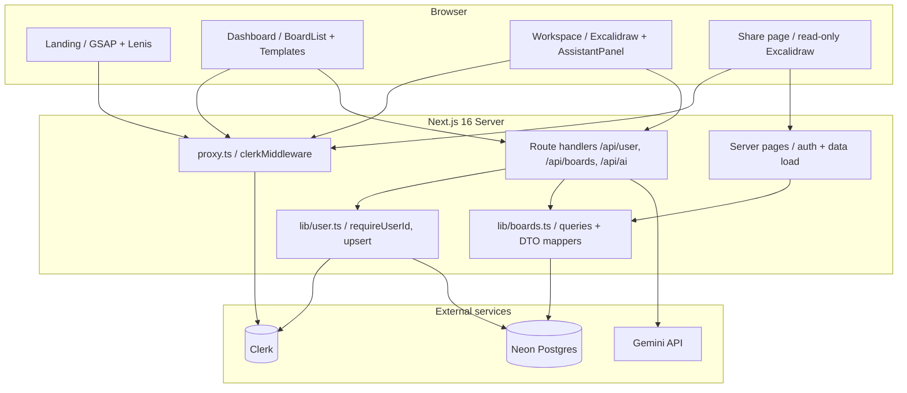

# Learning Guide — AI Whiteboard (Master Index & Phase 1 Analysis)

**Document version:** 1.0  
**Audience:** You (the project author) preparing to explain, defend, debug, and rebuild this project.  
**Method:** Source-code-first. Every claim is tied to a file that exists in this repository. Where intent is inferred rather than proven, it is labelled.

---

## 0. How to use this guide

1. Read `LEARNING_GUIDE.md` once (this file) — it is the map.
2. Study **one chapter at a time** from `docs/chapters/`.
3. At the end of each chapter: answer the 5 knowledge checks, do the 3 exercises, and answer the 5 interview questions.
4. Submit your answers to me; I evaluate them and only then unlock the next chapter.
5. Keep `docs/PROFESSIONAL_DOCUMENTATION.md` as a reference manual (API/DB/config); the chapters are the *teacher*.

**Important:** An earlier codebase map exists at `.planning/codebase/*.md`. It was generated at commit `16423a0`, **before** the production-hardening commit `1793a84`, so several of its "known bugs" are already fixed (atomic credits, thumbnail throttling, summary-column selects). Treat it as historical; this guide reflects the current source.

---

# PHASE 1 — COMPLETE PROJECT ANALYSIS

## 1. Project purpose and business requirements

**Purpose:** Let a user describe a diagram in plain English and receive a fully editable diagram on an infinite canvas, then save, organize, share, and export it.

The product has three surfaces:

| Surface | Route | Auth | Files |
| --- | --- | --- | --- |
| Marketing site | `/` | Public | `app/page.tsx`, `app/landing.css`, `components/landing/*` |
| Application | `/dashboard`, `/board/[id]` | Required | `app/dashboard/*`, `app/board/[id]/page.tsx`, `components/dashboard/*`, `components/whiteboard/*` |
| Public share | `/share/[token]` | Public, read-only | `app/share/[token]/page.tsx`, `components/whiteboard/shared-whiteboard.tsx` |

**Problem it solves (inferred from the code and landing copy):**
- A blank canvas is intimidating; users must manually place every shape.
- Chatbots can *describe* diagrams but their output is usually text or an image, not editable canvas elements.
- A usable SaaS needs more than generation: accounts, cloud persistence, organization, sharing, exports, and usage control.

**Solution implemented:** Excalidraw for the canvas, Gemini with a strict JSON schema for generation, deterministic conversion of that JSON into Excalidraw elements, and a small REST layer over Neon Postgres with Clerk identity.

## 2. Technology stack — what and why

Versions from `package.json` (current): Next.js **16.4.6**, React **19.3.0**, TypeScript 5, Tailwind CSS 4, `@clerk/nextjs` 7.9.18, `@excalidraw/excalidraw` 0.18.1, `@google/genai` ~2.x, Drizzle ORM 0.45.x, `@neondatabase/serverless`, Zustand 5, GSAP 3, Lenis 1, Motion 14, jsPDF, Sonner, Lucide.

| Choice | Evidence in code | Why it fits (reasoned from the code) |
| --- | --- | --- |
| **Next.js 16 App Router** | `app/` tree, async `params`, `proxy.ts` | Server components do auth + DB reads on the server; client islands handle interactive UI. One deployable full-stack app instead of separate frontend/backend. |
| **React 19** | `useEffect`, client components, Server Components | App Router requires it; React 19 supports the RSC model. |
| **TypeScript strict** | `tsconfig.json`, `npm run build` type-checks | Catch mismatches between AI JSON, Excalidraw elements, and API payloads. |
| **Tailwind v4 + Turbopack loader** | `next.config.ts` wires `@tailwindcss/turbopack` | Fast styling with utility classes; landing page uses a separate scoped CSS file. |
| **Excalidraw** | `excalidraw-wrapper.tsx`, `whiteboard-canvas.tsx`, `lib/export.ts` | Battle-tested canvas, element model, file support, and built-in exporters. Avoids building drawing primitives. |
| **Gemini + JSON schema** | `app/api/ai/route.ts` uses `responseMimeType`, `responseSchema` | Constrains output to a shape the converter can always consume; less fragile than free-form text parsing. |
| **Neon serverless + Drizzle** | `db/index.ts` uses `neon(url)` + `drizzle({ client, schema })`, HTTP transport | Serverless-friendly Postgres (no persistent socket), typed queries, schema-as-code. |
| **Clerk** | `ClerkProvider` in `app/layout.tsx`, `auth()` in pages/routes, `UserButton`, `Show` | Authentication UI and session handling are delegated; app code only deals with `userId`. |
| **Zustand** | `lib/whiteboard-store.ts`, `lib/store.ts` | Tiny global client state for cross-component signals (save status, API handle, credits) without prop drilling. |
| **GSAP + Lenis** | `components/landing/landing-motion.tsx` | Scroll-driven choreography and smooth scrolling on the marketing site; kept out of the app shell. |
| **Sonner** | `Toaster` in `app/layout.tsx` | Consistent toast feedback for share, export, and AI errors. |
| **jsPDF** | Dynamic `import("jspdf")` in `lib/export.ts` | Keeps PDF code out of the initial bundle; used only when the user exports. |

**Not present (do not claim):** Stripe/billing, WebSockets/CRDT collaboration, Redis, CI workflows, unit/E2E tests, monitoring service, feature flags, i18n.

## 3. High-level architecture



**Shape:** A full-stack monolith with three layers — presentation (App Router + React), server/API (route handlers + helpers), persistence/integration (Drizzle/Neon + Clerk + Gemini). There is no separate service layer class hierarchy; business rules live directly in route handlers and small helper modules.

## 4. Folder and file map

```
app/
  layout.tsx                 Root layout: ClerkProvider, fonts, metadata, Toaster, AppProvider
  provider.tsx               Client bootstrap: POST /api/user when Clerk session becomes ready
  page.tsx                   Landing page markup (sections: opening, services, workflow, boards, prices, switch, principle, faq, reviews, contact, footer)
  landing.css                ~1,647 lines of .ev-scoped design system
  globals.css                Tailwind + theme tokens for app shell
  proxy.ts                   Clerk middleware (Next.js 16 replacement for middleware.ts)
  global-error.tsx           Root 500 boundary (client)
  not-found.tsx              404 page
  dashboard/layout.tsx       Auth guard + dashboard header (brand, CreditBadge, UserButton)
  dashboard/page.tsx         Renders BoardList
  board/[id]/page.tsx        Auth guard + getBoard + notFound + WhiteboardWorkspace
  share/[token]/page.tsx     getBoardByShareToken + SharedWhiteboard
  sign-in/... / sign-up/...  Clerk hosted UI components
  api/user/route.ts          POST upsert user, GET get-or-upsert user
  api/boards/route.ts        GET list by scope, POST create board (1 credit)
  api/boards/[id]/route.ts   PATCH scene/title/favorite/share, DELETE soft/permanent
  api/boards/[id]/action/route.ts  archive / unarchive / restore
  api/ai/route.ts            rate limit → atomic credit decrement → Gemini → refund on failure
components/
  landing/landing-motion.tsx GSAP/Lenis scenes, nav menu, reduced-motion branch, cleanup
  landing/board-scenes.tsx   Decorative SVG scenes (flow, architecture, web, mobile, mindmap)
  landing/faq-section.tsx    Accordion FAQ (useState)
  landing/pricing-section.tsx Plan cards + monthly/yearly toggle (marketing only)
  landing/reveal.tsx         IntersectionObserver reveal wrapper
  animations/*               Magnetic button, mask reveal, stagger text, velocity scroll helpers
  dashboard/board-list.tsx   Fetch/scope/search/favorites/board actions, BoardCard, dropdown menus
  dashboard/templates.tsx    Template dialog → POST board → navigate with ?template=&prompt=
  dashboard/credit-badge.tsx Displays store credit
  whiteboard/excalidraw-wrapper.tsx  next/dynamic(Excalidraw, ssr:false) + typed props
  whiteboard/whiteboard-canvas.tsx   Excalidraw binding, onChange, 1.5s debounce, 30s thumbnail throttle
  whiteboard/workspace.tsx          Orchestrator: user bootstrap, dirty guard, layout
  whiteboard/workspace-header.tsx   Title commit, save status, favorite, share, 3 exports
  whiteboard/assistant-panel.tsx    Tool picker, prompt, placeholder, POST /api/ai, element insert
  whiteboard/shared-whiteboard.tsx  Read-only Excalidraw + header
  ui/*                       shadcn/Base UI primitives (button, dialog, tabs, dropdown, etc.)
db/
  index.ts  getDb() cached singleton; throws if DATABASE_URL missing
  schema.ts users, whiteboards tables + inferred types
lib/
  types.ts             BoardSummary / BoardData DTOs
  boards.ts            listBoards, getBoard, getBoardByShareToken, toSummary, boardToData
  user.ts              requireUserId, UnauthorizedError, upsertDbUser, getDbUserOrUpsert
  ai-tools.ts          6 AI_TOOLS, CANVAS_RULES, DiagramResult, RESPONSE_SCHEMA
  ai-canvas.ts         diagramToElements, buildPlaceholderElements, findEmptyCanvasPosition
  export.ts            PNG/SVG/PDF export + captureThumbnail
  store.ts             useUserStore
  whiteboard-store.ts  useWhiteboardStore
  pricing.ts           PLANS, CREDIT_PACKS (display data only)
  utils.ts             cn re-export + splitTextToWords
hooks/use-in-view.ts   IntersectionObserver hook
next.config.ts         Turbopack CSS rule + security headers
drizzle.config.ts      schema/out/dialect/credentials
eslint.config.mjs      ESLint 9 flat config (next vitals + typescript)
proxy.ts               Clerk middleware
```

### Important files: what happens if removed or changed

| File | Role | If removed/broken |
| --- | --- | --- |
| `app/layout.tsx` | Wraps everything in Clerk, fonts, toasts, provider | No auth context; pages using Clerk hooks throw; no global styles/toasts |
| `app/provider.tsx` | Bootstraps DB user + credit into store on sign-in | `CreditBadge` shows `–`; boards APIs still upsert lazily, but UI credit is stale |
| `proxy.ts` | Clerk middleware | No session refresh on requests; `auth()` may still work from cookies, but route protection behaviour changes |
| `db/index.ts` | Cached DB client | Every board/user route throws at runtime |
| `db/schema.ts` | Single source of truth for tables | Drizzle typed queries fail to compile; migrations cannot be generated |
| `lib/user.ts` | Identity → DB user bridge | `requireUserId`/upsert logic would need to be duplicated in every route |
| `lib/boards.ts` | Ownership-scoped queries + DTO mapping | Routes would leak raw rows (including heavy JSONB) and lose scope filtering |
| `app/api/ai/route.ts` | Credit gate + Gemini call + refunds | AI panel gets 404; no generation |
| `lib/ai-tools.ts` | Prompt presets + response schema | Model output becomes unconstrained; converter would break |
| `lib/ai-canvas.ts` | JSON → Excalidraw elements | AI results cannot be drawn |
| `excalidraw-wrapper.tsx` | Client-only boundary | SSR attempts to evaluate canvas code; app crashes or hydration breaks |
| `whiteboard-canvas.tsx` | Autosave engine | Boards no longer persist edits |
| `workspace-header.tsx` | Share/favorite/export UI | Those features become unreachable even though APIs exist |
| `landing-motion.tsx` | All marketing animation + cleanup | Static landing (still readable), but no scroll choreography or menu behaviour |

## 5. Frontend, backend, database, and API architecture

**Frontend:** Server components render route shells and load data (`app/board/[id]/page.tsx`, `app/share/[token]/page.tsx`). Client components (`"use client"`) handle state: `BoardList`, `TemplatesDialog`, `WorkspaceHeader`, `WhiteboardCanvas`, `AssistantPanel`, `LandingMotion`. Excalidraw is loaded with `dynamic(..., { ssr: false })` because it needs browser APIs.

**Backend:** Five route handlers under `app/api/`. No controllers/services/classes — helpers in `lib/user.ts`, `lib/boards.ts`, `lib/ai-tools.ts`, `lib/ai-canvas.ts` are the shared logic. Every protected route starts with Clerk identity and, for boards, an ownership check via `getBoard(userId, id)`.

**Database:** Two tables; `users.id` is the Clerk user ID (no separate app user ID). `whiteboards.userId` cascades from `users`. Scene data is JSONB. Soft delete (`deletedAt`) and archive (`archivedAt`) are nullable timestamps. `shareToken` is unique.

**APIs (verb + path + job):**
- `POST /api/user` — upsert user from Clerk profile; `GET /api/user` — get-or-upsert.
- `GET /api/boards?scope=active|archived|trashed` — summaries + credit.
- `POST /api/boards` — atomic credit deduction, create board, 201.
- `PATCH /api/boards/[id]` — title, elements, files, thumbnail (≤2 MB), favorite, share enable/disable.
- `DELETE /api/boards/[id]?permanent=1` — soft delete or permanent delete.
- `POST /api/boards/[id]/action` — archive, unarchive, restore.
- `POST /api/ai` — rate limit, atomic credit deduction, Gemini generation, refund on failure.

## 6. Auth, authorization, and integrations

- `ClerkProvider` in root layout supplies client auth; `auth()` in server pages/routes supplies `userId`.
- Public: `/`, `/share/[token]`, `/sign-in`, `/sign-up`. Protected: `/dashboard`, `/board/[id]`, all `/api/*` except share (share reads via server page, not API).
- `getDbUserOrUpsert()` lazily creates a `users` row on first request; `POST /api/user` does the same eagerly on sign-in via `AppProvider`.
- Ownership is enforced per board query: `where(id = boardId AND userId = user.id)`.
- Share links are capability URLs: `randomUUID().replace(/-/g, "")` (32 hex chars), unique index, revocable by setting token null; shared view uses `viewModeEnabled`.
- Third parties: Clerk (identity), Neon (DB), Gemini (generation), Unsplash images (landing), Google Fonts via `next/font/google`.

## 7. Environment and configuration

`.env.example` lists: `NEXT_PUBLIC_CLERK_PUBLISHABLE_KEY`, `CLERK_SECRET_KEY`, `NEXT_PUBLIC_CLERK_SIGN_IN_URL`, `NEXT_PUBLIC_CLERK_SIGN_UP_URL`, `DATABASE_URL`, `GEMINI_API_KEY`, `GEMINI_MODEL`. `.gitignore` ignores `.env*` and `next-env.d.ts`. `next.config.ts` adds security headers (`nosniff`, frame deny, referrer policy, permissions policy) and a Turbopack CSS loader for Tailwind.

## 8. Main data flows (condensed)

**A. First sign-in:** Clerk session → `AppProvider` sees `isSignedIn` → `POST /api/user` → `upsertDbUser()` reads `currentUser()`, inserts/upserts row → Zustand `setUser` → `CreditBadge` shows 3.

**B. Create board:** Templates dialog or "New board" → `POST /api/boards {title}` → atomic `UPDATE users SET credit = credit - 1 WHERE credit > 0 RETURNING credit` → insert board row → 201 with id → router push to `/board/[id]`.

**C. Edit/autosave:** Excalidraw `onChange` → pending snapshot + `markDirty` → 1.5s debounce → `captureThumbnail` (max once/30s) → `PATCH /api/boards/[id]` → ownership check → JSONB update → `setSaved()` → header shows "Saved".

**D. Generate AI:** Assistant panel tool + prompt → placeholder elements → `POST /api/ai` → rate limit → atomic debit → Gemini with JSON schema → parse + validate nodes → `diagramToElements` → replace placeholder → scroll to content. Failure: refund + toast.

**E. Share:** `PATCH {share:"enable"}` → token generated → clipboard URL → public `/share/[token]` → `getBoardByShareToken` → 404 if deleted → read-only Excalidraw.

**F. Export:** Header button → `exportToBlob`/`exportToSvg` → browser download; PDF converts PNG blob to data URL and feeds jsPDF.

---

# DOCUMENTATION ROADMAP

| # | Chapter | Status |
| --- | --- | --- |
| 1 | Project Overview | ✅ Available: `docs/chapters/01-project-overview.md` |
| 2 | Problem Statement and Objectives | Planned |
| 3 | Requirements Analysis | Planned |
| 4 | Technology Stack (deep dive + tradeoffs) | Planned |
| 5 | System Architecture (diagrams, boundaries) | Planned |
| 6 | Folder Structure and Codebase Explanation | Planned |
| 7 | Development Methodology (what is actually used) | Planned |
| 8 | Design Patterns and Engineering Principles | Planned |
| 9 | Frontend Deep Dive | Planned |
| 10 | Backend Deep Dive | Planned |
| 11 | Database Design | Planned |
| 12 | API Documentation | Planned |
| 13 | Authentication and Security | Planned |
| 14 | Feature-by-Feature Implementation | Planned |
| 15 | End-to-End Data Flow | Planned |
| 16 | Error Handling and Validation | Planned |
| 17 | Testing Strategy | Planned |
| 18 | Performance and Optimization | Planned |
| 19 | Deployment and DevOps | Planned |
| 20 | Challenges Faced and Solutions | Planned |
| 21 | Technical Limitations and Future Enhancements | Planned |
| 22 | Project Explanation for Interviews | Planned |
| 23 | Technical Interview Questions and Answers | Planned |
| 24 | Advanced Cross-Questioning | Planned |
| 25 | Rebuilding the Project From Scratch | Planned |
| 26 | Final Revision Notes and Cheat Sheet | Planned |

Existing reference docs: `README.md`, `docs/DETAILED_DOCUMENTATION.md`, `docs/PROFESSIONAL_DOCUMENTATION.md`, `docs/PORTFOLIO_AND_INTERVIEW.md`.

## Study ritual (every chapter)

1. Revision summary — 5 lines.
2. 5 knowledge-check questions.
3. 3 practical exercises.
4. 5 interview questions.
5. You answer; I evaluate; then next chapter.

---

# INFORMATION MISSING / NEEDS CONFIRMATION

These are **gaps in evidence**, not assumptions I will invent:

1. **Author intent** — Why a specific library was chosen is inferred from code, not recorded by you. Confirm or correct my reasoning in Chapter 4.
2. **Local environment** — `.env.local` has Clerk keys but `DATABASE_URL`/`GEMINI_API_KEY` are placeholders. No live E2E verification was possible locally.
3. **Security incident** — Clerk keys were exposed in an earlier chat; they must be rotated. I will not repeat their values in docs.
4. **No automated tests / CI** — `package.json` has no test script; no workflow files. Chapter 17 will teach a testing strategy as an *improvement*.
5. **No migrations directory** — `drizzle.config.ts` points to `./drizzle`, but no generated migration files are committed; setup relies on `npm run db:push`.
6. **No production deployment config** beyond Vercel-friendly defaults; no `vercel.json`, no monitoring, no analytics.
7. **No LICENSE file** although `README.md` says MIT.
8. **Pricing copy vs. code** — `lib/pricing.ts` and FAQ say "3 AI generations/month", but board creation *also* spends one credit. Confirm intended business rule.
9. **Stale codebase map** — `.planning/codebase/*.md` predates hardening commit `1793a84`; its "non-atomic credit" and "full thumbnail in list query" concerns are already fixed.
10. **No UI screenshots/demo link** captured in the repo.
11. **Landing palette inconsistency** — `components/landing/board-scenes.tsx` uses warm orange/brown (`#b45309`) while the app design system uses red (`#d12a1e`). Confirm whether this is intentional.

Anything you answer here will be folded into later chapters.
