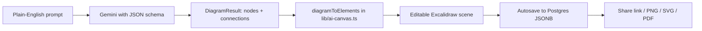
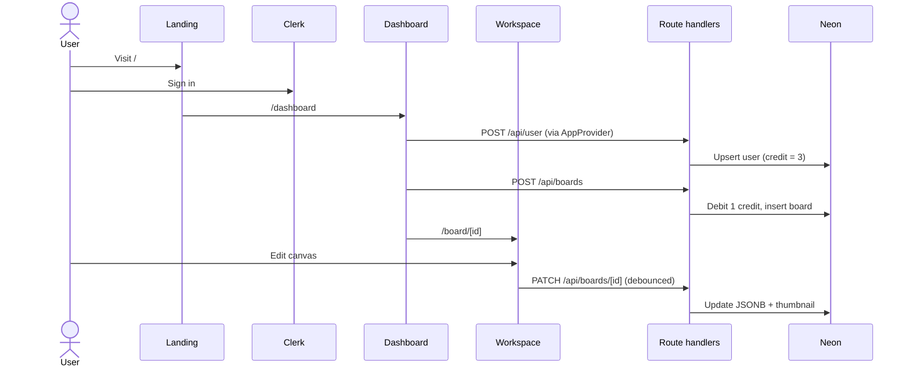

# Chapter 1 — Project Overview

**Goal:** By the end of this chapter you can tell anyone what the project is, who it is for, what it does *not* do, and trace one full user session through the code without opening a diagram.

---

## 1.1 What is this project, in plain language?

AI Whiteboard is a website where you can:

1. Draw on an infinite canvas (the canvas is Excalidraw).
2. Type a sentence like *"a signup flow with email verification"*.
3. Click **Generate** and get real, editable rectangles, text, and arrows on that canvas.
4. Keep working — every edit saves itself to the cloud.
5. Organize boards (favorite, archive, trash), share a read-only link, and export PNG/SVG/PDF.

That is the whole product. Everything else in the repository exists to make those five steps reliable.

**One sentence for a recruiter:**
> "It's a Next.js SaaS that turns natural-language prompts into editable Excalidraw diagrams using Gemini, with real SaaS plumbing around it: auth, persistence, autosave, sharing, exports, and credit limits."

---

## 1.2 The problem and the solution

### The problem (inferred from landing copy and the features built)

| Pain | Evidence in the project |
| --- | --- |
| Blank canvases are slow to start | Landing workflow says "Step 1: Prompt", "Step 2: Draft", "Step 3: Refine" (`app/page.tsx`, `WORKFLOW`) |
| AI text/images are not editable | `lib/ai-canvas.ts` exists specifically to convert AI JSON into native Excalidraw elements |
| Demos skip the "boring" SaaS parts | The repo has user provisioning, soft deletes, ownership checks, rate limits, refunds, and 3 export formats |

### The solution



The important design idea: **the AI produces data, not pixels**. Because the output is the same element format Excalidraw already uses, the user can move, relabel, and restyle every generated shape.

---

## 1.3 Who uses it and the four journeys

There are no user personas file in the repo, but the code supports these journeys:

| Journey | Steps | Main files |
| --- | --- | --- |
| **J1 — Generate a diagram** | Sign in → create board → open AI panel → pick tool → prompt → generate → refine by hand | `board-list.tsx`, `assistant-panel.tsx`, `api/ai/route.ts`, `ai-canvas.ts` |
| **J2 — Manage boards** | Dashboard → search/favorite → archive/restore/trash/delete | `board-list.tsx`, `api/boards/*`, `lib/boards.ts` |
| **J3 — Share** | Open board → Share → copy link → recipient opens read-only view → owner unshares | `workspace-header.tsx`, `api/boards/[id]/route.ts`, `share/[token]/page.tsx` |
| **J4 — Export** | Open board → PNG/SVG/PDF → browser download | `workspace-header.tsx`, `lib/export.ts` |



---

## 1.4 Scope — what this project is NOT

Be able to say this out loud. It prevents interview traps.

| Not implemented | Evidence |
| --- | --- |
| Real-time multiplayer / presence | No websocket or CRDT package; autosave is last-write-wins in `whiteboard-canvas.tsx` |
| Payments / subscriptions | `lib/pricing.ts` is display data; no Stripe dependency or webhook route |
| Team workspaces / shared ownership | `whiteboards.userId` is a single owner; all board queries filter by that ID |
| Automated tests / CI | No test script in `package.json`, no `*.test.*` files, no `.github/workflows` |
| Observability / analytics | No Sentry, no analytics SDK; logging uses `console.error` in route handlers |
| Fine-tuning / RAG | Generation is prompt + JSON schema only (`app/api/ai/route.ts`) |

---

## 1.5 Entry points — the six doors into the app

| Route | File | Server/client | Job |
| --- | --- | --- | --- |
| `/` | `app/page.tsx` | Server markup + client `LandingMotion` | Marketing, CTA to dashboard |
| `/dashboard` | `app/dashboard/page.tsx` + `layout.tsx` | Layout is server (auth guard), list is client | Board management |
| `/board/[id]` | `app/board/[id]/page.tsx` | Server guard + client workspace | Editor |
| `/share/[token]` | `app/share/[token]/page.tsx` | Server lookup + read-only client canvas | Public viewing |
| `/sign-in`, `/sign-up` | Clerk components | Clerk owns UI | Auth |
| `/api/*` | 5 `route.ts` files | Server only | Data + AI operations |

**Middleware:** `proxy.ts` runs `clerkMiddleware()` on matched routes. Note that it does not call `.protect()` on a allowlist — protection is done inside pages (`auth()` + `redirect`) and inside API handlers (`requireUserId()`).

---

## 1.6 Vocabulary you must use precisely

| Term | Meaning in this codebase | File |
| --- | --- | --- |
| **Board** | One row in `whiteboards`; a document containing a scene | `db/schema.ts` |
| **Scene** | `{ elements, appState, files }` — Excalidraw's document model | `lib/types.ts` (`BoardData`) |
| **Element** | One shape/arrow/text object inside `elements` JSONB | `lib/ai-canvas.ts` |
| **File** | Binary asset (e.g., embedded image) keyed by id in `files` JSONB | `lib/export.ts` |
| **Summary** | Lightweight board row for the dashboard (no full scene) | `toSummary()` in `lib/boards.ts` |
| **Credit** | One unit of paid usage, spent by board creation and AI generation | `api/boards/route.ts`, `api/ai/route.ts` |
| **Scope** | `active`, `archived`, `trashed` — dashboard filters | `listBoards()` |
| **Soft delete** | Setting `deletedAt` instead of deleting the row | `DELETE /api/boards/[id]` |
| **Share token** | 32-hex-char capability URL segment | `PATCH { share: "enable" }` |
| **Dirty** | Client flag meaning "unsaved changes exist" | `lib/whiteboard-store.ts` |

---

## 1.7 Trace one session through the actual code

### Step 1 — Layout wraps the app

```tsx
// app/layout.tsx
export default function RootLayout({ children }: LayoutProps<"/">) {
  return (
    <ClerkProvider>
      <html lang="en" className={...}>
        <body>
          <AppProvider>{children}</AppProvider>
          <Toaster theme="light" />
        </body>
      </html>
    </ClerkProvider>
  );
}
```
**Why:** `ClerkProvider` gives every client component access to auth hooks; `AppProvider` bootstraps our DB user; `Toaster` provides feedback for share/export/AI errors. Metadata (title template, OpenGraph) is exported above this component.

### Step 2 — Sign-in provisions a database user

```tsx
// app/provider.tsx
const { isLoaded, isSignedIn } = useUser();
useEffect(() => {
  if (!isLoaded || !isSignedIn) { setUser(null); return; }
  fetch("/api/user", { method: "POST" })
    .then(res => res.ok ? res.json() : null)
    .then(data => { if (data?.user) setUser(data.user); })
    .catch(() => {}); // DB may not be configured yet
}, [isLoaded, isSignedIn, setUser]);
```
**Why this design:** Clerk knows *who* you are; our database needs a matching row to store credits and boards. Doing it in a client-side effect means the UI works even before the database is configured (the catch is deliberately silent).

### Step 3 — Server pages guard access

```tsx
// app/board/[id]/page.tsx
const { id } = await params;
const { userId } = await auth();
if (!userId) redirect("/sign-in");

const board = await getBoard(userId, id);
if (!board || board.deletedAt) notFound();
return <WhiteboardWorkspace board={boardToData(board)} />;
```
**Why:** Auth happens on the server, before any board data is sent. `getBoard(userId, id)` includes the owner filter, so guessing another user's board ID yields `notFound()`.

### Step 4 — Board creation spends one credit atomically

```ts
// app/api/boards/route.ts (POST)
const [deducted] = await db
  .update(schema.users)
  .set({ credit: sql`${schema.users.credit} - 1` })
  .where(and(eq(schema.users.id, user.id), gt(schema.users.credit, 0)))
  .returning({ credit: schema.users.credit });

if (!deducted) return NextResponse.json({ error: "..." }, { status: 402 });

const [board] = await db.insert(schema.whiteboards)
  .values({ id, userId: user.id, title }).returning();
```
**Why atomic:** reading the balance and then subtracting in two separate queries would let two concurrent requests both see "1 credit" and both proceed. One conditional `UPDATE ... WHERE credit > 0` makes the database decide who wins.

### Step 5 — Ownership-scoped queries

```ts
// lib/boards.ts
export async function getBoard(userId: string, boardId: string) {
  const [row] = await db.select().from(schema.whiteboards).where(
    and(eq(schema.whiteboards.id, boardId),
        eq(schema.whiteboards.userId, userId))
  ).limit(1);
  return row ?? null;
}
```
**Why:** authorization is part of the query, not an after-the-fact check. This is the single most important security pattern in the app.

### Step 6 — The rest of the loop

Generation, autosave, share, and export are covered in later chapters. For now, remember where they live:
- AI: `assistant-panel.tsx` → `api/ai/route.ts` → `ai-canvas.ts`
- Autosave: `whiteboard-canvas.tsx` → `PATCH /api/boards/[id]`
- Share: `workspace-header.tsx` → `PATCH { share }` → `/share/[token]`
- Export: `workspace-header.tsx` → `lib/export.ts`

---

## 1.8 A 30-second and a 1-minute introduction

**30 seconds:**
> "AI Whiteboard is a full-stack Next.js app. The core idea is that Gemini generates Excalidraw *elements*, not images, so the output is fully editable. Around that I built the SaaS layer: Clerk auth, a Neon/Drizzle database, debounced autosave with thumbnails, archive and trash, shareable read-only links, three export formats, and credit limits with atomic deductions and refunds. The landing page has its own GSAP/Lenis design system."

**1 minute:** add these specifics:
> "There are five route handlers. Board creation and AI generation each spend one credit using a single conditional SQL update so concurrent requests can't overspend. If Gemini fails, the credit is refunded. The canvas is loaded with `next/dynamic` and `ssr: false` because Excalidraw needs browser APIs. Every board query filters by the Clerk user ID, and sharing uses a revocable 32-character token rendered in read-only mode."

---

## 1.9 Revision summary

- The product = editable AI-generated diagrams on Excalidraw + SaaS plumbing.
- The key insight: AI returns **structured data** (`nodes`, `connections`), not pixels.
- Three surfaces: public landing, authenticated app, public read-only share.
- Not built: multiplayer, payments, tests, monitoring, team workspaces.
- Six doors: `/`, `/dashboard`, `/board/[id]`, `/share/[token]`, Clerk auth routes, five `/api` handlers.
- First session: Clerk sign-in → `POST /api/user` upsert → `POST /api/boards` (credit −1) → editor → autosave.
- Two patterns to remember forever: **ownership in the query** and **atomic credit decrement**.

---

## 1.10 Knowledge checks (answer these before moving on)

1. Why is generating Excalidraw elements better than generating an image of a diagram?
2. Which file turns a signed-in Clerk user into a row in the `users` table, and when is it called?
3. What exactly does `getBoard(userId, id)` do that a plain `getBoard(id)` would not?
4. Name three features that exist in the code but are **not** implemented.
5. Why does board creation use `UPDATE ... WHERE credit > 0 RETURNING credit` instead of two queries?

## 1.11 Practical exercises

1. **Trace exercise:** Open `app/api/boards/route.ts` and write, in your own words, the six lines that run between "click New board" and the 201 response. Mark where the credit changes.
2. **Delete-impact exercise:** Pick three files from the "Important files" table in `LEARNING_GUIDE.md`. For each, write one paragraph describing the first thing that would break if you deleted it, and which other file would surface the error to the user.
3. **Scope exercise:** Write a one-paragraph product spec for adding "expiring share links" and list the exact files you would have to touch (hint: schema, share API, public page, UI). Do not write code yet — just identify the blast radius.

## 1.12 Interview questions (answer out loud)

1. "Describe your project in 30 seconds. What is the single most interesting technical decision?"
2. "How does a user's Clerk identity become a row in your database?"
3. "How do you prevent one user from opening another user's board?"
4. "Why does creating a board consume a credit, and why is that done atomically?"
5. "What are the biggest things this project deliberately does *not* do?"

---

**When you submit your answers to 1.10–1.12, I will evaluate them and unlock Chapter 2 (Problem Statement and Objectives).**
