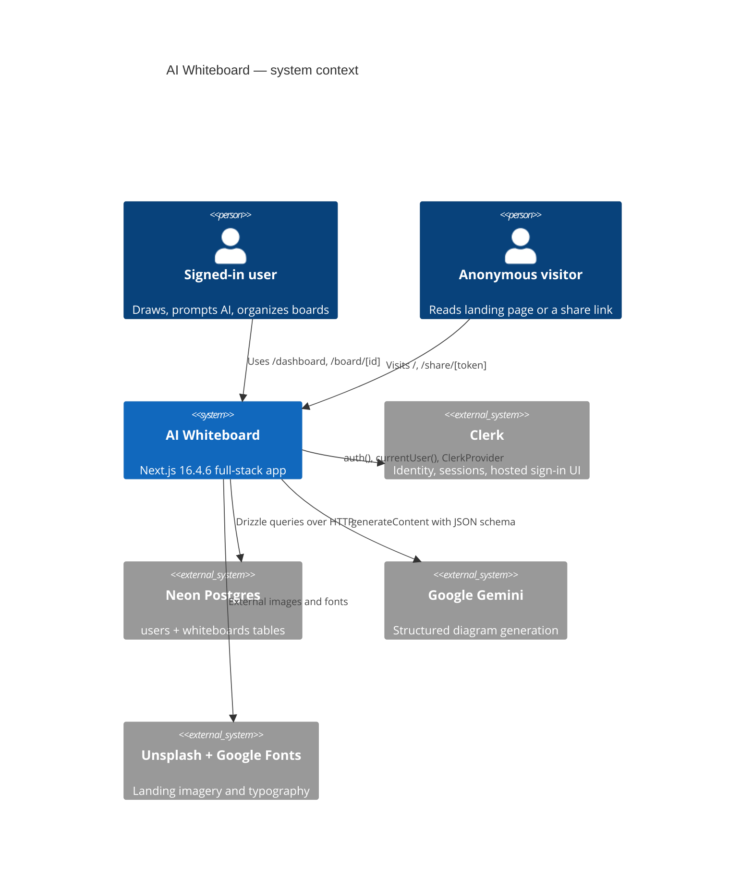
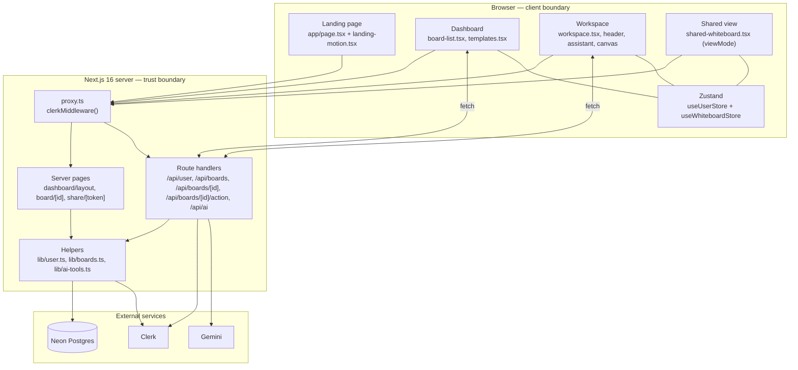
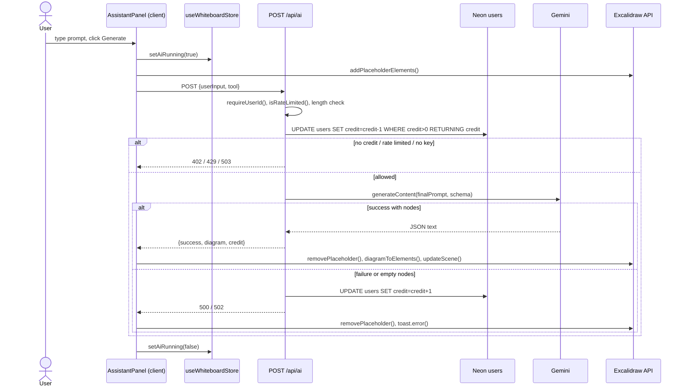
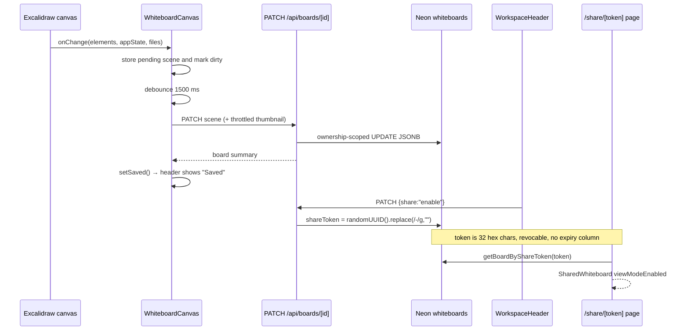
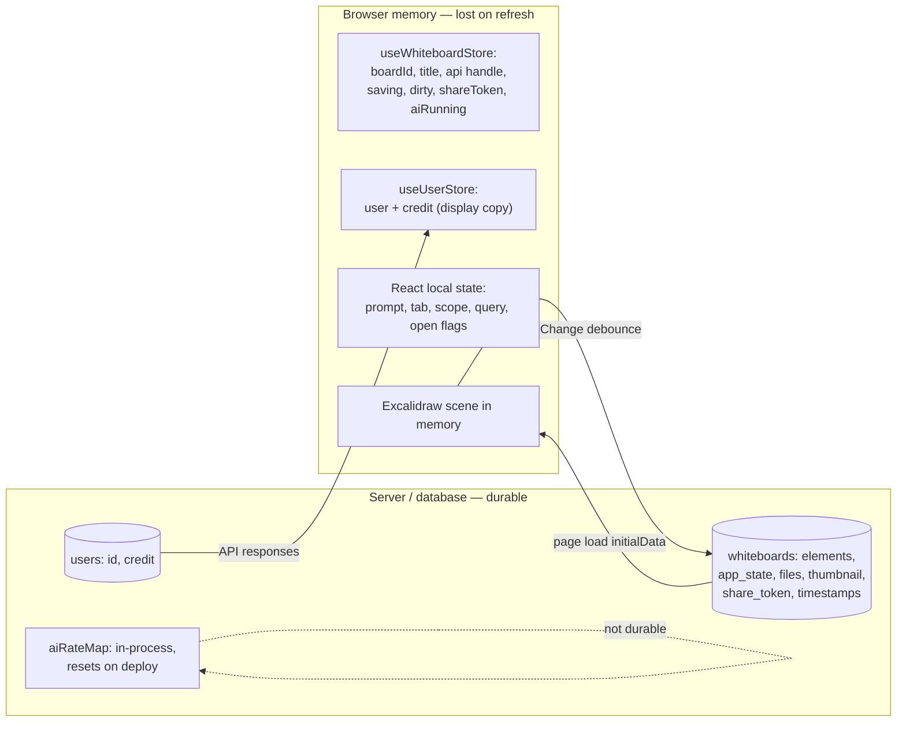

# Chapter 5 — System Architecture

**Goal:** By the end of this chapter you can draw the system from memory, name every trust boundary, explain where each piece of state lives, and describe honestly why there is no service layer.

---

## 5.1 Beginner framing: architecture as "who talks to whom"

Architecture is the map of boundaries. In this project there are three kinds of boundary:

1. **Browser ↔ Next.js server** — HTTP requests (`/api/*`) and server-rendered pages.
2. **Next.js server ↔ external services** — Clerk (identity), Neon (data), Gemini (generation).
3. **Public ↔ private** — the marketing page and `/share/[token]` are public; `/dashboard` and `/board/[id]` require a Clerk session.

**[IMPLEMENTED]** The whole product is one Next.js 16.4.6 application (`package.json:29`). There is no separate backend repository, no container orchestration config, and no message queue.

---

## 5.2 Context diagram (C4 level 1)



**Why this shape:** the app never talks to a user-owned database or a local file system. `db/index.ts:8-15` reads `DATABASE_URL` and creates a Neon HTTP client; `app/api/ai/route.ts:81-87` refuses to serve AI without `GEMINI_API_KEY`.

---

## 5.3 Container diagram (C4 level 2)



**Reading the diagram:** client components never import `getDb()` or call Drizzle directly. Database access is confined to `db/`, `lib/boards.ts`, `lib/user.ts`, and route handlers. **[IMPLEMENTED]** `lib/ai-canvas.ts` and `lib/export.ts` are marked `"use client"` and only manipulate the Excalidraw API.

---

## 5.4 Server/client split in practice

| Concern | Side | Exact file/line | Why |
| --- | --- | --- | --- |
| Root HTML, fonts, metadata | Server | `app/layout.tsx:8-38` | `Geist`, `Geist_Mono`, `Host_Grotesk` loaded with `next/font/google` |
| Auth session context | Both | `ClerkProvider` in `app/layout.tsx:42`; `auth()` in server files | Client hooks need provider; server code needs `userId` |
| Board authorization + load | Server | `app/board/[id]/page.tsx:9-20` | Data is checked before HTML is produced |
| User provisioning bootstrap | Client → server | `app/provider.tsx:19-25` → `POST /api/user` | Retries harmlessly; DB may not be configured yet |
| Board list state, search | Client | `board-list.tsx:47-142` | Interactive filtering over already-fetched summaries |
| Canvas rendering | Client only | `excalidraw-wrapper.tsx:8-25` `dynamic(..., { ssr: false })` | Excalidraw requires browser APIs |
| Save status, AI running, API handle | Client store | `lib/whiteboard-store.ts:31-53` | Shared across header/canvas/panel without prop drilling |
| Credit balance in UI | Client store | `lib/store.ts:17-25` | Updated from `/api/user`, `/api/boards`, `/api/ai`, and `/api/boards` GET responses |
| Credit balance authority | Server/DB | `users.credit` in `db/schema.ts:14` | Client number is display-only; the DB decides |

```ts
// app/layout.tsx:40-52
export default function RootLayout({ children }: LayoutProps<"/">) {
  return (
    <ClerkProvider>
      <html lang="en" className={`${geistSans.variable} ...`}>
        <body className="min-h-full flex flex-col bg-background text-foreground">
          <AppProvider>{children}</AppProvider>
          <Toaster theme="light" />
        </body>
      </html>
    </ClerkProvider>
  );
}
```

**Line-level reading:** `ClerkProvider` must wrap everything that uses Clerk hooks; `AppProvider` is a client component that boots the DB user; `Toaster` makes `toast.success/error` calls in header/panel visible. Note the nesting order — auth before app state before notifications.

---

## 5.5 "No service layer" reality

**[IMPLEMENTED]** There is no `services/` directory, no controller classes, no dependency-injection container, no domain entity classes, and no repository interface. Business rules live in three places:

1. **Route handlers** own orchestration and HTTP semantics: `app/api/boards/route.ts` (credit + insert), `app/api/ai/route.ts` (rate limit → debit → Gemini → refund), `app/api/boards/[id]/route.ts` (field-by-field PATCH, share token, deletes).
2. **Small helper modules** own reusable data access: `lib/user.ts` (`requireUserId`, `upsertDbUser`), `lib/boards.ts` (`listBoards`, `getBoard`, mappers).
3. **Presentation helpers** own transformations: `lib/ai-canvas.ts` (JSON → elements), `lib/export.ts` (scene → file), `lib/ai-tools.ts` (prompts/schema).

```ts
// app/api/boards/[id]/route.ts:63-72
const [updated] = await db
  .update(schema.whiteboards)
  .set(update)
  .where(
    and(
      eq(schema.whiteboards.id, id),
      eq(schema.whiteboards.userId, user.id),
    ),
  )
  .returning();
```

**Why this matters:** authorization is embedded in the write statement. Adding a service layer later must preserve this predicate or it will introduce an IDOR vulnerability (Chapter 13).

**[SUGGESTED IMPROVEMENT]** Extract the repeated `and(eq(id), eq(userId))` predicate and the refund logic into shared helpers if the project grows; today duplication is small and explicit.

---

## 5.6 Request lifecycle: AI generation



**[IMPLEMENTED]** Every arrow in that diagram is backed by source: `assistant-panel.tsx:41-113`, `api/ai/route.ts:45-170`, `lib/ai-canvas.ts:181-202`.

**Why credit is debited before the model call:** the comment at `api/ai/route.ts:89-90` says it explicitly — "deduct BEFORE calling Gemini so concurrent requests can't both pass the balance check." The refund branches (`:129`, `:141`, `:157`) make failure cheap for the user.

---

## 5.7 Request lifecycle: autosave and share



**[IMPLEMENTED]** The `appState: {}` line is at `whiteboard-canvas.tsx:77-78`; the token generation at `api/boards/[id]/route.ts:55-57`; read-only rendering at `shared-whiteboard.tsx:41`.

---

## 5.8 Trust boundaries

| Boundary | Crossing point | Protection | Label |
| --- | --- | --- | --- |
| Anonymous → dashboard | `/dashboard/*` | `auth()` + `redirect("/sign-in")` in `dashboard/layout.tsx:12-13` | **[IMPLEMENTED]** |
| Anonymous → editor | `/board/[id]` | `auth()` + `getBoard(userId, id)` + `notFound()` | **[IMPLEMENTED]** |
| Anonymous → share | `/share/[token]` | Capability token lookup; `deletedAt` boards → `notFound()` (`share/[token]/page.tsx:18`) | **[IMPLEMENTED]** revocable, no expiry |
| Client → API | `fetch("/api/...")` | Clerk session cookie; server re-derives identity with `auth()`; never trusts a client-sent user ID | **[IMPLEMENTED]** |
| User A → User B's board | PATCH/DELETE/action | Ownership in `WHERE` clause (`id` **and** `userId`) | **[IMPLEMENTED]** |
| Browser → downloaded file | `URL.createObjectURL` in `lib/export.ts:36-43` | Local download only; no server-side file storage | **[IMPLEMENTED]** |
| Server → Gemini | API key from env | Key never sent to client; 503 if absent (`api/ai/route.ts:81-87`) | **[IMPLEMENTED]** |
| Every HTTP response | `next.config.ts:22-24` | `nosniff`, `X-Frame-Options: DENY`, referrer/permissions policy | **[IMPLEMENTED]** |

**[EVIDENCE GAP]** `proxy.ts:3` runs `clerkMiddleware()` with a matcher but does not call `.protect()` on a route allowlist. Protection is implemented inside pages and handlers. This is a deliberate-looking simplification, but no comment confirms intent.

---

## 5.9 Where state lives



**[IMPLEMENTED]** Durable state is only `users` and `whiteboards` (`db/schema.ts:10-43`). **[PARTIAL]** `appState` is stored in the schema but autosave writes `{}`, so viewport/selection are not durable. **[EVIDENCE GAP]** The in-memory rate map is state that intentionally does not survive restart.

---

## 5.10 Architectural decisions and tradeoffs

| Decision | Evidence | Benefit | Tradeoff | Label |
| --- | --- | --- | --- | --- |
| Monolithic Next.js app | `app/` contains pages + APIs | One deploy, shared types, server auth | No independent scaling of AI work | **[IMPLEMENTED]** |
| Server components for guards/data | `dashboard/layout.tsx`, `board/[id]/page.tsx` | Authorization before HTML | More async plumbing (`await params`, `await auth()`) | **[IMPLEMENTED]** |
| Client-only Excalidraw | `dynamic(..., { ssr: false })` | Avoids SSR browser-API crashes | Canvas not in initial HTML; loading spinner | **[IMPLEMENTED]** |
| JSONB scene storage | `db/schema.ts:26-31` | Flexible document model; no element table joins | Hard to query individual elements; large rows | **[IMPLEMENTED]** |
| Ownership in query | `lib/boards.ts:74-90` | Hard to forget on reads | Must be repeated on every write | **[IMPLEMENTED]** |
| Atomic credit update | both credit routes | Correct under concurrency | Requires `RETURNING` and refund logic | **[IMPLEMENTED]** |
| In-memory rate limiting | `api/ai/route.ts:27` | Zero infrastructure | Resets on restart; per-instance only | **[PARTIAL]** |
| Base64 thumbnail in DB | `db/schema.ts:32`; 2 MB cap | Simple implementation | Row bloat; mitigated by summary selects + throttle | **[PARTIAL]** |
| Last-write-wins autosave | debounce + PATCH | Simple, no CRDT complexity | Two tabs can overwrite each other | **[PARTIAL]** |
| Capability share links | 32 hex token | No account needed for viewers | No expiry; possession = access until revoked | **[IMPLEMENTED]** with stated limitation |

Cross-references: the data model is detailed in Chapter 11, the API contract in Chapter 12, security boundaries in Chapter 13, and the full save/generate traces in Chapter 15.

---

## 5.11 Revision summary

- One Next.js 16.4.6 application; three external systems: Clerk, Neon, Gemini.
- Three surfaces: public marketing, authenticated app, public read-only share.
- Server components own auth and data loading; client components own interaction and canvas state.
- There is no service layer: route handlers + `lib/user.ts` + `lib/boards.ts` are the "backend".
- Ownership is enforced by `WHERE id = ? AND userId = ?`, including in write statements.
- Durable state is two database tables; client state is two Zustand stores plus React locals; rate state is a volatile `Map`.
- Tradeoffs are explicit: simple monolith and JSONB versus scaling, in-process rate limits, and last-write-wins conflicts.

## 5.12 Knowledge checks

1. Draw the context diagram from memory and name all four external systems.
2. Why is Excalidraw loaded with `ssr: false`, and which file isolates that decision?
3. Where is the "service layer" in this codebase? Answer with the three places business logic actually lives.
4. Name two trust boundaries and the exact code that protects each.
5. Which state survives a server restart, and which does not? Cite files.

## 5.13 Practical exercises

1. **Boundary labelling:** Take the container diagram in §5.3 and mark every arrow that crosses a trust boundary. Write one sentence per arrow describing the credential or token involved.
2. **Delete-impact exercise:** Remove `lib/boards.ts` mentally. List the server files that stop compiling and the user-visible feature that breaks first.
3. **Scaling sketch:** Sketch (Mermaid or prose) how §5.6 changes if `aiRateMap` moves to Redis. Name the file whose comment already predicts this change.

## 5.14 Interview questions

1. "Describe the architecture in one diagram and explain the most important boundary."
2. "Why don't you have a service layer, and what would make you add one?"
3. "How do you prevent a user from editing someone else's board?"
4. "Walk me through the states a credit goes through during a failed AI generation."
5. "Which architectural decision would you revisit first if the app had 10,000 concurrent users?"
