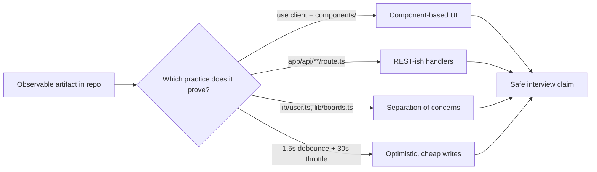

# Chapter 7 — Development Methodology

**Goal:** Learn to describe *how* this project was built — the practices the source actually proves — and to refuse claims about methodologies that leave no evidence in the repository.

---

## 7.1 Beginner first: methodology is what you can *show*

If someone asks "Was this project built with Agile?" the beginner answer is to guess. The professional answer is to open the repository and ask: **what artifacts would exist if that were true?** A Scrum process leaves sprint boards and retrospectives. TDD leaves tests written before implementation. DDD leaves domain aggregates and a ubiquitous-language model. MVC leaves controllers, models, and views wired by a framework.

This repository contains a Next.js 16.4.6 App Router application (`package.json`), five route handlers, two Drizzle tables, and helper modules. It does **not** contain a process document, a test suite, or a domain model. So the honest methodology statement is: **[IMPLEMENTED] the project follows an iterative, component-based, server-first web-development workflow, inferred from code structure — not from a recorded process.**

Two words to distinguish:

- **Practice** — something visible in code (e.g., debounced autosave).
- **Methodology** — a named process (Scrum, TDD, DDD). A practice is evidence; a methodology needs artifacts.



---

## 7.2 Evidence ledger: what is actually present

| Practice | Status | Exact evidence | Why it counts |
| --- | --- | --- | --- |
| Component-based architecture | [IMPLEMENTED] | `components/dashboard/board-list.tsx`, `components/whiteboard/workspace.tsx`, `components/ui/*` | UI is split into reusable components with typed props |
| REST-ish route handlers | [IMPLEMENTED] | `app/api/boards/route.ts` exports `GET` and `POST`; `app/api/boards/[id]/route.ts` exports `PATCH` and `DELETE` | HTTP verbs map to operations on board resources |
| Separation of concerns | [IMPLEMENTED] | `lib/user.ts` (identity), `lib/boards.ts` (queries + DTOs), route handlers (orchestration) | Auth, data access, and transport are not one function |
| DRY (shared helpers) | [IMPLEMENTED] | `toSummary()` and `boardToData()` in `lib/boards.ts`; `baseElement()` in `lib/ai-canvas.ts` | Repeated shaping logic lives in one place |
| KISS (no framework ceremony) | [IMPLEMENTED] | Plain functions in `db/index.ts` and `lib/*.ts`; no classes or DI container | The code favors direct calls over abstraction layers |
| YAGNI (no speculative features) | [IMPLEMENTED] | No billing SDK, no WebSocket package, no test script in `package.json` | Unbuilt features are not half-built |
| Server-first auth | [IMPLEMENTED] | `auth()` in `app/dashboard/layout.tsx`, `app/board/[id]/page.tsx`, `lib/user.ts` | Authorization runs before data is shipped to the browser |
| Lazy provisioning | [IMPLEMENTED] | `getDbUserOrUpsert()` in `lib/user.ts` | A DB row appears on first real request, not at sign-up |
| Optimistic UI | [PARTIAL] | `act()`/`remove()` in `board-list.tsx`; `toggleFavorite()` in `workspace-header.tsx` | Some actions update the UI first; rollback is inconsistent |
| Incremental commits | [PARTIAL] | `docs/LEARNING_GUIDE.md:17` records two distinct commits (`16423a0`, hardening `1793a84`) | Documentary evidence of staged work; no `git log` was run here |
| Automated testing | [EVIDENCE GAP] | No test script in `package.json`; no `*.test.*`/`*.spec.*` files | Cannot claim TDD or a test strategy |
| CI / Scrum / DDD artifacts | [EVIDENCE GAP] | No `.github/workflows`, no sprint docs, no aggregate/entity layer | Cannot claim those methodologies |

---

## 7.3 Component-based architecture and separation of concerns

Beginner view: the screen is a pile of boxes, and each box is one file. Professional view: each component owns a narrow responsibility and receives data through props or a store.

The **workspace orchestrator** is the clearest example. It knows nothing about drawing; it wires state and children:

```tsx
// components/whiteboard/workspace.tsx
return (
  <div className="flex h-screen w-full flex-col overflow-hidden bg-white">
    <WorkspaceHeader />
    <div className="relative min-h-0 flex-1">
      <div className="absolute inset-0">
        <WhiteboardCanvas board={board} />
      </div>
      <AssistantPanel boardId={board.id} />
    </div>
  </div>
);
```

Line-level reading: line 54 renders the header; lines 56–58 mount the canvas in an absolutely positioned layer; line 59 overlays the AI panel. **Why this shape:** the canvas needs the whole viewport, while the panel floats above it; separating them lets each own its own state without a giant `Workspace` component.

Separation of concerns also appears on the server. `lib/user.ts` owns identity translation only:

```ts
// lib/user.ts
export async function requireUserId(): Promise<string> {
  const { userId } = await auth();
  if (!userId) {
    throw new UnauthorizedError();
  }
  return userId;
}
```

`lib/boards.ts` owns board queries and DTO mapping (`listBoards`, `getBoard`, `getBoardByShareToken`, `toSummary`, `boardToData`). Route handlers call both but do not implement either. **[PARTIAL] separation is not absolute**: business rules such as credit deduction and thumbnail limits live directly inside `app/api/boards/route.ts` and `app/api/ai/route.ts`, so a true service layer does not exist ([SUGGESTED IMPROVEMENT] extract a `credit` service if the rules grow).

---

## 7.4 REST-ish route handlers, not a REST framework

The App Router turns the file path into the URL and the exported function name into the verb.

| Route file | Exported verbs | Operation | REST purity |
| --- | --- | --- | --- |
| `app/api/user/route.ts` | `POST`, `GET` | Provision / read current DB user | [PARTIAL] `POST` is an upsert, not a create |
| `app/api/boards/route.ts` | `GET`, `POST` | List summaries / create board | [IMPLEMENTED] collection semantics |
| `app/api/boards/[id]/route.ts` | `PATCH`, `DELETE` | Update scene / trash or hard-delete | [IMPLEMENTED] resource semantics |
| `app/api/boards/[id]/action/route.ts` | `POST` | Archive, unarchive, restore | [PARTIAL] custom action subresource |
| `app/api/ai/route.ts` | `POST` | Generate a diagram | [PARTIAL] RPC-style verb, not a resource |

Why "REST-ish" rather than "REST": the handlers use real verbs and status codes, but `POST /api/boards/[id]/action` with `{ action: "archive" }` is an RPC-style command, and `?permanent=1` on `DELETE` changes semantics through a query flag. Both are pragmatic choices, not violations of a contract the project ever claimed.

A shared body-parsing habit shows defensive KISS thinking:

```ts
// app/api/boards/[id]/route.ts
const body = (await request.json().catch(() => ({}))) as PatchBody;
const update: Partial<typeof schema.whiteboards.$inferInsert> = {
  updatedAt: new Date(),
};
```

A malformed or empty body becomes `{}`, so a PATCH that only toggles sharing still executes. **[SUGGESTED IMPROVEMENT] the `as PatchBody` cast is a type assertion, not runtime validation** — a library such as Zod would turn untrusted fields into checked data (see Chapter 16).

---

## 7.5 DRY, KISS, YAGNI in concrete code

**DRY — Don't Repeat Yourself.** The dashboard needs small board cards, but a full board row contains megabytes of `elements` and base64 `thumbnail`. `lib/boards.ts` solves this once:

```ts
// lib/boards.ts
function toSummary(row: SummaryRow): BoardSummary {
  return {
    id: row.id,
    title: row.title,
    thumbnail: row.thumbnail ?? null,
    favorited: row.favorited ?? false,
    archived: row.archivedAt !== null,
    deleted: row.deletedAt !== null,
    trashed: row.deletedAt !== null,
    createdAt: row.createdAt.toISOString(),
    updatedAt: row.updatedAt.toISOString(),
  };
}
```

Every list response goes through this mapper, so "archived means archivedAt is not null" is written once. `lib/ai-canvas.ts` applies the same idea with `baseElement()` for every generated shape and `makeText()` for every label.

**KISS — Keep It Simple.** `db/index.ts` is a 27-line function with a module-level `cached` variable; there is no connection-pool class. `app/api/ai/route.ts` even documents its simple rate limiter in a comment: *"ponytail: simple in-memory sliding-window rate limiter per userId. Ceiling: resets on deploy / restart. Upgrade to Redis if running multi-instance."* That is an explicit, honest simplicity tradeoff.

**YAGNI — You Aren't Gonna Need It.** `lib/pricing.ts` defines `PLANS` and `CREDIT_PACKS` as display data; there is no payment SDK or webhook route. `[IMPLEMENTED] speculative billing infrastructure was not built.` The same is true of multiplayer: no WebSocket or CRDT dependency exists, and autosave is last-write-wins.

**[SUGGESTED IMPROVEMENT] DRY is incomplete.** The same `try / UnauthorizedError / console.error / 500` envelope appears in all five route files. A shared `withAuth` wrapper or `apiError()` helper would remove that duplication, but the current duplication is small and legible — which is itself a KISS decision.

---

## 7.6 Server-first auth, lazy provisioning, optimistic UI

**Server-first auth [IMPLEMENTED].** `app/dashboard/layout.tsx` opens with:

```tsx
const { userId } = await auth();
if (!userId) redirect("/sign-in");
```

`app/board/[id]/page.tsx` repeats the guard and then calls `getBoard(userId, id)`. The client's `useUser()` (in `app/provider.tsx`) is only for UI state, never for the authorization decision.

**Lazy provisioning [IMPLEMENTED].** Most protected handlers call `getDbUserOrUpsert()`:

```ts
// lib/user.ts
export async function getDbUser(): Promise<User | null> {
  const { userId } = await auth();
  if (!userId) return null;
  const db = getDb();
  const [user] = await db
    .select()
    .from(schema.users)
    .where(eq(schema.users.id, userId))
    .limit(1);
  return user ?? null;
}
```

If no row exists, `upsertDbUser()` inserts one with `onConflictDoUpdate`, using a fallback email `${userId}@users.clerk.internal` when Clerk has none. `app/provider.tsx` also calls `POST /api/user` proactively after sign-in, so the two paths converge on the same upsert.

**Optimistic UI [PARTIAL].** The board list removes a card *before* waiting for the server:

```ts
// components/dashboard/board-list.tsx
async function remove(id: string, permanent: boolean) {
  setBoards((prev) => prev?.filter((b) => b.id !== id) ?? prev);
  await fetch(`/api/boards/${id}${permanent ? "?permanent=1" : ""}`, {
    method: "DELETE",
  });
  void fetchBoards(scopeRef.current);
}
```

The header's `toggleFavorite()` is stronger: it flips the star, and in `catch` calls `setFavorited(!next)` to roll back. The assistant panel inserts a dashed placeholder before the Gemini call and removes it in `catch`. **[SUGGESTED IMPROVEMENT] `remove()` and `act()` ignore the response status**, so a failed delete looks successful until the refetch; reuse the rollback pattern from `toggleFavorite()`.

---

## 7.7 Methodologies explicitly NOT evidenced

Say these out loud so an interviewer cannot trap you. All are **[EVIDENCE GAP]** — meaning *no repository artifact supports the claim*, not a claim about the author's private process.

| Named methodology | Why it is not evidenced | What would be required |
| --- | --- | --- |
| **Agile / Scrum** | No sprint backlog, standup notes, story points, or retrospective in the repo. `docs/LEARNING_GUIDE.md` is a study guide, not a sprint log. | Issue tracker history, sprint artifacts, definition-of-done record |
| **TDD** | `package.json` has only `dev`, `build`, `start`, `lint`, `db:generate`, `db:push`, `db:studio`. No test files exist. | Red-green-refactor commits, test suite, coverage config |
| **DDD** | `db/schema.ts` has two flat tables; no aggregates, value objects, repositories, or bounded contexts. | Domain layer, ubiquitous-language document, aggregate roots |
| **MVC / MVVM** | Next.js App Router is not an MVC framework; there are no `controllers/`, `models/`, or `views/` directories and no ViewModel classes. | Framework or explicit layer contracts |

The nearest honest analogue is **layered architecture by folder convention**: `app/` (transport + pages), `components/` (view), `lib/` (helpers), `db/` (persistence). Call it "clean separation by folder", not MVC.

---

## 7.8 Interview-safe wording

Use the left column; never say the middle column. The right column is your proof.

| Interviewer prompt | Unsafe wording | Interview-safe wording (evidence) |
| --- | --- | --- |
| "Which methodology did you follow?" | "We followed Scrum with two-week sprints." | [IMPLEMENTED] "I worked iteratively and kept concerns separated; the repo shows component boundaries and staged commits, but I don't claim a named process." (`components/`, `docs/LEARNING_GUIDE.md:17`) |
| "Did you write tests?" | "Yes, the code is well tested." | [EVIDENCE GAP] "There is no automated test suite yet; I rely on strict TypeScript, ESLint, and manual verification. Adding tests is a known next step." (`package.json`, `tsconfig.json`) |
| "Is this MVC?" | "Yes, models, views, controllers." | [PARTIAL] "It is App Router with server pages, client components, route handlers, and small helper modules — an MVC-like separation, not an MVC framework." (`app/`, `lib/`, `components/`) |
| "How did you keep it maintainable?" | "I used DRY everywhere." | [IMPLEMENTED] "Shared DTO mappers and element builders remove duplication; a few error envelopes are still repeated and I would extract them next." (`lib/boards.ts`, `lib/ai-canvas.ts`) |
| "Was the work incremental?" | "I shipped one big commit." | [PARTIAL] "The learning guide records a codebase map before a later hardening commit, so the work was staged; I did not inspect `git log` for this chapter." (`docs/LEARNING_GUIDE.md:17`) |

Cross-references: component details in Chapter 9, handler details in Chapter 10, missing test strategy in Chapter 17, rebuild sequence in Chapter 25.

---

## 7.9 Revision summary

- [IMPLEMENTED] Component-based UI, REST-ish handlers, helper-module separation, and server-first auth are directly visible in the source.
- [IMPLEMENTED] DRY lives in `toSummary()`, `boardToData()`, and `baseElement()`; KISS in plain functions and the deliberately simple rate limiter.
- [IMPLEMENTED] Lazy provisioning through `getDbUserOrUpsert()`; credit is spent atomically for board creation and AI generation, and AI failures refund.
- [PARTIAL] Optimistic UI is real in the dashboard and header, but rollback is inconsistent across actions.
- [EVIDENCE GAP] Agile/Scrum, TDD, DDD, and MVC/MVVM are not evidenced anywhere in the repository.
- [PARTIAL] The learning guide records two distinct commits, showing staged work; this chapter did not run `git log`.
- [SUGGESTED IMPROVEMENT] Extract shared error envelopes and add runtime request validation before claiming full DRY or a testing methodology.

## 7.10 Knowledge checks

1. Name three artifacts you would need before claiming TDD, and state which of them this repository has.
2. Why is `POST /api/boards/[id]/action` described as "REST-ish" rather than REST?
3. Trace how a signed-in Clerk user becomes a database row on the first API call.
4. In `board-list.tsx`, what happens visually before `DELETE /api/boards/[id]` resolves, and what is missing if the request fails?
5. What is the difference between a *practice* visible in code and a *methodology* you can claim in an interview?

## 7.11 Practical exercises

1. Open `lib/user.ts`, `lib/boards.ts`, and `app/api/boards/route.ts`. Draw a three-column table assigning each exported function to "identity", "data access", or "transport", then write one sentence explaining why the split helps debugging.
2. Find the repeated `try { ... } catch (error) { if (error instanceof UnauthorizedError) ... }` block in all five route files. Write a sketch of a shared `apiError(error, routeName)` helper and list which files would import it.
3. Prepare a 45-second spoken answer to "What methodology did you use?" using only claims labelled [IMPLEMENTED] or [PARTIAL] in this chapter. Underline every file path you mention.

## 7.12 Interview questions

1. What evidence would convince you a project used TDD? Does this project have it?
2. Explain the difference between the project's layered folder structure and true MVC.
3. Where does authorization happen, and why does the client-side `useUser()` hook not count as a security boundary?
4. Give one concrete DRY win and one concrete duplicated block you would refactor next.
5. How would you describe the project's development approach without overclaiming a named methodology?
