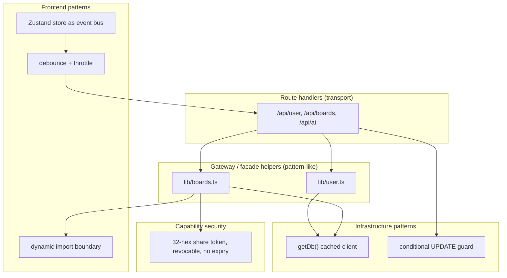

# Chapter 8 — Design Patterns and Engineering Principles

**Goal:** Name the real design patterns in AI Whiteboard, quote the code that implements each, and say plainly which ones are only "pattern-like" so you never overclaim in an interview.

---

## 8.1 Beginner first: a pattern is a repeated solution, not a badge

A beginner sees `getDb()` and says "singleton". A professional asks three questions: **What problem does it solve? What does it cost? What would I do instead?** A pattern label is only useful if you can answer all three.

This chapter uses strict labels. **[IMPLEMENTED] means the code exists.** **[PARTIAL] means the code resembles the pattern but lacks a defining property.** **[SUGGESTED IMPROVEMENT] means it does not exist yet.** Never say "we used the Repository pattern" when what you have is a file of query functions.



---

## 8.2 Module singleton / cached client — `getDb()`

**[IMPLEMENTED]** `db/index.ts` caches one Drizzle client for the lifetime of the server process:

```ts
let cached: Database | null = null;

export function getDb(): Database {
  if (!cached) {
    cached = createDatabase();
  }
  return cached;
}
```

**Why (beginner):** creating a Neon client means reading `DATABASE_URL` and constructing an HTTP client; doing it once avoids repeating that on every request. `createDatabase()` throws a clear error when the variable is missing (`"DATABASE_URL is not set..."`), and `Database` is derived with `ReturnType<typeof createDatabase>` so the type follows the implementation.

**Professional tradeoff:** this is a *module-level singleton*, not a globally enforced one. Next.js can load a module more than once (different runtimes, dev reloads, serverless instances), so there may be one client per module instance. That is acceptable because Neon's `neon(url)` is an HTTP client rather than a pooled TCP socket. **[SUGGESTED IMPROVEMENT]** for a driver with a real connection pool, finalize the pool on shutdown or use a framework-managed client.

**Alternatives:** pass a `Database` instance into handlers via dependency injection (better testability, more wiring); use a connection pool with explicit lifecycle; use a serverless proxy such as Neon Pooler.

---

## 8.3 Gateway / facade — `lib/user.ts` and `lib/boards.ts`

**[PARTIAL] — faithful to the intent, not to the textbook definition.** A classic facade is a class exposing a simplified interface over a subsystem. Here the "facade" is a module of plain functions.

`lib/user.ts` hides Clerk + Drizzle details behind four exports: `requireUserId()`, `UnauthorizedError`, `upsertDbUser()`, `getDbUser()`, and `getDbUserOrUpsert()`. The upsert shows the idea:

```ts
// lib/user.ts
  const db = getDb();
  const [user] = await db
    .insert(schema.users)
    .values({ id: userId, name, email })
    .onConflictDoUpdate({
      target: schema.users.id,
      set: { name, email },
    })
    .returning();

  return user;
```

**Why:** route handlers never write `db.insert(users)` themselves. Identity-to-row logic, the fallback email, and the conflict policy exist once. `getDbUserOrUpsert()` then composes a read with that write, giving callers one door.

`lib/boards.ts` plays the same role for board data: `listBoards(userId, scope)`, `getBoard(userId, id)`, and `getBoardByShareToken(token)`. Its most important line-level detail is that *authorization is inside the gateway*: `getBoard` filters on both `id` and `userId`.

**Tradeoff:** no interface or injectable dependency means you cannot swap the gateway in a unit test without module mocking. **[SUGGESTED IMPROVEMENT]** define a `BoardRepository` interface and accept it as a parameter if testing becomes a priority. Calling it a "Repository" today would be an overclaim — hence [PARTIAL].

**Alternatives:** class-based service with constructor injection; server-side data-access layer generated per request; a query builder wrapper with a `UnitOfWork`.

---

## 8.4 DTO mapping — `toSummary()` and `boardToData()`

**[IMPLEMENTED]** The database row is not the API representation. Two mappers define the boundary:

```ts
// lib/boards.ts
export function boardToData(
  row: typeof schema.whiteboards.$inferSelect,
): BoardData {
  return {
    id: row.id,
    title: row.title,
    elements: (row.elements ?? []) as unknown[],
    appState: (row.appState ?? {}) as Record<string, unknown>,
    files: (row.files ?? {}) as Record<string, unknown>,
    thumbnail: row.thumbnail ?? null,
    shareToken: row.shareToken ?? null,
    favorited: row.favorited ?? false,
    updatedAt: row.updatedAt.toISOString(),
  };
}
```

**Why:** the client should receive stable, serializable fields with `Date` converted to ISO strings, and never raw driver objects. `toSummary()` goes further: `summaryColumns` selects only eight columns so the dashboard does not download the full scene or thumbnail payload. The comment in `lib/boards.ts` says exactly that — *"avoids transferring potentially megabytes of base64 thumbnail data per page load"*.

**Tradeoff:** two shapes (`BoardSummary`, `BoardData` in `lib/types.ts`) must be kept in sync with the schema. The mappers use `as unknown[]` / `as Record<string, unknown>` casts, so they do not *validate* JSONB content — they only restate TypeScript's belief.

**Alternatives:** Zod schemas that parse at the boundary; a serialization library; GraphQL resolvers with explicit field selection.

---

## 8.5 Conditional update / optimistic-concurrency guard

**[IMPLEMENTED]** Both credit spends are one conditional SQL statement. From `app/api/boards/route.ts`:

```ts
    // Atomic credit decrement — prevents concurrent requests from both passing.
    const [deducted] = await db
      .update(schema.users)
      .set({ credit: sql`${schema.users.credit} - 1` })
      .where(and(eq(schema.users.id, user.id), gt(schema.users.credit, 0)))
      .returning({ credit: schema.users.credit });

    if (!deducted) {
```

`app/api/ai/route.ts` repeats the same guard before calling Gemini and adds three refund paths (`credit + 1`) for empty text, zero nodes, and thrown errors — the last one best-effort with `.catch(() => {})`.

**Why:** a read-then-write balance check lets two simultaneous requests both see "1 credit" and both proceed. Moving the condition into the `UPDATE ... WHERE credit > 0` makes the database the arbiter. **[IMPLEMENTED] board creation and AI generation each spend exactly one credit atomically; AI failures refund.**

**Is this optimistic concurrency control (OCC)? [PARTIAL].** Classic OCC compares a version column (`WHERE version = ?`) and retries on conflict. This is better described as an *atomic conditional decrement* — a compare-and-swap on a numeric balance. There is no version column and no retry.

**Tradeoff:** no refund branch exists in `POST /api/boards` if the board insert fails after the debit. **[SUGGESTED IMPROVEMENT]** wrap debit + insert in a transaction, or refund symmetrically with the AI route.

**Alternatives:** `SELECT ... FOR UPDATE` inside a transaction; a version column with retry; an append-only ledger of credit events summed at read time.

---

## 8.6 Dynamic import boundary

**[IMPLEMENTED]** `components/whiteboard/excalidraw-wrapper.tsx` isolates the browser-only canvas:

```tsx
export const Excalidraw = dynamic(
  () =>
    import("@excalidraw/excalidraw").then((mod) => {
      const Comp = mod.Excalidraw as unknown as React.ComponentType<
        ExcalidrawProps
      >;
      return { default: Comp };
    }),
  {
    ssr: false,
    loading: () => (
      <div className="flex h-full w-full items-center justify-center gap-2 text-sm text-muted-foreground">
        <Loader2 className="size-4 animate-spin" />
        Loading canvas…
      </div>
    ),
  },
);
```

**Why:** Excalidraw touches DOM and browser globals during module evaluation. `ssr: false` prevents server rendering of that module; the loading spinner covers the download gap. The wrapper also declares its own narrow `ExcalidrawProps` type instead of importing Excalidraw's full prop type. `components/whiteboard/shared-whiteboard.tsx` repeats the same boundary for public viewers, and `lib/export.ts` uses a second dynamic boundary with `await import("jspdf")`.

**Tradeoff:** the canvas cannot be server-rendered, so the first paint shows a spinner and SEO for board content is irrelevant by design. The `as unknown as` cast can silently drift from the real library API.

**Alternatives:** an iframe canvas; a client-only route with its own entry point; a canvas library that supports SSR. See Chapter 9 for the full client tree.

---

## 8.7 Debounce and throttle — the autosave pair

**[IMPLEMENTED]** `components/whiteboard/whiteboard-canvas.tsx` uses two different timing controls for two different costs:

```ts
const AUTOSAVE_DELAY = 1500;
const THUMBNAIL_THROTTLE_MS = 30_000;
```

```ts
      void appState;
      pending.current = { elements, appState: {}, files };
      markDirty();
      if (timer.current) clearTimeout(timer.current);
      timer.current = setTimeout(() => {
        void flush();
      }, AUTOSAVE_DELAY);
```

**Why:** Excalidraw's `onChange` fires on every pointer movement. A **debounce** waits until edits pause for 1.5 seconds, collapsing a burst of events into one PATCH. A **throttle** (the `lastThumbnailTime.current` comparison in `flush`) allows at most one expensive PNG capture per 30 seconds. Note the deliberate `appState: {}`: the client does not persist Excalidraw's transient UI state. `captureThumbnail()` additionally scales the image to a maximum 400 px dimension.

**Tradeoff:** up to 1.5 seconds of work can be lost on abrupt tab close; the unmount effect calls `void flush(true)` without awaiting it, which is a best-effort final save. **[SUGGESTED IMPROVEMENT]** use `navigator.sendBeacon()` or await the final flush; consider a queued writer if multiple PATCHes can overlap.

**Alternatives:** `requestIdleCallback`, an IndexedDB outbox, CRDT-based sync, or server-side batching of scene deltas.

---

## 8.8 Capability token + revocable share

**[IMPLEMENTED]** `app/api/boards/[id]/route.ts` creates and destroys a bearer capability:

```ts
    if (body.share === "enable" && !board.shareToken) {
      update.shareToken = randomUUID().replace(/-/g, "");
    }
    if (body.share === "disable") {
      update.shareToken = null;
    }
```

`randomUUID()` produces a 36-character hyphenated UUID; stripping hyphens yields **32 hexadecimal characters**. The column is `text("share_token").unique()` in `db/schema.ts`. `app/share/[token]/page.tsx` looks the token up with `getBoardByShareToken()` and rejects only deleted boards; `shared-whiteboard.tsx` renders with `viewModeEnabled` and no `onChange` handler.

**Why:** possession of the URL is the authorization — no second login is required. Revocation is a single `UPDATE` setting `shareToken = null`, which immediately breaks the link. Enabling again creates a *new* token.

**Tradeoff: [IMPLEMENTED] there is no expiry.** The schema has no `shareExpiresAt`; the token lives until revoked. It is also sent inside `PATCH` responses and `boardToData()`, so holders of an owner-scoped response can see it. **[SUGGESTED IMPROVEMENT]** add an expiry timestamp and rotate tokens on re-enable; do not log or index share URLs in analytics.

**Alternatives:** signed short-lived JWTs, one-time tokens, per-link passwords, or object-storage presigned URLs.

---

## 8.9 Client store as event bus — [PARTIAL]

Zustand stores connect components that do not share a parent-child relationship. `lib/whiteboard-store.ts` holds `boardId`, `title`, `api`, `saving`, `dirty`, `favorited`, `shareToken`, `exporting`, and `aiRunning`, with setters such as:

```ts
  markDirty: () => set({ dirty: true }),
  setSaving: (saving) => set({ saving }),
  setSaved: () =>
    set({ saving: false, dirty: false, lastSavedAt: Date.now() }),
```

`whiteboard-canvas.tsx` calls `markDirty()`; `workspace-header.tsx` subscribes to `saving`/`dirty` and displays "Saving… / Unsaved changes / Saved". `lib/export.ts` even reads the imperative API outside React with `useWhiteboardStore.getState().api`.

**Why:** this is a shared observable state container — cheap, typed, and free of prop drilling. **[PARTIAL] calling it an "event bus" is a stretch:** there are no named events, subscriptions, or pub/sub topics; components subscribe to *state slices*. `lib/store.ts` does the same for `user` and `credit`, with `setCredit()` updating the nested user object.

**Tradeoff:** global mutable state can drift from server truth — a failed PATCH still leaves `dirty` behavior dependent on the caller's error handling. **[SUGGESTED IMPROVEMENT]** add explicit `markFailed()` state and derive status in one selector.

**Alternatives:** React Context + reducer, TanStack Query cache, or a true event emitter with typed channels.

---

## 8.10 Pattern-like catalogue and tradeoff summary

| Candidate label | Verdict | What is really there | If you need the real pattern |
| --- | --- | --- | --- |
| Singleton | [IMPLEMENTED] | Cached module-level client in `db/index.ts` | DI container or lifecycle-managed client |
| Facade / Gateway | [PARTIAL] | Function modules `lib/user.ts`, `lib/boards.ts` | Interface + class wrapping subsystems |
| Repository | [PARTIAL] | Query functions, no interface or unit of work | `BoardRepository` interface with injectable implementation |
| DTO / Mapper | [IMPLEMENTED] | `toSummary()`, `boardToData()` | Schema-validating mapper (Zod) |
| Atomic conditional update | [IMPLEMENTED] | `UPDATE ... WHERE credit > 0 RETURNING` | Transaction + version column OCC |
| Strategy | [PARTIAL] | `AI_TOOLS` is a data lookup of prompt strings; the server builds one prompt from `tool.prompt` | Polymorphic strategy objects with a common interface |
| Dynamic import boundary | [IMPLEMENTED] | `next/dynamic` with `ssr: false` | Iframe or SSR-safe canvas |
| Debounce + throttle | [IMPLEMENTED] | 1.5 s debounce, 30 s thumbnail throttle | Durable outbox queue |
| Capability token | [IMPLEMENTED] | 32-hex token, unique, revocable, **no expiry** | Signed expiring token |
| Observer / event bus | [PARTIAL] | Zustand slice subscriptions | Typed pub/sub with named events |
| Optimistic UI | [PARTIAL] | Pre-removal and favorite rollback | Full optimistic cache with compensation on every mutation |

The professional takeaway: **the strongest patterns here are the small ones** — cached client, DTO mapping, conditional update, dynamic boundary, debounce/throttle, and capability token. The bigger architectural labels are approximations, and saying so is a sign of maturity, not weakness. Cross-references: Chapter 5 for system boundaries, Chapter 9 for store consumers, Chapter 13 for token security, Chapter 18 for timing tradeoffs.

---

## 8.11 Revision summary

- [IMPLEMENTED] `getDb()` is a cached module singleton over a Neon HTTP client; it is not a global process-wide singleton.
- [PARTIAL] `lib/user.ts` and `lib/boards.ts` act as gateways/facades but are plain function modules, not interfaces.
- [IMPLEMENTED] `toSummary()` and `boardToData()` are genuine DTO mappers that convert dates and hide heavy JSONB.
- [IMPLEMENTED] Credit spending uses an atomic conditional `UPDATE`; AI failures refund. This is compare-and-swap, not versioned OCC.
- [IMPLEMENTED] `next/dynamic` with `ssr: false` isolates Excalidraw; debounce (1.5 s) and thumbnail throttle (30 s) protect the write path.
- [IMPLEMENTED] Shares use a revocable 32-hex token with no expiry; Zustand is a state container rather than a true event bus.
- [SUGGESTED IMPROVEMENT] Add request validation, a board-creation refund/transaction, and explicit failure state before claiming "full" pattern discipline.

## 8.12 Knowledge checks

1. Why is `getDb()` a singleton per *module instance* rather than guaranteed per process, and why is that acceptable with Neon?
2. What exact SQL condition makes the credit decrement atomic, and why is that different from version-based optimistic concurrency?
3. Which two timing constants control autosave, and what cost does each one reduce?
4. How long is a share token, how is it revoked, and what happens if a user enables sharing again?
5. Why is `AI_TOOLS` only "Strategy-like" instead of an actual Strategy implementation?

## 8.13 Practical exercises

1. Pick `toSummary()`, `getDb()`, and `randomUUID().replace(/-/g, "")`. For each, write one paragraph with the heading *problem / code / tradeoff / alternative*, using only this chapter's source snippets.
2. Open `whiteboard-canvas.tsx` and trace one `onChange` event to the PATCH body. Mark where debounce, throttle, and `appState: {}` each take effect, then propose a durable-outbox replacement.
3. Rewrite the `AI_TOOLS` lookup as a real Strategy (interface + implementations), and list which files would change. Keep the new design compatible with the existing `POST /api/ai` body shape.

## 8.14 Interview questions

1. Which pattern in this project would you defend as textbook-correct, and which would you openly call "pattern-like"?
2. Explain the atomic credit guard as if the interviewer does not know SQL.
3. Why does the canvas need a dynamic import boundary, and what did that cost the user experience?
4. How would you add expiring share links without breaking existing links?
5. If you rebuilt this project, which single pattern would you change first and why?
