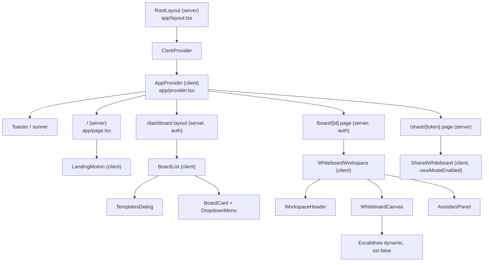

# Chapter 9 — Frontend Deep Dive

**Goal:** Read the UI like an engineer: know which components run on the server, which run in the browser, how state flows between them, and why the canvas, animation, and toast layers are shaped the way they are.

---

## 9.1 Beginner first: server components render, client components react

A **Server Component** runs only on the server and sends HTML; it cannot use `useState` or `useEffect`. A **Client Component** starts with `"use client"` and ships JavaScript to the browser. AI Whiteboard deliberately puts auth checks and initial data reads on the server, then hands interactive islands to the client.

| File | Server or client | Evidence | Responsibility |
| --- | --- | --- | --- |
| `app/layout.tsx` | Server | No `"use client"` | Fonts, metadata, `ClerkProvider`, `AppProvider`, `Toaster` |
| `app/page.tsx` | Server | No `"use client"` | Landing markup, imports `./landing.css` |
| `components/landing/landing-motion.tsx` | Client | `"use client"` line 1 | GSAP + Lenis, nav menu, cleanup |
| `app/dashboard/layout.tsx` | Server | `await auth()`, no directive | Auth redirect, header shell |
| `app/dashboard/page.tsx` | Server | 4-line pass-through | Renders `<BoardList />` |
| `components/dashboard/board-list.tsx` | Client | `"use client"` line 1 | Fetch, scope, search, optimistic actions |
| `app/board/[id]/page.tsx` | Server | `await auth()`, no directive | Guard + `getBoard()` + DTO |
| `components/whiteboard/workspace.tsx` | Client | `"use client"` line 1 | Wire header, canvas, assistant |
| `components/whiteboard/excalidraw-wrapper.tsx` | Client | `"use client"`, `dynamic(..., ssr:false)` | Browser-only canvas boundary |
| `app/share/[token]/page.tsx` | Server | No directive | Token lookup, read-only data |
| `components/whiteboard/shared-whiteboard.tsx` | Client | `"use client"` line 1 | View-mode canvas |



---

## 9.2 Root layout, providers, and toast feedback

**Beginner:** the root layout is the outer frame of every page. **Professional:** it is the composition root where cross-cutting concerns (auth context, global CSS, metadata, notifications) are installed once.

```tsx
// app/layout.tsx
export default function RootLayout({ children }: LayoutProps<"/">) {
  return (
    <ClerkProvider>
      <html
        lang="en"
        className={`${geistSans.variable} ${geistMono.variable} ${hostGrotesk.variable} h-full antialiased`}
      >
        <body className="min-h-full flex flex-col bg-background text-foreground">
          <AppProvider>{children}</AppProvider>
          <Toaster theme="light" />
        </body>
      </html>
    </ClerkProvider>
  );
}
```

Line by line: `ClerkProvider` supplies `useUser()` / `auth()` context; three `next/font/google` variables are attached to `<html>`; `AppProvider` runs the DB-user bootstrap; `Toaster` mounts the global notification portal. `metadata` above the component sets the title template and OpenGraph data.

`AppProvider` itself renders no DOM — it is an effect-driven bridge:

```tsx
// app/provider.tsx
    let cancelled = false;

    fetch("/api/user", { method: "POST" })
      .then((res) => (res.ok ? res.json() : null))
      .then((data) => {
        if (!cancelled && data?.user) {
          setUser(data.user);
        }
      })
      .catch(() => {
        // DB not reachable yet (no DATABASE_URL) — app still usable in UI-only mode.
      });
```

The `cancelled` flag prevents a stale response from overwriting state after sign-out. The silent `catch` is deliberate: UI-only mode is still usable when the database is unconfigured. **[IMPLEMENTED]**

`components/ui/sonner.tsx` customizes icons for success/info/warning/error/loading and maps colors to CSS variables. Because it spreads `{...props}` after its own `theme` prop, the `theme="light"` passed in `app/layout.tsx` wins over `useTheme()`'s default. Feedback calls are concrete: `toast.success("Share link copied")`, `toast.error("Failed to update sharing")` in `workspace-header.tsx`, and `toast.success("Diagram added to your canvas.")` in `assistant-panel.tsx`.

---

## 9.3 The canvas boundary and autosave engine

`components/whiteboard/excalidraw-wrapper.tsx` is the client-only seam:

```tsx
export const Excalidraw = dynamic(
  () =>
    import("@excalidraw/excalidraw").then((mod) => {
      const Comp = mod.Excalidraw as unknown as React.ComponentType<
        ExcalidrawProps
      >;
      return { default: Comp };
    }),
  {
    ssr: false,
    loading: () => (
      <div className="flex h-full w-full items-center justify-center gap-2 text-sm text-muted-foreground">
        <Loader2 className="size-4 animate-spin" />
        Loading canvas…
      </div>
    ),
  },
);
```

**Why:** Excalidraw needs browser globals at module evaluation time. `ssr: false` keeps it out of server rendering; a spinner covers the load. The wrapper publishes a hand-written `ExcalidrawProps` type so callers do not import library internals.

`whiteboard-canvas.tsx` is the write path. `onChange` stores a pending snapshot and restarts a 1.5 s timer; `flush()` builds the PATCH body:

```ts
      await fetch(`/api/boards/${board.id}`, {
        method: "PATCH",
        headers: { "Content-Type": "application/json" },
        body: JSON.stringify({
          elements: data?.elements ?? [],
          appState: data?.appState ?? {},
          files: data?.files ?? {},
          ...(thumbnail !== undefined ? { thumbnail } : {}),
        }),
      });
```

Two details matter. First, `handleChange` explicitly sets `appState: {}`, discarding Excalidraw's transient UI state — **[IMPLEMENTED] autosave sends `appState: {}`**. Second, `thumbnail` is only included when a capture happened (max once per 30 s, scaled to 400 px by `captureThumbnail()` in `lib/export.ts`). `handleApi()` restores elements via `api.updateScene()`, files via `api.addFiles()`, then calls `scrollToContent()`. `UIOptions.canvasActions` disables load/save/export inside the canvas because the workspace header owns those actions. **[SUGGESTED IMPROVEMENT]** the unmount effect uses `void flush(true)` without awaiting; a `sendBeacon` or awaited final save would be safer.

---

## 9.4 Zustand stores: two small global signals

`lib/store.ts` holds the signed-in user and credit:

```ts
export const useUserStore = create<UserStore>((set) => ({
  user: null,
  loaded: false,
  setUser: (user) => set({ user, loaded: true }),
  setCredit: (credit) =>
    set((state) =>
      state.user ? { user: { ...state.user, credit } } : state,
    ),
}));
```

`CreditBadge` subscribes with `useUserStore((s) => s.user?.credit)` and shows `–` when unknown. `board-list.tsx` and `assistant-panel.tsx` call `setCredit(data.credit)` after server responses, so the badge updates without a refetch.

`lib/whiteboard-store.ts` holds editor signals: `boardId`, `title`, `api`, `saving`, `dirty`, `lastSavedAt`, `favorited`, `shareToken`, `exporting`, `aiRunning`. `workspace.tsx` seeds board/title/favorite/share from the server DTO in an effect; `whiteboard-canvas.tsx` marks dirty and saved; `workspace-header.tsx` derives the status string:

```tsx
  const status = saving
    ? "Saving…"
    : dirty
      ? "Unsaved changes"
      : lastSavedAt
        ? "Saved"
        : null;
```

**Why a store instead of props:** the canvas, header, and assistant are siblings; a store avoids threading callbacks through `WhiteboardWorkspace`. **Tradeoff:** global state can disagree with the server after a failed request; there is no explicit `error` field in either store. **[SUGGESTED IMPROVEMENT]** add failure state and selectors that derive status in one place.

---

## 9.5 Dashboard list state: scope ref, optimism, memoized filters

Three techniques make `components/dashboard/board-list.tsx` feel instant.

**1. A ref for the freshest scope.** `scopeRef` is updated synchronously alongside React state:

```ts
  const scopeRef = useRef<Scope>("active");
  const [scope, setScopeState] = useState<Scope>("active");
  const [boards, setBoards] = useState<BoardSummary[] | null>(null);
```

```ts
  const setScope = useCallback((next: Scope) => {
    scopeRef.current = next;
    setBoards(null);
    setScopeState(next);
  }, []);
```

**Why:** after an optimistic action, `fetchBoards(scopeRef.current)` refetches the *current* tab rather than closing over a stale `scope`. A ref is the right tool because this value is read by async callbacks, not rendered.

**2. Optimistic removal.** `act()` and `remove()` filter the card out of local state before awaiting `fetch`. **[IMPLEMENTED]** the UI responds immediately; **[PARTIAL]** neither checks `res.ok`, so a failed mutation looks successful until the refetch.

**3. Memoized client-side filters.** Search and favorites are not sent to the server:

```ts
  const filteredBoards = useMemo(() => {
    if (!boards) return null;
    let list = boards;
    if (showFavorites) list = list.filter((b) => b.favorited);
    if (query.trim()) {
      const q = query.toLowerCase();
      list = list.filter((b) => b.title.toLowerCase().includes(q));
    }
    return list;
  }, [boards, query, showFavorites]);
```

`boards === null` renders four Skeleton cards; an empty array renders scope-specific copy; otherwise `BoardCard` receives callbacks for open/archive/unarchive/restore/trash/delete. The dropdown's menu items change by scope, which is why `BoardCard` takes `scope` as a prop.

---

## 9.6 Workspace header and assistant panel

`workspace-header.tsx` is a client component reading seven Zustand slices. Its title input uses a trailing debounce and commits on blur:

```tsx
  function commit(next: string) {
    const trimmed = next.trim() || "Untitled board";
    setTitle(trimmed);
    if (boardId) {
      void fetch(`/api/boards/${boardId}`, {
        method: "PATCH",
        headers: { "Content-Type": "application/json" },
        body: JSON.stringify({ title: trimmed }),
      });
    }
  }

  function onTitleChange(next: string) {
    setValue(next);
    if (commitTimer.current) clearTimeout(commitTimer.current);
    commitTimer.current = setTimeout(() => commit(next), 800);
  }
```

Favorite toggling is optimistic **with rollback** (`catch { setFavorited(!next); }`). Sharing enables/disables a token, copies `${window.location.origin}/share/${token}` to the clipboard, and toasts the result. Exports delegate to `lib/export.ts`: PNG via `exportToBlob`, SVG via `exportToSvg`, PDF via a dynamic `jspdf` import around a PNG data URL.

`assistant-panel.tsx` reads `?template=` and `?prompt=` (set by `TemplatesDialog`), chooses a tool from `AI_TOOLS`, and opens automatically for template visits. `void boardId;` marks the unused prop explicitly. Before calling `/api/ai`, it inserts a dashed skeleton scene:

```tsx
  function addPlaceholder(): { x: number; y: number } | null {
    if (!api) return null;
    const current = api.getSceneElements();
    const pos = findEmptyCanvasPosition(current as unknown as Record<string, unknown>[]);
    const placeholder = buildPlaceholderElements(pos.x, pos.y);
    api.updateScene({
      elements: [...current, ...placeholder] as never,
    });
    return pos;
  }
```

On success it removes placeholder IDs, converts `DiagramResult` with `diagramToElements()`, and scrolls to the new elements; on failure it removes the placeholder and toasts the error. This is optimistic UI applied to *canvas content*, not just a list.

---

## 9.7 Landing motion: GSAP, Lenis, and reduced motion

`components/landing/landing-motion.tsx` returns `null`; all work happens in one `useEffect` that queries the `.ev` DOM tree. `reduceMotion()` checks `window.matchMedia("(prefers-reduced-motion: reduce)").matches`. If reduced motion is on, the entire GSAP/Lenis setup is skipped and only this runs:

```ts
    // reduced-motion: make everything visible, no animation
    gsap.set(root.querySelectorAll(".op-two"), { clipPath: "none" });
```

Otherwise Lenis provides smooth scrolling, `lenis.on("scroll", ScrollTrigger.update)` syncs scroll-driven scenes, and `gsap.context()` scopes all selectors to `root`. The nav menu uses `clipPath` animation and `lenis.stop()`/`start()`. The workflow ruler uses one scrubbed `--mo-p` variable plus a `ScrollTrigger.create()` callback that toggles `.is-on` on tasks; the boards section rotates a CSS globe with `rotateY: 200`. Cleanup is unusually thorough:

```ts
      return () => {
        window.removeEventListener("load", refresh);
        window.clearTimeout(t);
        menuBtn?.removeEventListener("click", onOpen);
        menuClose?.removeEventListener("click", onClose);
        lenis.off("scroll", onScroll);
        gsap.ticker.remove(raf);
        lenis.destroy();
        ctx.revert();
        ScrollTrigger.getAll().forEach((s) => s.kill());
      };
```

**Why:** without this, hot reloads or route changes leave duplicate scroll listeners and stale triggers. `app/landing.css` separately gates CSS keyframes behind `@media (prefers-reduced-motion: no-preference)` (lines 645 and 1633), so both JS and CSS respect the preference.

A smaller reveal path exists in `components/landing/reveal.tsx` and `hooks/use-in-view.ts`:

```ts
    const observer = new IntersectionObserver(
      ([entry]) => {
        if (entry.isIntersecting) {
          setVisible(true);
          observer.disconnect();
        }
      },
      { threshold: 0.15, rootMargin: "0px 0px -60px 0px" },
    );
```

`Reveal` fades/translates children once; `useInView` powers `mask-reveal-text.tsx` and `stagger-text-reveal.tsx` (Motion-based helpers). **[SUGGESTED IMPROVEMENT]** these helpers do not themselves check reduced-motion; callers must handle it, and `Reveal` is not imported by `app/page.tsx` in the current markup.

---

## 9.8 Styling layers and what to remember

**Tailwind v4 + scoped CSS [IMPLEMENTED].** `app/globals.css` starts with `@import "tailwindcss";`, `@import "tw-animate-css";`, and `@import "shadcn/tailwind.css";`, then defines theme tokens. `next.config.ts` wires a Turbopack rule for `"*.css"` with `@tailwindcss/turbopack`. The landing page imports `./landing.css`, whose rules are scoped under `.ev` — the root `<div className="ev">` in `app/page.tsx`. This keeps the Swiss/marketing design system from leaking into the app shell, which uses Tailwind utilities directly.

**Toast feedback [IMPLEMENTED].** `Toaster` in the root layout plus `toast.success` / `toast.error` in header and assistant cover share, export-adjacent errors, and generation outcomes.

| Surface | State owner | Cross-component channel |
| --- | --- | --- |
| Dashboard list | Local `useState` in `BoardListInner` | `useUserStore.setCredit` |
| Editor | `useWhiteboardStore` | Zustand slices + imperative `api` handle |
| Landing | DOM + GSAP context | Lenis scroll events |
| Auth identity | `useUserStore` from `AppProvider` | `POST /api/user` |

Cross-references: Chapter 8 for store-as-event-bus tradeoffs, Chapter 10 for the handlers these components call, Chapter 18 for performance details, Chapter 21 for animation accessibility improvements.

---

## 9.9 Revision summary

- [IMPLEMENTED] Server components guard `/dashboard` and `/board/[id]`; client components own interaction, with `"use client"` at the top of each interactive file.
- [IMPLEMENTED] `RootLayout` composes `ClerkProvider`, fonts, `AppProvider`, and `Toaster`; `AppProvider` upserts the DB user with a cancellation guard.
- [IMPLEMENTED] Excalidraw is loaded via `next/dynamic` with `ssr: false`; autosave debounces 1.5 s, throttles thumbnails to 30 s, and sends `appState: {}`.
- [IMPLEMENTED] Two Zustand stores carry user/credit and editor signals; the header derives save status from `saving`, `dirty`, and `lastSavedAt`.
- [IMPLEMENTED] The dashboard uses `scopeRef` for fresh async scope, optimistic removal, and a `useMemo` filter pipeline for search/favorites.
- [IMPLEMENTED] GSAP/Lenis landing effects have a reduced-motion branch and full listener/ticker/ScrollTrigger cleanup; `Reveal` uses a one-shot IntersectionObserver.
- [SUGGESTED IMPROVEMENT] Add reduced-motion handling to `Reveal`/`useInView`, await the final autosave, and represent mutation failures in the store.

## 9.10 Knowledge checks

1. Why can `app/dashboard/layout.tsx` call `auth()` while `components/dashboard/board-list.tsx` cannot?
2. What does `scopeRef` solve that the `scope` state alone would not?
3. Which exact fields are sent in the autosave PATCH, and why is `appState` empty?
4. How does `AssistantPanel` show feedback before Gemini responds, and how does it clean up on failure?
5. What does `LandingMotion`'s cleanup function remove, and why does that matter during development?

## 9.11 Practical exercises

1. Draw the component tree from `app/layout.tsx` down to `AssistantPanel` and `SharedWhiteboard`, labelling each node server or client. Mark where a Zustand slice crosses a sibling boundary.
2. In `board-list.tsx`, add a written plan for rollback on failed `act()`/`remove()` calls. Name the exact lines you would change and which store field, if any, you would add.
3. Compare `LandingMotion`, `Reveal`, and `useInView` as three animation approaches. Write a table of *trigger / cleanup / reduced-motion support / best use case* using only observed code.

## 9.12 Interview questions

1. How do you decide whether a component should be a Server Component or a Client Component in this project?
2. Walk through one keystroke in the board title input to the database write.
3. Why is Excalidraw dynamically imported, and what is the user-visible consequence?
4. What state belongs in Zustand here, and what state should stay local?
5. How would you make the whole frontend respect reduced-motion preferences consistently?
