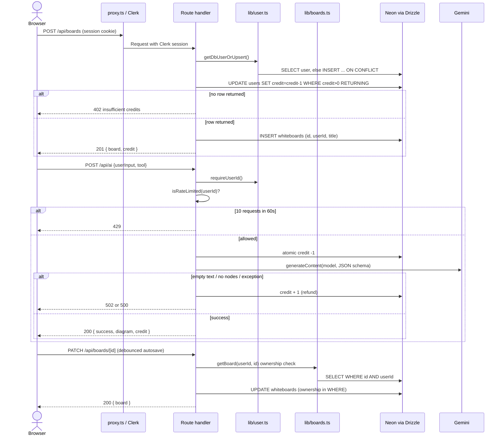

# Chapter 10 — Backend Deep Dive

**Goal:** Read every route handler as a request pipeline: identity, validation, authorization, database mutation, external call, refund, and status code — and be able to explain each decision out loud.

---

## 10.1 The five handlers and one full lifecycle

There are exactly five `route.ts` files under `app/api/`. All run on the server; none are server actions.

| File | Exports | Main job |
| --- | --- | --- |
| `app/api/user/route.ts` | `POST`, `GET` | Provision / read the current DB user |
| `app/api/boards/route.ts` | `GET`, `POST` | List board summaries / create a board (1 credit) |
| `app/api/boards/[id]/route.ts` | `PATCH`, `DELETE` | Update scene/metadata / trash or hard-delete |
| `app/api/boards/[id]/action/route.ts` | `POST` | Archive, unarchive, restore |
| `app/api/ai/route.ts` | `POST` | Rate limit → debit → Gemini → refund on failure |



---

## 10.2 Auth entry points and the middleware role

`proxy.ts` is the app's middleware entry point in Next.js 16 (the README notes it replaces `middleware.ts`):

```ts
import { clerkMiddleware } from "@clerk/nextjs/server";

export default clerkMiddleware();

export const config = {
  matcher: [
    "/((?!_next|[^?]*\\.(?:html?|css|js(?!on)|jpe?g|webp|png|gif|svg|ttf|woff2?|ico|csv|docx?|xlsx?|zip|webmanifest)).*)",
    "/(api|trpc)(.*)",
  ],
};
```

**[IMPLEMENTED] role:** attach/refresh Clerk session context for matched routes and skip static assets. **[IMPLEMENTED] what it does *not* do:** there is no `.protect()` call and no allowlist. Authorization is performed twice, closer to the data:

1. **Server pages** — `app/dashboard/layout.tsx` and `app/board/[id]/page.tsx` call `auth()` and `redirect("/sign-in")`.
2. **Route handlers** — `requireUserId()` in `lib/user.ts`:

```ts
export async function requireUserId(): Promise<string> {
  const { userId } = await auth();
  if (!userId) {
    throw new UnauthorizedError();
  }
  return userId;
}
```

`UnauthorizedError` is a custom `Error` subclass with `name = "UnauthorizedError"`; handlers translate it to a 401. `getDbUserOrUpsert()` in the same file composes `getDbUser()` (SELECT by Clerk ID) with `upsertDbUser()` (INSERT with `onConflictDoUpdate`). **[IMPLEMENTED] lazy provisioning:** the DB row appears on the first protected request, even if the client-side `POST /api/user` never ran.

---

## 10.3 `app/api/user/route.ts` — two ways to get the same row

```ts
export async function POST() {
  try {
    const user = await upsertDbUser();
    return NextResponse.json({ user });
  } catch (error) {
    if (error instanceof UnauthorizedError) {
      return NextResponse.json({ error: "Unauthorized" }, { status: 401 });
    }
    console.error("POST /api/user failed:", error);
    return NextResponse.json({ error: "Internal error" }, { status: 500 });
  }
}
```

`POST` always upserts — it reads Clerk's `currentUser()` for name/email, falls back to `"User"` and `${userId}@users.clerk.internal`, and writes through `onConflictDoUpdate({ target: schema.users.id, set: { name, email } })`. `GET` calls `getDbUserOrUpsert()` instead: it reads first and only inserts if absent. Both return the raw `User` row (including `credit` and `createdAt`) inside `{ user }`.

**Why two verbs [IMPLEMENTED]:** `app/provider.tsx` calls `POST` after sign-in to seed the client store proactively; `components/whiteboard/workspace.tsx` calls `GET` when entering the editor, where an existing user is the common case. **Tradeoff [SUGGESTED IMPROVEMENT]:** returning the raw row couples the API to the schema; a DTO would be safer (see Chapter 8).

---

## 10.4 `app/api/boards/route.ts` — scope filtering and atomic creation

### GET — a whitelist for scope

```ts
    const scopeParam = new URL(request.url).searchParams.get("scope");
    const scope =
      scopeParam === "archived" || scopeParam === "trashed"
        ? scopeParam
        : "active";
    const boards = await listBoards(user.id, scope);
    return NextResponse.json({ boards, credit: user.credit });
```

Unknown or missing values silently become `"active"` — **[IMPLEMENTED] fail-closed default**. `listBoards()` in `lib/boards.ts` turns the scope into SQL:

```ts
  const where =
    scope === "active"
      ? and(base, isNull(schema.whiteboards.deletedAt), isNull(schema.whiteboards.archivedAt))
      : scope === "archived"
        ? and(base, isNull(schema.whiteboards.deletedAt))
        : base;
```

All three branches start with `base = eq(schema.whiteboards.userId, userId)`, then apply a JS-side `filter()` on the mapped summaries as a second defence. `summaryColumns` excludes `elements`, `appState`, `files`, and `shareToken`, so the list endpoint never ships full scenes. Ordering is `desc(updatedAt)`.

### POST — one credit, one insert

```ts
    // Atomic credit decrement — prevents concurrent requests from both passing.
    const [deducted] = await db
      .update(schema.users)
      .set({ credit: sql`${schema.users.credit} - 1` })
      .where(and(eq(schema.users.id, user.id), gt(schema.users.credit, 0)))
      .returning({ credit: schema.users.credit });

    if (!deducted) {
```

Line-level reading: `sql` template performs arithmetic in the database, `gt(users.credit, 0)` is the compare-and-swap condition, and `RETURNING` yields the *new* balance for the client. An empty result means either the user is gone or the balance is zero → **402**. Otherwise `crypto.randomUUID()` becomes the board ID, the body is parsed defensively with `(await request.json().catch(() => ({})))` and the title is trimmed to `"Untitled board"` if empty. The insert uses only `{ id, userId: user.id, title }`; all other columns rely on schema defaults. The 201 response builds a manual DTO and returns `credit: deducted.credit`.

**[IMPLEMENTED] board creation spends exactly 1 credit atomically.** **[SUGGESTED IMPROVEMENT]:** if the INSERT throws after the debit, there is no refund path (unlike `/api/ai`); a transaction would close that gap.

---

## 10.5 `app/api/boards/[id]/route.ts` — PATCH and DELETE line by line

`RouteContext` declares `params: Promise<{ id: string }>` — Next.js 16 passes route params asynchronously. Both handlers begin with `const { id } = await params;` and reject empty/non-string IDs with **400**.

### PATCH — field whitelist and ownership

```ts
    if (typeof body.title === "string" && body.title.trim()) {
      update.title = body.title.trim().slice(0, 120);
    }
    if (Array.isArray(body.elements)) update.elements = body.elements;
    if (body.appState && typeof body.appState === "object") {
      update.appState = body.appState;
    }
    if (body.files && typeof body.files === "object") update.files = body.files;
```

Only recognised fields enter `update`; unknown keys are ignored. `updatedAt: new Date()` is always set. This is manual allowlisting rather than a schema validator — **[PARTIAL] runtime validation is shallow**. Note that `elements` is only checked with `Array.isArray`, so arbitrary objects can be stored in JSONB.

```ts
    if (typeof body.thumbnail === "string") {
      // 2MB ceiling on base64 thumbnail to protect database storage
      if (body.thumbnail.length <= 2_000_000) {
        update.thumbnail = body.thumbnail;
      }
    } else if (body.thumbnail === null) {
      update.thumbnail = null;
    }
    if (typeof body.favorited === "boolean") update.favorited = body.favorited;
    if (body.share === "enable" && !board.shareToken) {
      update.shareToken = randomUUID().replace(/-/g, "");
    }
    if (body.share === "disable") {
      update.shareToken = null;
    }
```

**[IMPLEMENTED] thumbnail cap:** the guard measures the **string length** of the base64 data URL (≤ 2,000,000 characters); the comment calls it a "2MB ceiling". Oversized values are silently dropped, not rejected. **[IMPLEMENTED] share token:** `randomUUID()` minus hyphens = 32 hex characters; `!board.shareToken` makes enabling idempotent (no rotation), `"disable"` sets NULL, so sharing is revocable with **no expiry field**.

```ts
    const [updated] = await db
      .update(schema.whiteboards)
      .set(update)
      .where(
        and(
          eq(schema.whiteboards.id, id),
          eq(schema.whiteboards.userId, user.id),
        ),
      )
      .returning();
```

The ownership predicate appears **again** in the write, not just in the earlier `getBoard(user.id, id)` check. That is the critical security habit: even if a stale or forged board reference reaches this point, the UPDATE matches zero rows. **[SUGGESTED IMPROVEMENT]** the code does not check `updated`; a concurrent delete would produce `TypeError` and a 500 rather than a clean 404.

The response maps `archived` / `deleted` from the nullable timestamps and includes `shareToken`. `getBoard()` does not filter deleted boards, so a PATCH on a trashed board is still accepted by the API — the *page* guard in `app/board/[id]/page.tsx` is what hides it.

### DELETE — soft and permanent

`?permanent=1` selects hard deletion:

```ts
    const permanent = new URL(request.url).searchParams.get("permanent") === "1";
    const db = getDb();

    if (permanent) {
      await db
        .delete(schema.whiteboards)
        .where(
          and(
            eq(schema.whiteboards.id, id),
            eq(schema.whiteboards.userId, user.id),
          ),
        );
      return NextResponse.json({ ok: true });
    }
```

Otherwise the handler performs a soft delete:

```ts
    const [updated] = await db
      .update(schema.whiteboards)
      .set({ deletedAt: new Date(), updatedAt: new Date() })
      .where(
        and(
          eq(schema.whiteboards.id, id),
          eq(schema.whiteboards.userId, user.id),
        ),
      )
      .returning();
```

Both paths are scoped to `userId`. The soft-delete response returns a board DTO so the dashboard can update locally; the permanent path returns `{ ok: true }`.

---

## 10.6 `app/api/boards/[id]/action/route.ts` — state transitions

The body is parsed with the same `.catch(() => ({}))` pattern, then the action is allowlisted:

```ts
    if (!action || !["archive", "unarchive", "restore"].includes(action)) {
      return NextResponse.json(
        { error: "Invalid or missing action. Allowed: archive, unarchive, restore" },
        { status: 400 },
      );
    }
```

After `getBoard(user.id, id)` (404 on miss), three explicit transitions:

```ts
    const update: Partial<typeof schema.whiteboards.$inferInsert> = {
      updatedAt: new Date(),
    };
    if (action === "archive") update.archivedAt = new Date();
    if (action === "unarchive") update.archivedAt = null;
    if (action === "restore") {
      update.deletedAt = null;
      update.archivedAt = null;
    }
```

**[IMPLEMENTED] `restore` clears both timestamps**, so a restored board reappears in the active scope. The UPDATE again carries `and(eq(id), eq(userId))`. The response DTO matches PATCH. **Tradeoff:** there is no transition guard (archiving an already archived board rewrites `archivedAt`), and no separate "untrash without unarchive" action.

---

## 10.7 `app/api/ai/route.ts` — the most involved handler

The module declares `export const runtime = "nodejs"`, `MODEL = process.env.GEMINI_MODEL ?? "gemini-2.5-flash"`, and `MAX_PROMPT_LENGTH = 4000`. The rate limiter is intentionally simple:

```ts
const aiRateMap = new Map<string, number[]>();
const AI_RATE_LIMIT = 10; // requests
const AI_RATE_WINDOW_MS = 60_000; // per minute

function isRateLimited(userId: string): boolean {
  const now = Date.now();
  const timestamps = (aiRateMap.get(userId) ?? []).filter(
    (t) => now - t < AI_RATE_WINDOW_MS,
  );
  if (timestamps.length >= AI_RATE_LIMIT) {
    aiRateMap.set(userId, timestamps);
    return true;
  }
  timestamps.push(now);
  aiRateMap.set(userId, timestamps);
  return false;
}
```

**[IMPLEMENTED]** 10 requests per user per 60 s; the map is in-memory, so it resets on restart and cannot work correctly across multiple instances. The check happens **before** JSON parsing, so malformed requests still consume rate-limit slots.

Pipeline order matters: `requireUserId()` (401) → rate limit (429) → `req.json()` in its own try/catch → **400 "Invalid JSON"** → empty prompt (400) → over-length prompt (400) → missing `GEMINI_API_KEY` (**503**) → atomic debit (**402** on empty result). Because validation precedes the debit, invalid prompts and missing keys do not cost credits.

```ts
  try {
    const ai = new GoogleGenAI({ apiKey: process.env.GEMINI_API_KEY });
    const response = await ai.models.generateContent({
      model: MODEL,
      contents: finalPrompt,
      config: {
        responseMimeType: "application/json",
        responseSchema: RESPONSE_SCHEMA as unknown as Record<string, unknown> & {
          type: Type;
        },
      },
    });
```

`finalPrompt` is `[systemPrompt, CANVAS_RULES, \`User request: ${userInput}\`].filter(Boolean).join("\n\n")`, where `systemPrompt` comes from `body.systemPrompt` or `body.tool?.prompt` from `lib/ai-tools.ts`. `responseMimeType` plus `RESPONSE_SCHEMA` constrains Gemini to the `DiagramResult` shape (`title`, `width`, `height`, `nodes`, `connections`).

Three refund branches exist. Empty `response.text` and zero `diagram.nodes` each add one credit before returning **502**; any thrown error enters:

```ts
  } catch (err) {
    // Refund on failure so users aren't charged for errors.
    await db
      .update(users)
      .set({ credit: sql`${users.credit} + 1` })
      .where(eq(users.id, userId))
      .catch(() => {}); // best-effort refund

    console.error("AI generation failed:", err);
    return NextResponse.json(
      { error: "AI generation failed. Please try again." },
      { status: 500 },
    );
  }
```

**[IMPLEMENTED] AI failures refund the credit.** Success returns `{ success: true, diagram, credit: deducted.credit }` with HTTP 200. **[SUGGESTED IMPROVEMENT]** the refund is a separate statement from the debit (no transaction), and the best-effort `.catch(() => {})` means a refund failure is invisible to the user.

---

## 10.8 Status codes, error style, and cross-cutting limits

| Status | When | Evidence |
| --- | --- | --- |
| **400** | Invalid board ID, invalid action, invalid JSON, empty/long AI prompt | `[id]` PATCH/DELETE, `/action`, `/api/ai` |
| **401** | `UnauthorizedError` from `requireUserId()` / `getDbUserOrUpsert()` | All five handlers; AI uses a bare `catch` |
| **402** | No credit left for board creation or AI generation | `app/api/boards/route.ts`, `app/api/ai/route.ts` |
| **404** | `getBoard()` returns null (missing **or** another user's board) | `[id]` PATCH/DELETE, `/action` |
| **429** | More than 10 AI requests in 60 seconds | `isRateLimited()` |
| **500** | Catch-all: logs via `console.error`, returns `"Internal error"` | All handlers; AI returns a friendlier generic message |
| **502** | Empty model text or zero generated nodes | `/api/ai` refund branches |
| **503** | `GEMINI_API_KEY` not configured | `/api/ai` |
| **201** | Board created | `POST /api/boards` |

**Why 404 for someone else's board [IMPLEMENTED]:** `getBoard(userId, id)` cannot distinguish a missing row from a forbidden row, so the API does not help attackers enumerate IDs.

**Error style [IMPLEMENTED]:** every handler uses a local `try/catch`; known errors get specific messages, unknown errors are logged server-side and replaced with a generic string. **[SUGGESTED IMPROVEMENT]:** the envelope is duplicated in five files; no structured logging, tracing, monitoring, or analytics SDK exists. There is no runtime input-validation library and no test suite or CI workflow in `package.json` / `.github` (see Chapter 17).

Cross-references: Chapter 12 for response schemas, Chapter 13 for auth/threat model, Chapter 15 for the full data flow, Chapter 16 for validation and error handling.

---

## 10.9 Revision summary

- [IMPLEMENTED] Five route handlers cover user upsert/read, board list/create, board update/delete, board actions, and AI generation.
- [IMPLEMENTED] `proxy.ts` attaches Clerk sessions via `clerkMiddleware()`; it does not call `.protect()` — pages and handlers enforce auth.
- [IMPLEMENTED] Board creation and AI generation each debit one credit with `UPDATE ... WHERE credit > 0 RETURNING`; AI failures refund with `credit + 1`.
- [IMPLEMENTED] Ownership (`id AND userId`) appears both in `getBoard()` and in every board UPDATE/DELETE predicate; misses become 404.
- [IMPLEMENTED] PATCH allowlists fields, caps base64 thumbnails at 2,000,000 characters, and generates a revocable 32-hex share token with no expiry.
- [IMPLEMENTED] `/api/ai` enforces 10 requests/minute in memory, uses Gemini JSON-schema output, and maps failures to 502/500 with refunds; 402/401/429/503 cover credit/auth/rate/config failures.
- [SUGGESTED IMPROVEMENT] Add runtime validation, transactions around debit+work, a check on `.returning()` results, shared error envelopes, and real monitoring.

## 10.10 Knowledge checks

1. Why does `getBoard(userId, id)` returning `null` produce 404 rather than 403?
2. In what order do auth, rate limiting, JSON parsing, prompt validation, key check, and credit debit happen in `/api/ai`, and why does that order protect credits?
3. What exactly does the thumbnail size guard measure, and what happens to an oversized thumbnail?
4. Name all three refund paths in `/api/ai` and the status code each produces.
5. What is the practical limitation of `aiRateMap` in a multi-instance deployment?

## 10.11 Practical exercises

1. Open `app/api/boards/[id]/route.ts` and annotate each line of `PATCH` with one of: identity, validation, authorization, mutation, serialization. Circle the two places ownership is enforced.
2. Write a status-code decision table for `/api/ai` with columns *condition / code / credit spent? / refund?* Cover 400, 401, 402, 429, 500, 502, 503.
3. Sketch a refactor that wraps debit + Gemini call + refund in one transaction-safe service. List the exact files and symbols that would move, without writing full code.

## 10.12 Interview questions

1. How do you prevent a user from modifying another user's board through the API?
2. Explain the atomic credit decrement and why a transaction alone is not enough without the `credit > 0` condition.
3. Why do board creation and AI generation both cost one credit, and what happens when either fails?
4. How does the share token work, and how can an owner revoke it?
5. What would you change first if this API had to run on three server instances?
