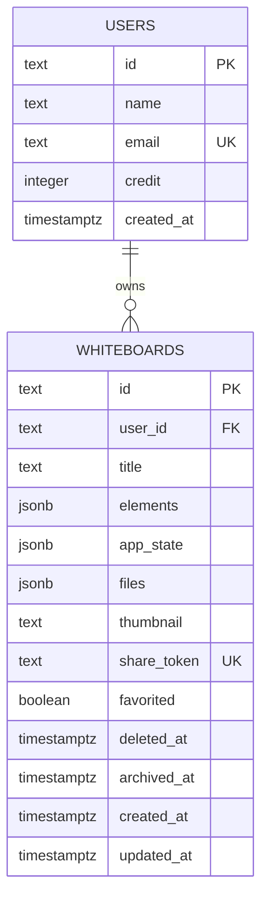
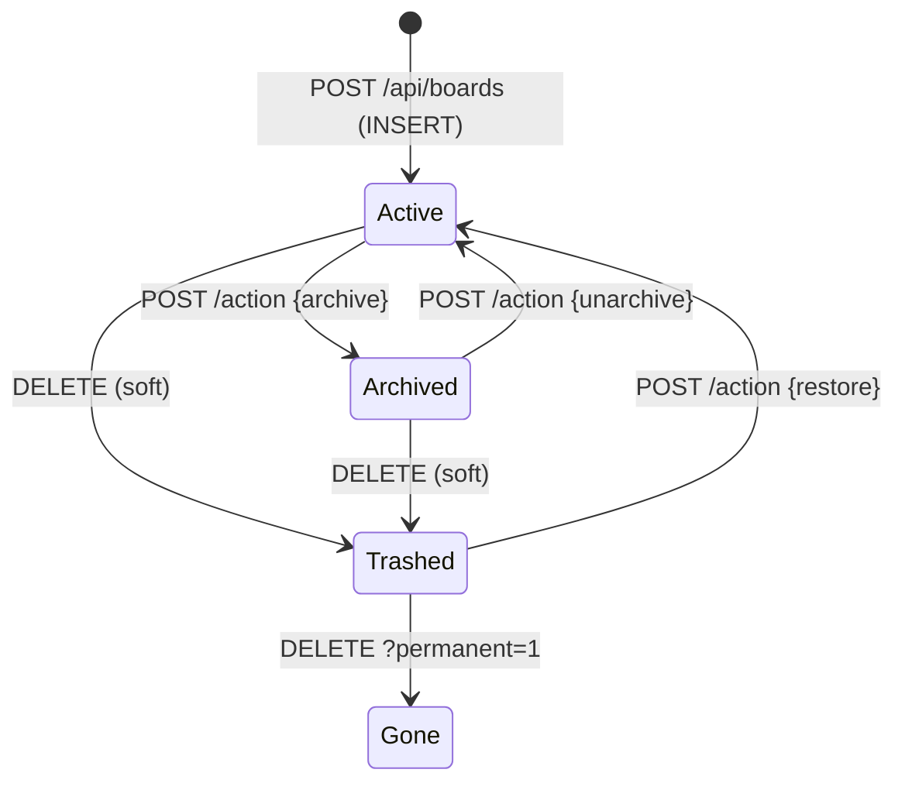

# Chapter 11 — Database Design

**Goal:** Know every column in both tables, every query the app runs, why the scene is JSONB, how archive/trash works, which indexes exist (and which are missing), and where database rows become API JSON.

---

## 11.1 Beginner first: two tables and one idea

The entire database is defined in `db/schema.ts` (49 lines). There are two tables: `users` (one row per Clerk identity) and `whiteboards` (one row per board). A board row *contains* its drawing as three JSONB columns rather than storing each shape in its own table.



The arrow reads: one user owns zero or many whiteboards; every whiteboard belongs to exactly one user. That relationship is why every board query in the app carries `userId`.

---

## 11.2 `users` — field by field

**File:** `db/schema.ts:10–18`.

| Column | Drizzle definition | SQL type | Null / default | Constraint | Why it exists |
| --- | --- | --- | --- | --- | --- |
| `id` | `text("id").primaryKey()` | `text` | NOT NULL (PK) | Primary key | The Clerk `userId` is reused directly; no second app ID |
| `name` | `text("name").notNull()` | `text` | NOT NULL, no default | — | Display name from Clerk profile |
| `email` | `text("email").notNull().unique()` | `text` | NOT NULL, no default | **Unique** | Prevents duplicate profile rows |
| `credit` | `integer("credit").notNull().default(3)` | `integer` | NOT NULL, default `3` | — | Usage balance; decremented atomically by board creation and AI generation |
| `createdAt` → `created_at` | `timestamp("created_at", { withTimezone: true }).notNull().defaultNow()` | `timestamptz` | NOT NULL, default `now()` | — | Provisioning time |

The fallback email in `lib/user.ts` (`${userId}@users.clerk.internal`) exists because `email` is NOT NULL even when Clerk has no email address. **[IMPLEMENTED]**

---

## 11.3 `whiteboards` — field by field

**File:** `db/schema.ts:20–43`.

| Column | Drizzle definition | SQL type | Null / default | Constraint | Why it exists |
| --- | --- | --- | --- | --- | --- |
| `id` | `text("id").primaryKey()` | `text` | NOT NULL (PK) | Primary key | `crypto.randomUUID()` in `POST /api/boards` |
| `userId` → `user_id` | `text("user_id").notNull().references(() => users.id, { onDelete: "cascade" })` | `text` | NOT NULL | FK → `users.id`, **ON DELETE CASCADE** | Ownership + cascade cleanup |
| `title` | `text("title").notNull()` | `text` | NOT NULL, no default | — | PATCH truncates to 120 chars |
| `elements` | `jsonb("elements").$type<unknown[]>().notNull().default([])` | `jsonb` | NOT NULL, default `[]` | — | Excalidraw scene shapes/arrows/text |
| `appState` → `app_state` | `jsonb(...).$type<Record<string, unknown>>().notNull().default({})` | `jsonb` | NOT NULL, default `{}` | — | Excalidraw UI state (client deliberately saves `{}`) |
| `files` | `jsonb("files").$type<Record<string, unknown>>().notNull().default({})` | `jsonb` | NOT NULL, default `{}` | — | Embedded assets keyed by id |
| `thumbnail` | `text("thumbnail")` | `text` | **NULL allowed**, no default | — | Base64 PNG data URL, capped at 2,000,000 characters |
| `shareToken` → `share_token` | `text("share_token").unique()` | `text` | **NULL allowed**, no default | **Unique** | 32-hex capability; NULL = sharing off |
| `favorited` | `boolean("favorited").notNull().default(false)` | `boolean` | NOT NULL, default `false` | — | Dashboard favorites filter |
| `deletedAt` → `deleted_at` | `timestamp("deleted_at", { withTimezone: true })` | `timestamptz` | NULL allowed | — | Trash marker; NULL = not trashed |
| `archivedAt` → `archived_at` | `timestamp("archived_at", { withTimezone: true })` | `timestamptz` | NULL allowed | — | Archive marker; NULL = not archived |
| `createdAt` → `created_at` | `timestamp(...).notNull().defaultNow()` | `timestamptz` | NOT NULL, default `now()` | — | Creation time |
| `updatedAt` → `updated_at` | `timestamp(...).notNull().defaultNow()` | `timestamptz` | NOT NULL, default `now()` | — | Autosave ordering; `listBoards()` sorts DESC |

At the bottom, `db/schema.ts:45–48` exports inferred types:

```ts
export type User = typeof users.$inferSelect;
export type NewUser = typeof users.$inferInsert;
export type Whiteboard = typeof whiteboards.$inferSelect;
export type NewWhiteboard = typeof whiteboards.$inferInsert;
```

**[IMPLEMENTED] these types are compile-time only** — `.$type<unknown[]>()` does not validate incoming JSON.

---

## 11.4 Relationships, cascade, and the JSONB decision

**Cascade [IMPLEMENTED]:** `onDelete: "cascade"` means deleting a `users` row removes all their boards at the database level. The app's `DELETE ?permanent=1` only removes a board, not the user. The user row is never deleted by application code — there is no account-deletion route.

**Why JSONB [IMPLEMENTED]:** Excalidraw's document model is `{ elements, appState, files }`. `lib/export.ts` reads exactly those three from `api.getSceneElements()`, `api.getAppState()`, and `api.getFiles()`; `whiteboard-canvas.tsx` writes them into `initialData`. One JSONB column per top-level concept means one row per board and one atomic PATCH per autosave.

**Tradeoff:** the database cannot answer "how many rectangles does user X have" with a simple indexed query, and JSON shape is unvalidated. **[SUGGESTED IMPROVEMENT]** if element-level queries are ever needed, add generated columns or normalize elements into a child table with a GIN index on JSONB paths; if thumbnails outgrow the text column, move them to object storage (the stale `.planning/codebase/CONCERNS.md` flags exactly this — see the caveat in 11.7).

The heavy columns are deliberately avoided on the dashboard:

```ts
// lib/boards.ts
const summaryColumns = {
  id: schema.whiteboards.id,
  title: schema.whiteboards.title,
  thumbnail: schema.whiteboards.thumbnail,
  favorited: schema.whiteboards.favorited,
  deletedAt: schema.whiteboards.deletedAt,
  archivedAt: schema.whiteboards.archivedAt,
  createdAt: schema.whiteboards.createdAt,
  updatedAt: schema.whiteboards.updatedAt,
};
```

Eight columns, no `elements`/`appState`/`files`/`shareToken`. **[IMPLEMENTED]**

---

## 11.5 Soft delete and archive as a state machine

Two nullable timestamps encode three dashboard scopes. `lib/boards.ts` maps them to booleans via `toSummary()` (`archived: row.archivedAt !== null`, `deleted: row.deletedAt !== null`, plus an identical `trashed` alias).



Scope predicates in `listBoards()`:

| Scope | SQL predicate | Extra JS filter |
| --- | --- | --- |
| `active` | `userId = ? AND deletedAt IS NULL AND archivedAt IS NULL` | `!archived && !deleted` |
| `archived` | `userId = ? AND deletedAt IS NULL` | `archived && !deleted` |
| `trashed` | `userId = ?` (all rows) | `deleted` |

**[IMPLEMENTED] details worth defending:**

- `POST /api/boards/[id]/action` with `restore` clears **both** `deletedAt` and `archivedAt`, so the board returns to `active`.
- `DELETE` without `?permanent=1` sets `deletedAt`, not `archivedAt`; with `?permanent=1` it is a real `DELETE`.
- `app/share/[token]/page.tsx` rejects only `row.deletedAt`; **archived boards remain shareable** because the share lookup does not check `archivedAt`.
- `getBoard()` itself ignores both timestamps, so API PATCH can still touch a trashed row; the board *page* adds `if (!board || board.deletedAt) notFound();`.

**[SUGGESTED IMPROVEMENT]** centralize "is this board visible?" in one predicate used by pages, handlers, and share lookup so these three interpretations cannot drift.

---

## 11.6 Indexes: what exists and what is missing

**[IMPLEMENTED] indexes declared in `db/schema.ts`:**

| Index | Source | Serves |
| --- | --- | --- |
| PK on `users.id` | `.primaryKey()` | User lookup by Clerk ID |
| PK on `whiteboards.id` | `.primaryKey()` | Board lookup, ownership checks |
| UNIQUE on `users.email` | `.unique()` | Upsert/profile integrity |
| UNIQUE on `whiteboards.shareToken` | `.unique()` | `getBoardByShareToken()` lookup; in Postgres, NULLs are allowed multiple times, so "sharing off" does not conflict |

There are **no explicit `index()` calls** in `db/schema.ts`. **[SUGGESTED IMPROVEMENT] missing indexes:**

| Missing index | Why it matters | Likely definition |
| --- | --- | --- |
| `whiteboards(user_id)` | Every `listBoards()` and `getBoard()` filters by user | `index("whiteboards_user_id_idx").on(table.userId)` |
| `whiteboards(user_id, updated_at DESC)` | `listBoards()` orders by `desc(updatedAt)` | composite index matching filter + sort |
| Partial index on `(user_id) WHERE deleted_at IS NULL AND archived_at IS NULL` | Active scope is the default dashboard view | partial index on the hot predicate |
| `whiteboards(deleted_at, archived_at)` | Scope filtering if a single-table scan grows | partial/composite variants |

With two tables and a small dataset these omissions are harmless, but they are the first thing to measure when the board list slows down. **[EVIDENCE GAP]** no `EXPLAIN ANALYZE` output or load test exists in the repo.

---

## 11.7 Query inventory and the Drizzle setup

Every database operation in the application, grouped by file:

| File / symbol | Operation |
| --- | --- |
| `db/index.ts` / `getDb()` | Lazily creates and caches `drizzle({ client: neon(url), schema })`; throws if `DATABASE_URL` is missing |
| `lib/user.ts` / `getDbUser()` | `SELECT` from `users` WHERE `id = ?` LIMIT 1 |
| `lib/user.ts` / `upsertDbUser()` | `INSERT users ... ON CONFLICT (id) DO UPDATE SET name, email RETURNING` |
| `lib/boards.ts` / `listBoards()` | `SELECT summaryColumns WHERE userId + scope ORDER BY updatedAt DESC` + JS filters |
| `lib/boards.ts` / `getBoard()` | `SELECT * WHERE id = ? AND userId = ? LIMIT 1` |
| `lib/boards.ts` / `getBoardByShareToken()` | Trims token then `SELECT * WHERE shareToken = ? LIMIT 1` |
| `app/api/boards/route.ts` / `POST` | Atomic `UPDATE users SET credit = credit - 1 WHERE id = ? AND credit > 0 RETURNING`; then `INSERT whiteboards` |
| `app/api/boards/[id]/route.ts` / `PATCH` | `UPDATE whiteboards SET <allowlisted fields> WHERE id AND userId RETURNING` |
| same / `DELETE` | `DELETE ... WHERE id AND userId` or `UPDATE deletedAt + updatedAt` |
| `app/api/boards/[id]/action/route.ts` | `UPDATE archivedAt / deletedAt WHERE id AND userId RETURNING` |
| `app/api/ai/route.ts` | Atomic `credit - 1` before Gemini; `credit + 1` in three failure paths |

**Configuration [IMPLEMENTED]:** `drizzle.config.ts` calls `loadEnv({ path: ".env.local" })`, points `schema` at `./db/schema.ts`, sets `out: "./drizzle"`, `dialect: "postgresql"`, a placeholder connection URL fallback, `strict: true`, and `verbose: true`. `package.json` offers `db:generate`, `db:push`, and `db:studio`. The README tells readers to run `npm run db:push`; **or** `npm run db:generate` + `npm run db:migrate`.

**[EVIDENCE GAP] `db:migrate` does not exist in `package.json`**, there is no `drizzle/` directory in the repository, and no generated migration SQL is committed — setup in practice relies on `db:push`. Also note the stale map: `docs/LEARNING_GUIDE.md:17` warns that `.planning/codebase/*.md` predates the hardening commit; treat its "known bugs" (non-atomic credits, full thumbnails in list queries) as historical, not current. This chapter's claims come from `db/schema.ts` and the live handlers.

---

## 11.8 Serialization boundaries

A database row does not travel to the browser unchanged.

| Boundary | Mechanism | Evidence |
| --- | --- | --- |
| `timestamptz` → JSON string | `.toISOString()` in `toSummary()`, `boardToData()`, and route DTOs | `lib/boards.ts`, `app/api/boards/route.ts` |
| Nullable columns → `null` | `row.thumbnail ?? null`, `row.shareToken ?? null`, `updated.thumbnail ?? null` | `lib/boards.ts`, `[id]/route.ts` |
| Timestamps → booleans | `archived: updated.archivedAt !== null`, `deleted: updated.deletedAt !== null` | `PATCH` / `DELETE` / `action` responses |
| JSONB → client DTO | `as unknown[]` / `as Record<string, unknown>` casts | `boardToData()` |
| Client DTO → Excalidraw | `as never` at `initialData` and `api.updateScene()` | `whiteboard-canvas.tsx` |
| Raw user → API | `NextResponse.json({ user })` serializes `Date` automatically | `app/api/user/route.ts` |

`lib/types.ts` defines the two public shapes: `BoardSummary` (8 fields, used by `GET /api/boards`) and `BoardData` (elements/appState/files/thumbnail/shareToken/favorited/updatedAt, used by server pages). The `share` page deliberately passes only `id`, `title`, `elements`, `appState`, `files` to `SharedWhiteboard` — no token or credit crosses into the public client. **[IMPLEMENTED]**

Cross-references: Chapter 5 for architecture, Chapter 8 for DTO pattern tradeoffs, Chapter 12 for exact response payloads, Chapter 18 for index/performance work.

---

## 11.9 Revision summary

- [IMPLEMENTED] `db/schema.ts` defines `users` (5 columns) and `whiteboards` (13 columns); `users.id` is the Clerk ID and `whiteboards.userId` cascades on delete.
- [IMPLEMENTED] Scene state lives in `elements`, `app_state`, and `files` JSONB columns with non-null defaults; `.$type<>()` is compile-time typing only.
- [IMPLEMENTED] Archive/trash are nullable timestamps; `restore` clears both, and `listBoards()` maps them to `active`, `archived`, `trashed` scopes.
- [IMPLEMENTED] Indexes are PKs plus unique `email` and unique `shareToken`; no explicit `index()` exists.
- [SUGGESTED IMPROVEMENT] Add `(userId, updatedAt DESC)` and partial scope indexes; move oversized thumbnails to object storage.
- [IMPLEMENTED] All queries are centralized in `lib/user.ts`, `lib/boards.ts`, and the five handlers; ownership is part of every board predicate.
- [EVIDENCE GAP] `db:migrate` is documented but absent from `package.json`, no migrations are committed, and `.planning/codebase/*.md` is stale.

## 11.10 Knowledge checks

1. Which columns does `summaryColumns` exclude, and why does that matter on the dashboard?
2. What is the exact cascade behavior when a `users` row is deleted?
3. How does `POST /action { action: "restore" }` change the two timestamp columns?
4. Why does `shareToken` being UNIQUE not prevent many boards from having sharing disabled?
5. Where are `Date` objects converted to strings before reaching the client?

## 11.11 Practical exercises

1. Recreate `db/schema.ts` from memory in a scratch file, then diff it against the original. Focus on defaults (`[]`, `{}`, `false`, `3`) and the two nullable timestamps.
2. Write the SQL that `listBoards(userId, "archived")` effectively executes, then add the composite index you would create and explain the column order.
3. Map every route handler to the exact columns it reads or writes. Circle the operations that can change `users.credit`, and note which one lacks a refund path.

## 11.12 Interview questions

1. Why store Excalidraw elements as JSONB instead of a normalized `elements` table?
2. How do you represent three dashboard scopes with two timestamp columns?
3. What happens to a share link when the owner archives the board? What happens when they disable sharing?
4. Which indexes would you add first, and how would you verify they helped?
5. Explain the difference between `db:push` and committed migrations in this repository.
