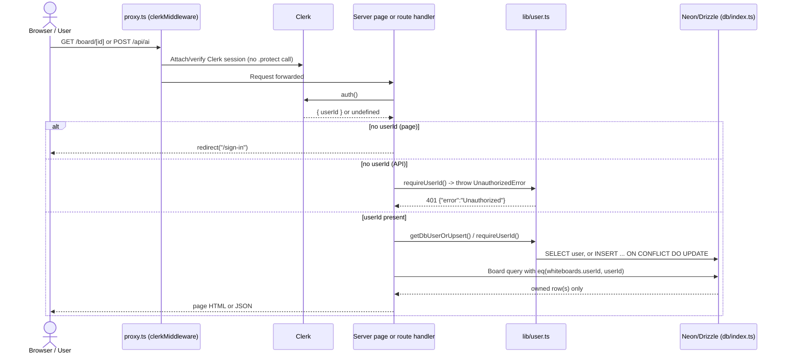

# Chapter 13 — Authentication and Security

**Goal:** By the end of this chapter you can explain exactly who decides *who you are* (Clerk), who decides *what you may touch* (route handlers and SQL predicates), and which protections exist only on paper — with file-and-function evidence for each claim.

---

## 13.1 The beginner model: three locks on three doors

Think of the app as a building with three kinds of doors:

1. **Front door** — are you signed in at all? Handled by Clerk, mounted in `app/layout.tsx` as `<ClerkProvider>`.
2. **Room doors** — are you allowed to see `/dashboard` or `/board/[id]`? Handled inside Server Components with `auth()` plus `redirect()` / `notFound()`.
3. **Filing-cabinet doors** — does this specific board row belong to you? Handled in every query by an ownership predicate in `lib/boards.ts` and in every write by an owner-scoped SQL `WHERE`.

[IMPLEMENTED] There is a **fourth, public door**: `/share/[token]`. It has no session check at all; possession of the token is the credential. That is a *capability URL*, explained in 13.6.

Professionally: authentication (identity) is delegated to Clerk, authorization (access) is enforced at the data-access layer with **ownership-scoped queries**, and public sharing uses an **unguessable bearer capability** stored in a unique column.



---

## 13.2 Identity: ClerkProvider, `auth()` and `requireUserId()`

[IMPLEMENTED] `app/layout.tsx` wraps the entire application:

```tsx
// app/layout.tsx
  return (
    <ClerkProvider>
      <html
        lang="en"
        className={`${geistSans.variable} ${geistMono.variable} ${hostGrotesk.variable} h-full antialiased`}
      >
        <body className="min-h-full flex flex-col bg-background text-foreground">
          <AppProvider>{children}</AppProvider>
          <Toaster theme="light" />
        </body>
      </html>
    </ClerkProvider>
  );
```

**Line-level:** L2 `ClerkProvider` supplies session context to server `auth()` and client hooks like `useUser()`; L7 `AppProvider` is our client bootstrap; L8 `Toaster` renders feedback. `app/sign-in/[[...sign-in]]/page.tsx` and `app/sign-up/[[...sign-up]]/page.tsx` only render Clerk's `<SignIn />` / `<SignUp />` — password handling is not ours.

[IMPLEMENTED] Server-side identity reading is centralized in `lib/user.ts`:

```ts
export async function requireUserId(): Promise<string> {
  const { userId } = await auth();
  if (!userId) {
    throw new UnauthorizedError();
  }
  return userId;
}
```

**Line-level:** L2 calls Clerk's `auth()` (server-only); L3–L5 fail closed by throwing; L6 returns the raw Clerk user id, which is used as the **primary key** of our `users` table (`db/schema.ts`, `id: text("id").primaryKey()`).

[IMPLEMENTED] Page guards use the same `auth()` directly: `app/dashboard/layout.tsx` runs `if (!userId) redirect("/sign-in")`, and `app/board/[id]/page.tsx` does the same before loading any board data. [PARTIAL] These guards cover pages only; API handlers use `requireUserId()` or `getDbUserOrUpsert()`, so a forgotten check in a new handler would not be caught centrally.

---

## 13.3 The middleware reality (`proxy.ts`)

[IMPLEMENTED] Next.js 16 uses `proxy.ts` rather than `middleware.ts` (also noted in `README.md`, "Notes"). The entire file is:

```ts
// proxy.ts
import { clerkMiddleware } from "@clerk/nextjs/server";

export default clerkMiddleware();

export const config = {
  matcher: [
    "/((?!_next|[^?]*\\.(?:html?|css|js(?!on)|jpe?g|webp|png|gif|svg|ttf|woff2?|ico|csv|docx?|xlsx?|zip|webmanifest)).*)",
    "/(api|trpc)(.*)",
  ],
};
```

**Line-level:** L3 calls `clerkMiddleware()` **with no callback**, so no route is declared protected here; L6–L9 match almost everything except static assets and explicitly include `/api`; the practical effect is that Clerk session data is available downstream, while access decisions happen in pages and handlers.

[EVIDENCE GAP] Do not claim in an interview that "middleware protects all routes." It does not call `.protect()`, does not maintain an allowlist, and does not redirect. The public share page is intentionally reachable — which is also why a naive `.protect()` on all matched routes would break sharing. [SUGGESTED IMPROVEMENT] Introduce an explicit public-routes allowlist and document it next to `proxy.ts`.

---

## 13.4 Lazy user provisioning and ownership in the query

[IMPLEMENTED] Clerk knows *who* the user is; our database needs a matching row for credits and boards. `lib/user.ts` does this lazily:

```ts
export async function upsertDbUser(): Promise<User> {
  const userId = await requireUserId();
  const clerkUser = await currentUser();

  const name =
    clerkUser?.fullName || clerkUser?.username || clerkUser?.firstName || "User";
  const email =
    clerkUser?.emailAddresses[0]?.emailAddress ??
    `${userId}@users.clerk.internal`;

  const db = getDb();
  const [user] = await db
    .insert(schema.users)
    .values({ id: userId, name, email })
    .onConflictDoUpdate({
      target: schema.users.id,
      set: { name, email },
    })
    .returning();
```

**Line-level:** L2 enforces auth before any DB write; L5–L6 pick a display name with a `"User"` fallback; L7–L8 use a synthetic internal email when Clerk has none, keeping the `unique` email column in `db/schema.ts` satisfiable; L11–L17 make the operation idempotent. `credit` is not set here — the default of 3 in `db/schema.ts` applies on insert.

[IMPLEMENTED] Call sites: `app/provider.tsx` calls `POST /api/user` once after Clerk reports `isSignedIn`; `components/whiteboard/workspace.tsx` calls `GET /api/user` (which uses `getDbUserOrUpsert()`) when the editor opens.

[IMPLEMENTED] Authorization is part of the SQL, not an afterthought:

```ts
// lib/boards.ts — getBoard(userId, boardId)
.where(
  and(
    eq(schema.whiteboards.id, boardId),
    eq(schema.whiteboards.userId, userId),
  ),
)
.limit(1);
```

**Line-level:** L3 matches the requested id; L4 is the owner filter — guessing another user's UUID returns `null`, which handlers turn into 404; L6 limits the result to one row. The same predicate is repeated on writes in `PATCH`/`DELETE`/`action` route handlers, and `listBoards()` starts with `const base = eq(schema.whiteboards.userId, userId)`.

**Why this matters:** there is no separate `if (board.userId !== userId) throw` step to forget. The database never returns someone else's row in the first place. [EVIDENCE GAP] There is no row-level security policy in the database itself and no test file proving these predicates cannot be bypassed.

---

## 13.5 Capability-based sharing: generate, revoke, no expiry

[IMPLEMENTED] Enabling sharing is a `PATCH` with `{ "share": "enable" }` in `app/api/boards/[id]/route.ts`:

```ts
if (body.share === "enable" && !board.shareToken) {
  update.shareToken = randomUUID().replace(/-/g, "");
}
if (body.share === "disable") {
  update.shareToken = null;
}
```

**Line-level:** L1–L2 produce a UUID with hyphens removed → **32 hexadecimal characters**, stored in `shareToken` (a `unique` text column in `db/schema.ts`); L4–L5 revoke by setting `NULL`. Because enabling checks `!board.shareToken`, repeated "enable" calls do not rotate the token. [IMPLEMENTED] `components/whiteboard/workspace-header.tsx` builds the URL as `` `${window.location.origin}/share/${data.board.shareToken}` `` and copies it with `navigator.clipboard.writeText`.

[IMPLEMENTED] The public reader is `app/share/[token]/page.tsx`:

```tsx
let row;
try {
  row = await getBoardByShareToken(token);
} catch {
  notFound();
}
if (!row || row.deletedAt) notFound();
```

**Line-level:** L3 looks up by token alone via `getBoardByShareToken()` (`lib/boards.ts`), which trims the token and queries `eq(shareToken, clean)`; L4–L5 map DB failures to 404; L6 also hides trashed boards. Note that **archived** boards are not excluded here — only `deletedAt` is checked.

[IMPLEMENTED] `components/whiteboard/shared-whiteboard.tsx` renders the scene with `viewModeEnabled`, `theme="light"`, and disables `loadScene`, `saveToActiveFile`, `export` and `saveAsImage` in `UIOptions`. The header says "Read-only".

[PARTIAL] Security properties of this design:

| Property | Status | Evidence |
| --- | --- | --- |
| Unguessable token (32 hex chars) | [IMPLEMENTED] | `randomUUID().replace(/-/g, "")` in `[id]/route.ts` |
| Unique token per board | [IMPLEMENTED] | `shareToken: text("share_token").unique()` in `db/schema.ts` |
| Owner-only generation/revocation | [IMPLEMENTED] | `getBoard(user.id, id)` + owner-scoped update in `[id]/route.ts` |
| Instant revocation | [IMPLEMENTED] | `shareToken = null` → `getBoardByShareToken` finds nothing |
| Read-only rendering | [IMPLEMENTED] | `viewModeEnabled` in `shared-whiteboard.tsx` |
| Expiry | [EVIDENCE GAP] | No expiry column in `db/schema.ts`; no date comparison in share page |
| Password / per-recipient control | [EVIDENCE GAP] | Single token per board; no second factor |
| Usage audit / view counters | [EVIDENCE GAP] | No logging in `app/share/[token]/page.tsx` |
| Rotation on re-enable | [PARTIAL] | Old token is nulled and a fresh one generated, but no explicit rotation action exists |

[SUGGESTED IMPROVEMENT] Add `shareExpiresAt`, an optional password hash, and a "rotate link" action; log views with token id (never the token itself).

---

## 13.6 Input-related protections that exist

[IMPLEMENTED] Three concrete ceilings are enforced server-side:

| Protection | Exact limit | File / symbol |
| --- | --- | --- |
| Thumbnail payload | string `length <= 2_000_000` (2 MB of base64 text) | `PATCH` in `app/api/boards/[id]/route.ts` |
| AI prompt | trimmed `userInput.length <= 4000` | `MAX_PROMPT_LENGTH` in `app/api/ai/route.ts` |
| AI request rate | 10 requests per 60 000 ms per Clerk `userId` | `AI_RATE_LIMIT`, `AI_RATE_WINDOW_MS`, `isRateLimited()` in `app/api/ai/route.ts` |

**Why the thumbnail cap:** base64 thumbnails are stored in a `text` column and returned in board summaries (`lib/boards.ts`, `summaryColumns`); without a ceiling a single client could bloat every dashboard response. **Why the prompt cap:** it bounds Gemini cost and latency. **Why rate limiting:** it bounds cost even for a valid user.

[IMPLEMENTED] The limiter itself:

```ts
const aiRateMap = new Map<string, number[]>();
const AI_RATE_LIMIT = 10;
const AI_RATE_WINDOW_MS = 60_000;
function isRateLimited(userId: string): boolean {
  const now = Date.now();
  const timestamps = (aiRateMap.get(userId) ?? []).filter(
    (t) => now - t < AI_RATE_WINDOW_MS,
  );
  if (timestamps.length >= AI_RATE_LIMIT) {
    aiRateMap.set(userId, timestamps);
    return true;
  }
  timestamps.push(now);
  aiRateMap.set(userId, timestamps);
  return false;
}
```

**Line-level:** L1 stores timestamps per Clerk user id in process memory; L4–L6 discard samples older than one minute; L7–L10 reject the 11th request in the window; L11–L13 record an allowed request. The file comment explicitly says it resets on deploy/restart and recommends Redis for multiple instances — [PARTIAL] as written it is per-process, so two instances allow up to 20 requests/minute.

[IMPLEMENTED] Security headers are declared in `next.config.ts`:

```ts
const securityHeaders = [
  { key: "X-Content-Type-Options", value: "nosniff" },
  { key: "X-Frame-Options", value: "DENY" },
  { key: "Referrer-Policy", value: "strict-origin-when-cross-origin" },
  { key: "Permissions-Policy", value: "camera=(), microphone=(), geolocation=()" },
];
```

**Line-level:** L2 blocks MIME sniffing; L3 prevents framing (clickjacking); L4 limits referrer leakage — useful because share tokens live in the URL path; L5 denies unused browser features. `next.config.ts` then declares `async headers() { return [{ source: "/(.*)", headers: securityHeaders }]; }`, applying the set to every path. [EVIDENCE GAP] No `Content-Security-Policy`, no `Strict-Transport-Security`, and no test asserting the headers are emitted.

[IMPLEMENTED] Error responses deliberately avoid leaking internals: handlers return `{"error":"Internal error"}` after `console.error(...)`. [PARTIAL] The raw error is still logged server-side, which is correct operationally but means log hygiene matters.

---

## 13.7 Threat model: what is actually mitigated

| Threat | Mitigated? | Mechanism / file |
| --- | --- | --- |
| Anonymous user calling an API | [IMPLEMENTED] | `requireUserId()` → 401 in `app/api/ai/route.ts`; `getDbUserOrUpsert()` in board/user routes |
| Reading another user's board by id | [IMPLEMENTED] | `eq(whiteboards.userId, userId)` in `getBoard()`, `listBoards()`, and write `WHERE`s |
| Forged client title/credit | [IMPLEMENTED] | Credit only changed server-side by SQL in `POST /api/boards` and `POST /api/ai`; title capped at 120 chars in PATCH |
| Database bloat via large thumbnail | [IMPLEMENTED] | 2,000,000-character ceiling in PATCH |
| AI cost abuse by one user | [PARTIAL] | 10/min in-memory limiter + credits; resets on restart, per-process only |
|AI cost abuse across accounts | [EVIDENCE GAP] | No per-IP limit, no device fingerprint, no CAPTCHA |
| Share link enumeration | [IMPLEMENTED] | 32 hex chars from `randomUUID()` in PATCH; unique DB column |
| Share link never revoked | [IMPLEMENTED] | `share: "disable"` nulls the token; trashed boards 404 |
| Share link eternal validity | [EVIDENCE GAP] | No expiry field or check |
| Clickjacking / MIME sniffing / referrer leakage | [IMPLEMENTED] | `securityHeaders` in `next.config.ts` |
| XSS via prompt or board title | [EVIDENCE GAP] | React escapes text by default, but there is no CSP and no sanitizer around stored `elements`/`files` JSON |
| CSRF on PATCH/DELETE | [EVIDENCE GAP] | No CSRF token or origin check in handlers; mitigation currently relies on Clerk session cookies and browser same-origin behaviour |
| Leaking stack traces to clients | [IMPLEMENTED] | Generic 500 bodies in every route handler |
| Credential leakage in this guide | [IMPLEMENTED] | Only environment variable **names** are documented here; no secret values are reproduced |

[IMPLEMENTED] **Key-rotation note:** `README.md` explicitly advises that Clerk publishable/secret keys should be rotated if they were previously exposed. `.env.example` contains only placeholders for the Clerk, database and Gemini credentials — no usable secret is stored in the repository. [SUGGESTED IMPROVEMENT] If a real key was ever committed, rotate it at the provider, purge it from history, and require all developers to refresh `.env.local`; do not paste the old or new value into documentation, chat, or issues.

[EVIDENCE GAP] Additional gaps to state honestly: no test suite or CI (`package.json` scripts are only dev/build/start/lint/db tasks), no monitoring or alerting (`console.error` only), no audit log for share/credit events, no database-level RLS, and no rate limit on board creation. The `.planning/codebase/*.md` notes are stale and must not be used as security evidence.

---

## 13.8 Revision summary

- Clerk owns identity (`ClerkProvider`, `auth()`); our `users.id` is the Clerk user id.
- `requireUserId()` throws `UnauthorizedError`; handlers translate it to 401.
- `proxy.ts` runs `clerkMiddleware()` but never calls `.protect()` — protection is local to pages and handlers.
- `upsertDbUser()` lazily creates the DB row on first signed-in request; `credit` comes from a schema default of 3.
- Authorization lives in SQL: every board read and write filters by `whiteboards.userId`.
- Share links are 32-hex capabilities in a unique column, revocable by nulling, with no expiry or password.
- Real ceilings exist (2 MB thumbnail, 4000-char prompt, 10 AI requests/minute) plus four global security headers; many advanced controls are evidence gaps.

## 13.9 Knowledge checks

1. Why is `proxy.ts` alone insufficient to protect `/api/boards`, and where is access actually enforced?
2. What does `upsertDbUser()` do when Clerk has no email address for a user, and why is that necessary?
3. Give the exact code expression that generates a share token and explain why it is called a capability.
4. Which three numeric limits protect the AI endpoint and the thumbnail column?
5. Name two threats that are mitigated and two that are explicitly unmitigated, with file evidence.

## 13.10 Practical exercises

1. **Trace the guard:** Starting from `app/board/[id]/page.tsx`, list every function call that must succeed before board JSON reaches the browser. Mark the exact line where another user's id would cause `notFound()`.
2. **Revoke experiment:** In a local environment, enable sharing, open the `/share/<token>` page in a second browser, then disable sharing and refresh. Use `lib/boards.ts` and `app/share/[token]/page.tsx` to explain the result without guessing.
3. **Threat-table audit:** Add one row to the table in 13.7 for a threat not listed there. State whether it is mitigated, cite a file and symbol, and if it is an evidence gap, write the smallest change that would close it.

## 13.11 Interview questions

1. "Where does your app decide that a signed-in user may open a particular board?"
2. "Why is the share link a capability rather than a role or a database permission?"
3. "Your rate limiter is an in-memory `Map`. What happens when you deploy two instances?"
4. "Which security headers do you set, and what attack does each one reduce?"
5. "A former developer committed a real Clerk secret. Walk me through your response, without revealing any key values."
