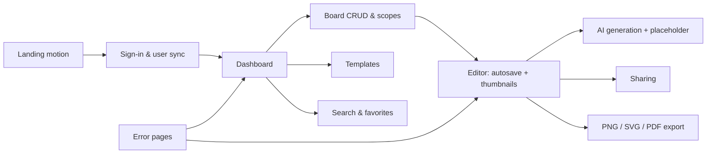

# Chapter 14 — Feature-by-Feature Implementation

**Goal:** By the end of this chapter you can pick any user-visible feature in AI Whiteboard, name the files that implement it, walk through the exact call sequence, and defend why the current design is reasonable — including its edge cases.

---

## 14.1 Feature map and how to read this chapter

[IMPLEMENTED] The product surface comes from `README.md` (Features) and the code: ten features are built. Each subsection below uses the same shape — **What / Why → Files → Steps & data flow → Errors & edge cases → Alternatives & why current wins** — so you can compare features consistently.



---

## 14.2 Sign-in and user sync

**What & why.** [IMPLEMENTED] Clerk handles sign-in UI and sessions; our database needs a parallel row to store credits and boards. `app/provider.tsx` bridges the two.

**Files.** `app/layout.tsx` (`ClerkProvider`), `app/sign-in/[[...sign-in]]/page.tsx`, `app/sign-up/[[...sign-up]]/page.tsx`, `app/provider.tsx`, `app/api/user/route.ts`, `lib/user.ts`, `lib/store.ts`.

**Steps & data flow.** Clerk loads → `useUser()` returns `isLoaded`/`isSignedIn` → `POST /api/user` → `upsertDbUser()` reads `auth()` and `currentUser()` → `INSERT ... ON CONFLICT DO UPDATE` → `setUser()` into Zustand → `CreditBadge` renders the number.

```tsx
// app/provider.tsx
    if (!isLoaded || !isSignedIn) {
      setUser(null);
      return;
    }

    let cancelled = false;

    fetch("/api/user", { method: "POST" })
      .then((res) => (res.ok ? res.json() : null))
      .then((data) => {
        if (!cancelled && data?.user) {
          setUser(data.user);
        }
      })
      .catch(() => {
        // DB not reachable yet (no DATABASE_URL) — app still usable in UI-only mode.
      });
```

**Line-level:** L1–L4 clear client state while auth loads or is absent; L6 guards against a stale effect; L8 is the POST; L9–L13 store the user; L14–L16 deliberately swallow DB failures so the UI still renders.

**Errors & edge cases.** [IMPLEMENTED] Missing session → `setUser(null)`. [IMPLEMENTED] Missing email → synthetic `${userId}@users.clerk.internal` in `upsertDbUser()` to satisfy the unique column. [PARTIAL] A DB outage is invisible to the user: the credit badge shows `–` (`components/dashboard/credit-badge.tsx`) with no explanation.

**Alternatives & why current wins.** A webhook-based sync would be more authoritative, but a lazy client POST needs no webhook endpoint or event replay and works with a brand-new Clerk app. Cross-reference Chapter 13 for the security implications.

---

## 14.3 Board CRUD and scopes (Active / Archived / Trash)

**What & why.** [IMPLEMENTED] Boards are rows in `whiteboards`; "scopes" are derived from two nullable timestamps, `archivedAt` and `deletedAt`, rather than separate tables or an enum. This makes archive/unarchive/restore simple timestamp writes.

**Files.** `components/dashboard/board-list.tsx`, `app/api/boards/route.ts`, `app/api/boards/[id]/route.ts`, `app/api/boards/[id]/action/route.ts`, `lib/boards.ts`, `db/schema.ts`.

**Steps & data flow.** Tabs call `setScope()` → `fetchBoards(scope)` → `GET /api/boards?scope=...` → `listBoards()` → `toSummary()` → cards. Create: `POST /api/boards` debits one credit atomically, inserts the row, returns 201, then `router.push(/board/:id)`. Trash: `DELETE` sets `deletedAt`. Restore/archive: `POST /api/boards/:id/action`. Permanent delete: `DELETE ?permanent=1`.

```ts
// components/dashboard/board-list.tsx
async function act(id: string, action: "archive" | "unarchive" | "restore") {
  setBoards((prev) => prev?.filter((b) => b.id !== id) ?? prev);
  await fetch(`/api/boards/${id}/action`, {
    method: "POST",
    headers: { "Content-Type": "application/json" },
    body: JSON.stringify({ action }),
  });
  void fetchBoards(scopeRef.current);
}
```

**Line-level:** L2 removes the card optimistically so the UI feels instant; L3–L6 call the action endpoint; L7 refreshes from the server using a ref (`scopeRef`) so an in-flight tab switch does not refresh the wrong scope.

**Errors & edge cases.** [PARTIAL] `act()` and `remove()` ignore the HTTP response entirely — a failed archive leaves the card gone until refresh. [IMPLEMENTED] `listBoards()` double-filters: SQL conditions plus `summaries.filter(...)`, so `archived && trashed` rows never appear in Active or Archived. [IMPLEMENTED] `restore` clears both timestamps (`action/route.ts`).

**Alternatives & why current wins.** A `status` enum would be simpler to read but would lose the "when" information that `relativeTime()` (`board-list.tsx`) and ordering by `updatedAt` already provide. Soft delete also keeps the share page able to hide trashed boards via `row.deletedAt`.

---

## 14.4 Templates

**What & why.** [IMPLEMENTED] Templates are **not** stored scenes. Each of the six entries in `TEMPLATES` (`components/dashboard/templates.tsx`) is a title plus a ready-made AI prompt. This reuses the generation pipeline instead of maintaining seed JSON.

**Files.** `components/dashboard/templates.tsx`, `lib/ai-tools.ts` (`AI_TOOLS`), `app/api/boards/route.ts`, `components/whiteboard/assistant-panel.tsx`.

**Steps & data flow.** Click template → `POST /api/boards` with the template title → navigate to `/board/<id>?template=<toolId>&prompt=<encoded prompt>` → `AssistantPanel` reads `useSearchParams()`, picks the matching `AI_TOOLS` entry, pre-fills prompt, and opens the panel automatically.

```ts
// components/dashboard/templates.tsx (start)
const res = await fetch("/api/boards", {
  method: "POST",
  headers: { "Content-Type": "application/json" },
  body: JSON.stringify({ title: template.title }),
});
const data = await res.json().catch(() => ({}));
if (!res.ok || !data?.board?.id) {
  throw new Error(data?.error ?? "Could not create a board.");
}
const tool = AI_TOOLS.find((t) => t.id === template.tool)?.id ?? "diagram";
const query = new URLSearchParams({ template: tool, prompt: template.prompt });
router.push(`/board/${data.board.id}?${query.toString()}`);
```

**Line-level:** L1–L4 create the board normally (so exactly one credit is spent); L5–L7 surface the server error body such as the 402 message; L8 falls back to `"diagram"` if a template references an unknown tool; L9–L10 encode state into the URL rather than a database field.

**Errors & edge cases.** [IMPLEMENTED] 402 is shown inline in the dialog (`{error ? <p ...>}`). [PARTIAL] Generation is **not** automatic: the user must click Generate, so a template costs 1 credit at creation and another at generation. [EVIDENCE GAP] No analytics tell us which templates are used.

**Alternatives & why current wins.** Shipping prebuilt Excalidraw JSON would make templates free and instant, but would require maintaining six scenes and a second creation path. URL-carried prompt state is shareable and stateless.

---

## 14.5 Search and favorites

**What & why.** [IMPLEMENTED] Both are **client-side filters** over the already-fetched board list — no server search endpoint exists.

**Files.** `components/dashboard/board-list.tsx` (`filteredBoards`, `showFavorites`, `query`), `app/api/boards/[id]/route.ts` (`favorited` in PATCH), `components/whiteboard/workspace-header.tsx` (`toggleFavorite`).

**Steps & data flow.** `GET /api/boards` returns all summaries in a scope → `useMemo` applies favorites filter then case-insensitive title substring → `BoardCard`s render. Starring in the editor optimistically flips Zustand state and PATCHes `{ favorited: next }`; on failure it rolls back.

```ts
// components/dashboard/board-list.tsx
const filteredBoards = useMemo(() => {
  if (!boards) return null;
  let list = boards;
  if (showFavorites) list = list.filter((b) => b.favorited);
  if (query.trim()) {
    const q = query.toLowerCase();
    list = list.filter((b) => b.title.toLowerCase().includes(q));
  }
  return list;
}, [boards, query, showFavorites]);
```

**Line-level:** L2 keeps the loading state (`null`) distinct from an empty result; L4 filters favorites first; L5–L8 lowercases both sides for a simple substring match; L9 recomputes only when inputs change.

**Errors & edge cases.** [IMPLEMENTED] Empty results show "No boards match your filters." vs. scope-specific empty copy. [PARTIAL] Search only matches `title`, not canvas content, and is case-insensitive but not accent-aware. Favorites are per-scope: a favorited archived board only appears when the Archived tab and the filter are both active.

**Alternatives & why current wins.** For a few hundred boards, in-memory filtering is instantaneous and needs no index. [SUGGESTED IMPROVEMENT] Move to server-side search with tRPC/SQL `ILIKE` and pagination when board counts grow.

---

## 14.6 AI generation with placeholder

**What & why.** [IMPLEMENTED] Gemini returns a `DiagramResult` (`lib/ai-tools.ts`), not pixels; `lib/ai-canvas.ts` converts nodes/connections into real Excalidraw elements. A dashed skeleton placeholder is drawn first so the user sees immediate feedback.

**Files.** `components/whiteboard/assistant-panel.tsx`, `lib/ai-tools.ts`, `lib/ai-canvas.ts`, `app/api/ai/route.ts`, `lib/store.ts`.

**Steps & data flow.** Generate → `addPlaceholder()` finds an empty spot with `findEmptyCanvasPosition()` and inserts six fixed-id elements → `POST /api/ai` → success removes placeholder by `PLACEHOLDER_IDS`, calls `diagramToElements(diagram, pos.x, pos.y)`, appends to the scene, scrolls to content, updates credit → failure removes placeholder and toasts.

```ts
// components/whiteboard/assistant-panel.tsx (handleGenerate, L73–L85)
      const res = await fetch("/api/ai", {
        method: "POST",
        headers: { "Content-Type": "application/json" },
        body: JSON.stringify({
          userInput: value,
          tool: { id: tool.id, name: tool.name, prompt: tool.prompt },
        }),
      });

      const data = await res.json();
      if (!res.ok) {
        throw new Error(data?.error ?? "AI generation failed.");
      }
```

**Line-level:** L2–L8 send the prompt plus the selected tool's own prompt; L10 parses JSON even on errors (the server always returns JSON); L11–L13 throw with the **server's** message so 402/429/502 text reaches the toast.

**Errors & edge cases.** [IMPLEMENTED] `CANVAS_RULES` caps output at 25 nodes, 40px spacing and <4-word labels; `RESPONSE_SCHEMA` enforces shape. [IMPLEMENTED] Connections referencing unknown node ids are skipped in `diagramToElements()` because `byId.get()` returns undefined. [PARTIAL] The prompt length is validated server-side only; the textarea has no `maxLength`. [PARTIAL] `boardId` prop is explicitly ignored (`void boardId`) — generation is not persisted until autosave runs.

**Alternatives & why current wins.** Streaming tokens would feel faster but Excalidraw needs a complete element list; a skeleton plus schema-constrained JSON is simpler and yields editable output. Cross-reference Chapter 15 for the refund flow.

---

## 14.7 Autosave and thumbnails

**What & why.** [IMPLEMENTED] Canvas edits are debounced by 1.5 s, thumbnails throttled to 30 s, and every save is a `PATCH` with the full scene plus optional base64 preview.

**Files.** `components/whiteboard/whiteboard-canvas.tsx`, `lib/export.ts` (`captureThumbnail`), `lib/whiteboard-store.ts`, `app/api/boards/[id]/route.ts`.

**Steps & data flow.** Excalidraw `onChange` → `pending.current = { elements, appState: {}, files }` → `markDirty()` → 1500 ms timer → `flush()` → maybe `captureThumbnail()` → `PATCH` → `setSaved()` clears dirty and updates "Saved" in the header. Unmount calls `flush(true)` to force a final thumbnail.

```ts
// components/whiteboard/whiteboard-canvas.tsx
pending.current = { elements, appState: {}, files };
markDirty();
if (timer.current) clearTimeout(timer.current);
timer.current = setTimeout(() => {
  void flush();
}, AUTOSAVE_DELAY);
```

**Line-level:** L1 intentionally stores an **empty** `appState` — ephemeral UI state (selection, viewport) is not persisted; L2 marks the header dirty; L3 resets the debounce timer on every keystroke/drag; L4–L6 schedule the save 1500 ms later.

**Errors & edge cases.** [IMPLEMENTED] `captureThumbnail()` returns `null` for an empty scene and swallows export errors (`lib/export.ts`), so a thumbnail failure never blocks saving. [PARTIAL] `flush()`'s `catch` only calls `setSaving(false)` — it does not clear `dirty`, show a toast, or retry; a failed save looks like "Unsaved changes" forever. Last-write-wins means two tabs will overwrite each other; there is no multiplayer.

**Alternatives & why current wins.** Sending the whole scene is simple and idempotent; diffing/CRDT would be needed for collaboration, which is explicitly out of scope. The 2 MB cap in the PATCH route bounds the base64 cost.

---

## 14.8 Sharing

**What & why.** [IMPLEMENTED] Owners create a public, read-only view of a board without creating an account for the viewer.

**Files.** `components/whiteboard/workspace-header.tsx` (`toggleShare`, `copyShareLink`), `app/api/boards/[id]/route.ts`, `lib/boards.ts` (`getBoardByShareToken`), `app/share/[token]/page.tsx`, `components/whiteboard/shared-whiteboard.tsx`.

**Steps & data flow.** Share → `PATCH {share:"enable"}` → server generates `randomUUID().replace(/-/g,"")` → response `board.shareToken` → Zustand `setShareToken` → clipboard write + sonner toast. Viewer opens `/share/<token>` → Server Component looks up the token → `SharedWhiteboard` with `viewModeEnabled`. Unshare → `PATCH {share:"disable"}` → token nulled.

```ts
// components/whiteboard/workspace-header.tsx
const res = await fetch(`/api/boards/${boardId}`, {
  method: "PATCH",
  headers: { "Content-Type": "application/json" },
  body: JSON.stringify({ share: "enable" }),
});
const data = await res.json();
if (data?.board?.shareToken) {
  setShareToken(data.board.shareToken);
  const url = `${window.location.origin}/share/${data.board.shareToken}`;
  await navigator.clipboard.writeText(url);
  toast.success("Share link copied");
}
```

**Line-level:** L1–L4 request enablement; L6 requires a token in the response before updating UI; L7 stores it; L8 builds the absolute URL; L9 copies it; L10 confirms. Note the code never checks `res.ok` here — the token check serves as the success test.

**Errors & edge cases.** [IMPLEMENTED] Failure shows `toast.error("Failed to update sharing")`. [IMPLEMENTED] Trashing the board makes the share page 404 because `row.deletedAt` is checked. [EVIDENCE GAP] Archiving does **not** disable the link; no expiry exists; clipboard permission denial is caught by the same generic toast.

**Alternatives & why current wins.** Per-user ACLs would need an invite flow and user table joins; a single capability token is 6 lines of server code and trivially revocable. Chapter 13 covers the threat model.

---

## 14.9 PNG, SVG and PDF export

**What & why.** [IMPLEMENTED] Exports run entirely in the browser from the live Excalidraw API — no server rendering or upload.

**Files.** `lib/export.ts` (`exportBoardToPng`, `exportBoardToSvg`, `exportBoardToPdf`), `components/whiteboard/workspace-header.tsx` (`handleExport`), `lib/whiteboard-store.ts` (`api`).

**Steps & data flow.** Click format → `handleExport(type)` sets exporting state → call the matching function → read `api.getSceneElements()`, `getFiles()`, `getAppState()` → build blob/SVG → object URL → temporary `<a download>` click → revoke URL. PDF additionally rasterises to PNG at 2× then embeds it with `jsPDF`.

```ts
// lib/export.ts (exportBoardToPdf)
  const blob = await exportToBlob({
    elements,
    files,
    appState: {
      ...appState,
      exportWithDarkMode: false,
      exportBackground: true,
    },
    mimeType: "image/png",
    quality: 1,
    exportPadding: 24,
    getDimensions: (width: number, height: number) => ({
      width: width * 2,
      height: height * 2,
      scale: 2,
    }),
  });
```

**Line-level:** L1–L17 render a 2× PNG with padding and light-mode background. The next lines (omitted for length) dynamically `import("jspdf")` — keeping it out of the initial bundle — then call `blobToDataUrl()`; orientation comes from `img.width >= img.height`.

**Errors & edge cases.** [IMPLEMENTED] All three functions return early when no Excalidraw API is available. [IMPLEMENTED] Filenames are sanitised with `.replace(/[^\w.-]+/g, "_") || "board"`. [PARTIAL] `handleExport` uses `try/finally` without `catch`, so a failed export surfaces as an unhandled promise rejection rather than a toast; the buttons stay disabled only while `exporting` is true.

**Alternatives & why current wins.** Server-side rendering would require shipping Excalidraw to Node and storing fonts; client export is exact because it uses the same scene instance the user sees.

---

## 14.10 Landing motion

**What & why.** [IMPLEMENTED] The public landing page has a distinct design system: Swiss/Evenkeel-inspired black-on-white with a red accent, GSAP ScrollTrigger scenes and Lenis smooth scrolling. It exists to make the product look credible before sign-in.

**Files.** `app/page.tsx` (content arrays `TILES`, `TOOLS`, `WORKFLOW`, `PLANS`), `app/landing.css`, `components/landing/landing-motion.tsx`, plus `components/landing/{reveal,board-scenes,pricing-section,faq-section}.tsx`, `components/ui/zoom-parallax.tsx`.

**Steps & data flow.** `LandingMotion` mounts → queries `.ev` root → if motion is allowed, creates a Lenis instance wired to `gsap.ticker` and `ScrollTrigger.update` → builds a `gsap.context()` with opening timeline, tool ledger, workflow scrub, board sphere, pricing, switch rings, principles, reviews and footer animations → cleanup removes all listeners and kills triggers on unmount.

```ts
// components/landing/landing-motion.tsx
      const lenis = new Lenis({
        duration: 0.8,
        smoothWheel: true,
        wheelMultiplier: 0.85,
        lerp: 0.1,
      });
      const raf = (time: number) => lenis.raf(time * 1000);
      lenis.on("scroll", ScrollTrigger.update);
      gsap.ticker.add(raf);
      gsap.ticker.lagSmoothing(0);
```

**Line-level:** L1–L6 configure smooth scrolling; L7 converts GSAP seconds to Lenis milliseconds; L8 synchronises scroll with ScrollTrigger; L9 drives Lenis from GSAP's ticker so there is one animation loop; L10 disables lag smoothing. The nearby `reduceMotion()` helper checks `window.matchMedia("(prefers-reduced-motion: reduce)").matches`.

**Errors & edge cases.** [IMPLEMENTED] Reduced-motion users get static content with `clipPath: "none"` instead of animations; `ctx.revert()`, `lenis.destroy()` and `ScrollTrigger.getAll().forEach(kill)` prevent leaks. [PARTIAL] The component is a client-side `useEffect`, so animation starts after hydration. [IMPLEMENTED] Pricing is display-only (`components/landing/pricing-section.tsx` reads `lib/pricing.ts`); no payment provider exists.

**Alternatives & why current wins.** CSS-only animation would be lighter but cannot do pinned/scrubbed scenes; the explicit cleanup is what makes GSAP safe under React Strict Mode.

---

## 14.11 Error pages and user-facing fallbacks

**What & why.** [IMPLEMENTED] Different failures get different UX: a missing board shows the shared 404 page, a crashed tree shows `global-error`, and background request failures use toasts or inline text.

**Files.** `app/not-found.tsx`, `app/global-error.tsx`, `app/board/[id]/page.tsx`, `app/share/[token]/page.tsx`, `components/ui/skeleton.tsx`, `components/ui/sonner.tsx`.

**Steps & data flow.** `app/board/[id]/page.tsx`: no Clerk id → `redirect("/sign-in")`; missing/unowned/deleted board or DB throw → `notFound()` → `app/not-found.tsx` renders "404". `app/share/[token]/page.tsx` does the same for bad tokens. Unhandled render errors reach `app/global-error.tsx`, a client component that renders its own `<html>` with "500" and a `reset()` button.

```tsx
// app/global-error.tsx
export default function GlobalError({
  reset,
}: {
  error: Error & { digest?: string };
  reset: () => void;
}) {
  return (
    <html lang="en">
      <body>
        <div
          style={{
            display: "flex",
            minHeight: "100vh",
```

**Line-level:** L2 receives Next.js's `reset` callback; L4 types the error with an optional `digest` (not displayed); L8–L13 replace the whole document, which a root-level error boundary must do. Further down, `<h1 style={{ fontSize: "3rem", fontWeight: 600 }}>500</h1>` and `<button onClick={reset}>Try again</button>` provide the copy and recovery. Styling is inline because global CSS may be the thing that broke.

**Errors & edge cases.** [IMPLEMENTED] The dashboard shows four `<Skeleton>` cards while `boards === null`; on fetch failure it replaces them with inline red-rule error text (`board-list.tsx`). [PARTIAL] No component-level `error.tsx` exists, so a single canvas error escalates to the global 500 page. [EVIDENCE GAP] No error IDs are shown to users, and no error reporting service is configured.

**Alternatives & why current wins.** Route-level `error.tsx` boundaries would preserve the dashboard shell; the current approach is simpler and guarantees a usable page even when the root layout fails. Chapter 16 catalogues every error branch in detail.

## 14.12 Revision summary

- Sign-in sync is lazy: `POST /api/user` upserts a DB row from Clerk and populates Zustand.
- Board scopes are timestamps, not enums; every action is a small route-handler write.
- Templates are prompts in the URL plus a normal board creation — generation is a separate, user-triggered step.
- Search and favorites are client-only `useMemo` filters over board summaries.
- AI generation shows a fixed-id placeholder, then swaps in schema-constrained, editable Excalidraw elements.
- Autosave is 1500 ms debounced with 30 s thumbnail throttling; `appState` is deliberately saved as `{}`.
- Sharing is a revocable 32-hex capability; exports are browser-side; landing motion respects reduced-motion preferences.

## 14.13 Knowledge checks

1. Why do templates navigate with `?template=...&prompt=...` instead of storing a scene in the database?
2. Which two fields does `filteredBoards` use, and why is favorites filtering applied before title search?
3. What happens to the dashed placeholder when Gemini returns an error, and which function removes it?
4. Why does autosave send `appState: {}`, and what does `flush(true)` on unmount do differently?
5. Which three functions in `lib/export.ts` produce downloads, and where does PDF get its raster image?

## 14.14 Practical exercises

1. **Feature-to-file map:** Choose five features from this chapter. For each, write the exact file → function → file chain from user click to database or download, without looking at the diagrams.
2. **Placeholder inspection:** Open `lib/ai-canvas.ts` and list the six `PLACEHOLDER_IDS`. Explain in two sentences why fixed IDs are necessary for removal after generation.
3. **Failure walkthrough:** Simulate a 402 from `POST /api/boards` while using a template, then a 502 from `POST /api/ai`. Write down which UI component displays each message and whether any credits are spent in total.

## 14.15 Interview questions

1. "Walk me through what happens between clicking Generate and seeing an editable diagram on the canvas."
2. "Why is autosave last-write-wins, and what would you change to support two collaborators?"
3. "How do templates avoid duplicating the generation pipeline?"
4. "What does the 2 MB thumbnail ceiling protect, and where is it enforced?"
5. "Which feature in this app has the weakest error handling, and how would you fix it?"
