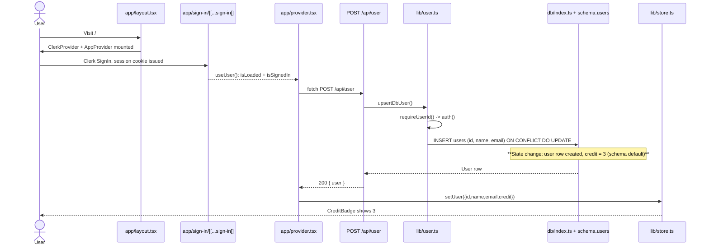
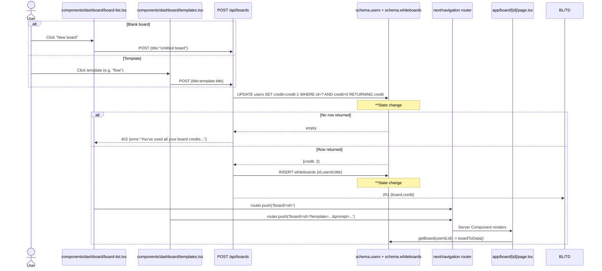
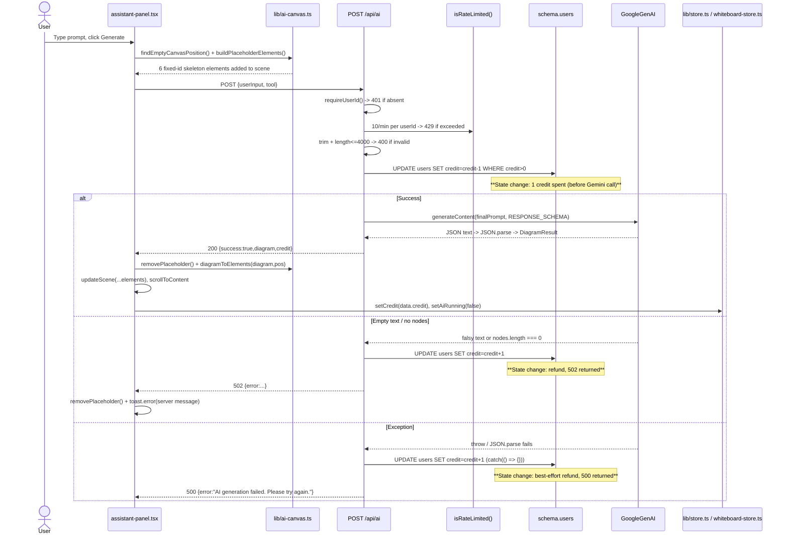
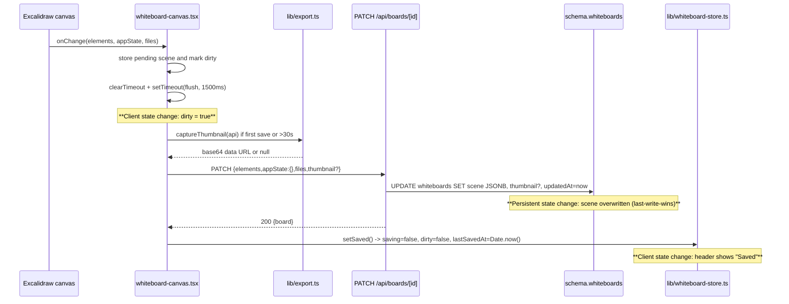
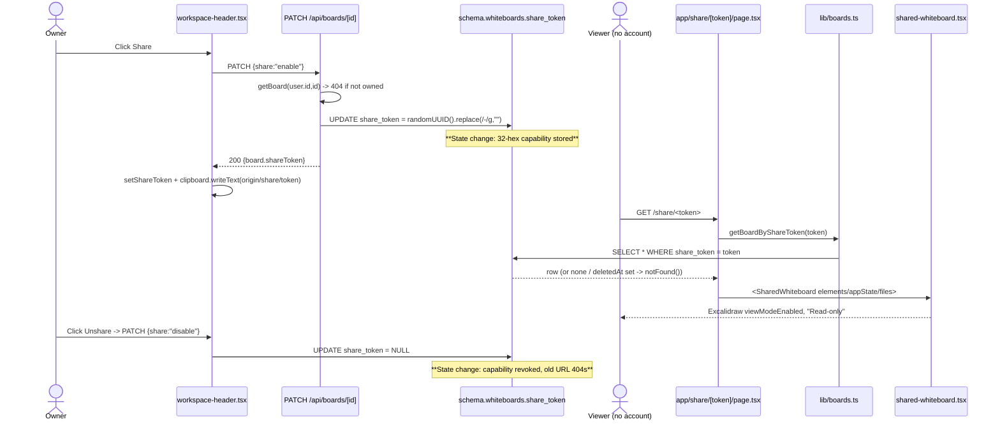
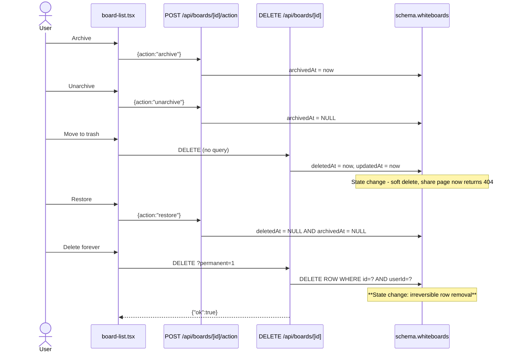
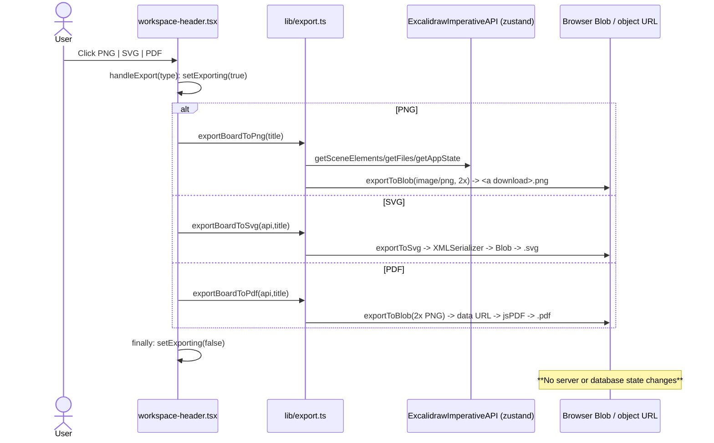

# Chapter 15 — End-to-End Data Flow

**Goal:** By the end of this chapter you can trace any user action from click to database write (or browser download), naming every function and file hop and the exact line where state changes — including the credit refund path.

---

## 15.1 How to read a trace

[IMPLEMENTED] Every flow crosses the same four layers:

| Layer | Files | Owns which state |
| --- | --- | --- |
| Browser UI | `app/**/page.tsx`, `components/**` | local React state, Zustand (`lib/store.ts`, `lib/whiteboard-store.ts`) |
| HTTP boundary | `app/api/**/route.ts` | status codes, JSON bodies, validation |
| Domain helpers | `lib/user.ts`, `lib/boards.ts`, `lib/ai-tools.ts`, `lib/ai-canvas.ts`, `lib/export.ts` | identity, ownership, AI conversion, browser export |
| Persistence | `db/index.ts` (`getDb()`), `db/schema.ts` | `users`, `whiteboards` rows in Neon Postgres |

**Why this layering matters:** a bug in "the board didn't save" can be localized by asking which layer last held the correct state. In these traces, **bold** steps mark the exact state mutation.

---

## 15.2 Trace 1 — First sign-in

[IMPLEMENTED] Step-by-step: `app/layout.tsx` mounts `ClerkProvider` and `AppProvider`; Clerk's catch-all sign-in page renders `<SignIn />`; `app/provider.tsx` watches `useUser()` and fires `POST /api/user`; `app/api/user/route.ts` calls `upsertDbUser()`; `lib/user.ts` gets the Clerk id, falls back to a synthetic email if needed, and upserts; `lib/store.ts` caches the row.

[IMPLEMENTED] The database write is `.values({ id: userId, name, email }).onConflictDoUpdate({ target: schema.users.id, set: { name, email } })` — note that an existing row's `credit` is **never** reset. [EVIDENCE GAP] If the POST fails (no `DATABASE_URL`), `app/provider.tsx` swallows the error and the UI runs with `user: null`.

---

## 15.3 Trace 2 — Create a board (blank and template)

[IMPLEMENTED] Blank path: `createBoard()` in `board-list.tsx` posts a hard-coded `"Untitled board"`, checks `res.ok`, calls `setCredit(data.credit)`, then navigates. Template path: `start()` in `templates.tsx` posts the template title, then encodes `template` and `prompt` in the query string (`URLSearchParams`) before navigating.

[IMPLEMENTED] Both converge on `POST /api/boards`: the atomic debit is `db.update(schema.users).set({ credit: sql`${users.credit} - 1` }).where(and(eq(users.id, user.id), gt(users.credit, 0)))` — the database decides who wins under concurrency. Only after a returned row does `db.insert(schema.whiteboards)` run.

[IMPLEMENTED] The board page then calls `auth()` → `getBoard(userId, id)` (owner-filtered) → `boardToData(row)` → `<WhiteboardWorkspace board={data}>`. [PARTIAL] `BoardData` contains `elements`, `appState`, `files`, `thumbnail`, `shareToken`, `favorited`, `updatedAt` — the create response contains only a subset, which is why the navigation refetches.

---

## 15.4 Trace 3 — AI generation (success, failure and refund)

[IMPLEMENTED] The prompt sent to Gemini is assembled in `app/api/ai/route.ts` as `[systemPrompt, CANVAS_RULES, \`User request: ${userInput}\`].filter(Boolean).join("\n\n")`, where `systemPrompt = body.systemPrompt?.trim() || body.tool?.prompt || ""`. `CANVAS_RULES` and `RESPONSE_SCHEMA` come from `lib/ai-tools.ts`.

[IMPLEMENTED] Three refund sites exist, each a SQL `credit + 1`: empty `response.text` (502), empty `diagram.nodes` (502), and the outer `catch` (500, with `.catch(() => {})` making it best-effort). [PARTIAL] Board creation has no equivalent refund if the subsequent `INSERT` fails — the debit and insert are two statements with no transaction.

[IMPLEMENTED] On success, `diagramToElements()` in `lib/ai-canvas.ts` makes a container + bound text per node, arrows with `startBinding`/`endBinding` from `fromId`/`toId`, and drops connections whose ids are missing. The generated elements are appended to the live scene; persistence happens later via autosave (15.5).

---

## 15.5 Trace 4 — Autosave and thumbnails

[IMPLEMENTED] Triggers: debounce `AUTOSAVE_DELAY = 1500`, thumbnail throttle `THUMBNAIL_THROTTLE_MS = 30_000`, and an unmount effect calling `flush(true)` for a forced final thumbnail. `captureThumbnail()` scales output to a 400 px max dimension and returns `null` for an empty scene.

[IMPLEMENTED] **`appState: {}` is intentional**: `handleChange` contains `void appState;` then stores `{}`, so ephemeral editor state (selection, viewport, collaborators) is never persisted — only `elements` and `files` survive. [PARTIAL] On a failed PATCH the `catch` only calls `setSaving(false)`; `dirty` remains true and no error is reported. [EVIDENCE GAP] There is no sequence number or version check, so concurrent tabs can overwrite each other.

---

## 15.6 Trace 5 — Share enable and public view

[IMPLEMENTED] `getBoardByShareToken()` trims the input and returns `null` for blank tokens; `app/share/[token]/page.tsx` converts DB errors, missing rows and `row.deletedAt` into `notFound()`. [PARTIAL] `archivedAt` is not checked, so archived boards remain viewable. [EVIDENCE GAP] No expiry or view log.

---

## 15.7 Trace 6 — Archive, trash, restore, permanent delete

[IMPLEMENTED] `listBoards()` maps these timestamps back into scopes: Active requires both timestamps null, Archived requires `deletedAt IS NULL` and then filters `b.archived`, Trash returns rows with `deletedAt` set. [IMPLEMENTED] Every write repeats the owner predicate. [PARTIAL] The client filters a card out optimistically before awaiting the response and ignores non-OK statuses.

---

## 15.8 Trace 7 — Exports (PNG / SVG / PDF)

[IMPLEMENTED] All three read the live scene from the imperative API stored by `setApi()` in `lib/whiteboard-store.ts`; filenames are sanitised with `/[^\w.-]+/g`. [PARTIAL] `handleExport` has `try/finally` but no `catch`, so failed exports produce an unhandled rejection while the UI simply stops spinning. Cross-reference Chapter 14 for per-feature rationale.

---

## 15.9 State transition table

| Entity / state | Trigger | Function / file | New state | Reversible? |
| --- | --- | --- | --- | --- |
| No DB user → user row | First signed-in request | `upsertDbUser()`, `lib/user.ts` | row with `credit = 3` (schema default) | n/a |
| Credit N → N−1 | Create board | atomic SQL in `app/api/boards/route.ts` | N−1 | No refund path |
| Credit N → N−1 | AI call starts | atomic SQL in `app/api/ai/route.ts` | N−1 | Yes, on failure |
| Credit N−1 → N | AI empty output / exception | three `credit + 1` updates in `app/api/ai/route.ts` | N | n/a |
| No board → board | `POST /api/boards` | `db.insert(schema.whiteboards)` | row with UUID id, title, empty JSONB | Via delete |
| Board scene V1 → V2 | Canvas edit | `flush()` → `PATCH` in `whiteboard-canvas.tsx` | JSONB overwritten | No version history |
| Thumbnail null → data URL | First/throttled save | `captureThumbnail()` in `lib/export.ts` | base64 text ≤2 MB | Can be set to null |
| Dirty true → false | Successful PATCH | `setSaved()` in `lib/whiteboard-store.ts` | header shows "Saved" | n/a |
| Share null → 32-hex token | `PATCH {share:"enable"}` | `[id]/route.ts` | public URL works | Yes |
| Share token → null | `PATCH {share:"disable"}` | `[id]/route.ts` | old URL 404s | Yes (new token) |
| archivedAt null → date | `action:"archive"` | `action/route.ts` | Archived tab | Yes |
| deletedAt null → date | `DELETE` (soft) | `[id]/route.ts` | Trash tab; share 404 | Yes via restore |
| deletedAt date → null | `action:"restore"` | `action/route.ts` | Active tab (also clears archivedAt) | Yes |
| Board row → gone | `DELETE ?permanent=1` | `[id]/route.ts` | irreversible | **No** |
| Scene → file | Export click | `lib/export.ts` | local download only | n/a |

## 15.10 Revision summary

- First sign-in lazily inserts a `users` row; credit 3 comes from the schema default, not from application code.
- Board creation debits first, inserts second, and has no refund if the insert fails.
- AI generation debits before the Gemini call and refunds on all three failure branches.
- Autosave persists `elements`/`files` but deliberately sends `appState: {}`; thumbnails are throttled to 30 s.
- Sharing is a token write plus a public Server Component lookup; revocation is a NULL write.
- Scopes are timestamp flips; permanent delete is the only irreversible transition.
- Exports never touch the server — they read the live Excalidraw API and download a Blob.

## 15.11 Knowledge checks

1. At which exact line does `POST /api/boards` change state first, and what happens if the following insert throws?
2. Name the three AI failure branches that refund a credit and the status codes they return.
3. Why does autosave send `appState: {}` instead of the Excalidraw appState, and where is `dirty` cleared?
4. What two database conditions make a share URL stop working, and which one does not disable it?
5. Which transitions in the state table are irreversible, and what client call triggers them?

## 15.12 Practical exercises

1. **Diagram reconstruction:** Without looking at the Mermaid blocks, draw the AI success + refund flow on paper with file names at every hop. Compare with 15.4 and mark any hop you missed.
2. **Credit ledger:** Starting from 3 credits, perform: create blank board, create template board, AI success, AI 502, AI 500, create board. Write the credit after each step and cite the SQL that changed it.
3. **State-detective:** A user reports "my share link still works after archiving." Using `app/share/[token]/page.tsx` and `listBoards()`, explain why, then list the smallest code change that would make archive hide the link.

## 15.13 Interview questions

1. "Trace a prompt from the AI panel to editable Excalidraw elements. Where does the credit change?"
2. "Why is the credit debit placed before the external API call, and how do you handle failures?"
3. "Describe your autosave strategy, including debounce, throttling and failure behaviour."
4. "How does soft delete affect the public share page, and how is a board restored?"
5. "Which data flows happen entirely in the browser, and what does that imply for observability?"
