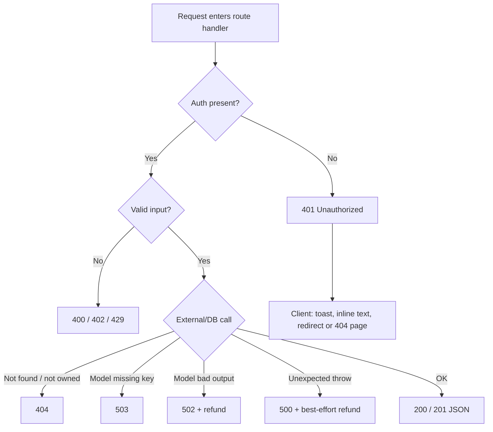

# Chapter 16 — Error Handling and Validation

**Goal:** By the end of this chapter you can name every error branch in the codebase, its exact status code and JSON body, which layer swallows it, what the user sees, and which improvements would make failures observable.

---

## 16.1 Beginner explanation: what an "error branch" is

Every `if` that returns a non-2xx response and every `catch` block is an **error branch**. [IMPLEMENTED] This project uses three styles:

1. **Explicit early returns** for expected failures — e.g. `if (!userInput) return NextResponse.json(..., { status: 400 })` in `app/api/ai/route.ts`.
2. **Typed exception translation** — `UnauthorizedError` from `lib/user.ts` becomes 401 in every route handler.
3. **Silent catches** — `catch {}` in client fetches and thumbnail capture, where the failure is intentionally ignored.

Professionally: the codebase mixes **result-by-status** handling with **exception-to-HTTP mapping** and a few **fire-and-forget** operations. There is no central error middleware; each `route.ts` repeats the same pattern.



---

## 16.2 Complete server error catalogue

[IMPLEMENTED] Verbatim bodies and statuses from the five `route.ts` files:

| Status | Exact body | Trigger | File / symbol |
| --- | --- | --- | --- |
| 400 | `{"error":"Invalid board ID"}` | `!id \|\| typeof id !== "string"` | `app/api/boards/[id]/route.ts` PATCH and DELETE; `app/api/boards/[id]/action/route.ts` |
| 400 | `{"error":"Invalid or missing action. Allowed: archive, unarchive, restore"}` | action not in the 3-item allowlist | `action/route.ts` |
| 400 | `{"error":"Invalid JSON"}` | `req.json()` throws | `app/api/ai/route.ts` |
| 400 | `{"error":"Describe what you want to generate."}` | trimmed `userInput` empty | `app/api/ai/route.ts` |
| 400 | `{"error":"Prompt is too long (max 4000 characters)."}` | `userInput.length > MAX_PROMPT_LENGTH` | `app/api/ai/route.ts` |
| 401 | `{"error":"Unauthorized"}` | `UnauthorizedError` in user/board routes; any throw from `requireUserId()` in AI route | all five files |
| 402 | `{"error":"You've used all your board credits. Upgrade to create more whiteboards."}` | atomic credit update returned no row | `app/api/boards/route.ts` POST |
| 402 | `{"error":"Insufficient credits. You have used all of your generations."}` | atomic credit update returned no row | `app/api/ai/route.ts` POST |
| 404 | `{"error":"Not found"}` | `getBoard(user.id, id)` returned null | `[id]/route.ts` PATCH/DELETE, `action/route.ts` |
| 429 | `{"error":"Too many requests. Please wait a moment."}` | `isRateLimited(userId)` | `app/api/ai/route.ts` |
| 500 | `{"error":"Internal error"}` | any non-auth exception after `console.error` | `app/api/user/route.ts`, all board routes |
| 500 | `{"error":"AI generation failed. Please try again."}` | outer `catch` around Gemini call/parse | `app/api/ai/route.ts` |
| 502 | `{"error":"The model returned an empty response."}` | falsy `response.text` | `app/api/ai/route.ts` |
| 502 | `{"error":"The model did not produce any nodes. Try a more specific prompt."}` | `!diagram.nodes?.length` | `app/api/ai/route.ts` |
| 503 | `{"error":"AI generation is temporarily unavailable."}` | `!process.env.GEMINI_API_KEY` | `app/api/ai/route.ts` |

[IMPLEMENTED] 404 is also a **page** outcome: `app/board/[id]/page.tsx` and `app/share/[token]/page.tsx` call `notFound()`, rendering `app/not-found.tsx`. [EVIDENCE GAP] No endpoint returns 403, 409, 422 or 504; there is no `Retry-After` on 429 and no `WWW-Authenticate` on 401.

---

## 16.3 The standard try/catch pattern and `UnauthorizedError`

[IMPLEMENTED] Four of the five route files share this skeleton:

```ts
  } catch (error) {
    if (error instanceof UnauthorizedError) {
      return NextResponse.json({ error: "Unauthorized" }, { status: 401 });
    }
    console.error("GET /api/boards failed:", error);
    return NextResponse.json({ error: "Internal error" }, { status: 500 });
  }
```

**Line-level:** L2–L4 use `instanceof` to distinguish the expected auth failure from bugs; L5 logs the real error for the operator; L6 returns a generic body so stack traces and SQL text never reach the client (also cited in Chapter 13).

[IMPLEMENTED] The sentinel class itself is in `lib/user.ts`:

```ts
export async function requireUserId(): Promise<string> {
  const { userId } = await auth();
  if (!userId) {
    throw new UnauthorizedError();
  }
  return userId;
}

export class UnauthorizedError extends Error {
  constructor() {
    super("Unauthorized");
    this.name = "UnauthorizedError";
  }
}
```

**Line-level:** L1–L7 are `requireUserId()`; L3 calls Clerk's `auth()`, L4–L6 fail closed. L9 subclasses the built-in `Error` so `instanceof` works; L12 sets a readable name. [PARTIAL] `app/api/ai/route.ts` does not use this class — it wraps `requireUserId()` in a bare `catch { return ... 401 }`, which can mask a programming error as "Unauthorized".

[IMPLEMENTED] Board routes take a different approach: `getDbUserOrUpsert()` can throw `UnauthorizedError` from `upsertDbUser()`, and the outer catch maps it. Ownership failures are not exceptions — `getBoard()` returns `null`, converted to 404 explicitly.

---

## 16.4 The AI route: layered guards and refund paths

[IMPLEMENTED] Guard order in `app/api/ai/route.ts`: auth (401) → rate limit (429) → JSON parse (400) → prompt present/length (400) → API key (503) → debit (402) → Gemini call → output checks (502) → success. **Why:** rate limiting precedes validation, so invalid requests consume a slot; the key check precedes the debit, so misconfiguration spends no credits.

```ts
    if (!text) {
      // Refund the credit on model failure.
      await db
        .update(users)
        .set({ credit: sql`${users.credit} + 1` })
        .where(eq(users.id, userId));
      return NextResponse.json(
        { error: "The model returned an empty response." },
        { status: 502 },
      );
    }
```

**Line-level:** L1 detects an unusable model response; L3–L6 restore exactly one credit; L7–L10 return 502. The same `credit + 1` block is repeated for empty `nodes` and in the outer `catch`.

[IMPLEMENTED] The outer catch uses a best-effort refund:

```ts
  } catch (err) {
    // Refund on failure so users aren't charged for errors.
    await db
      .update(users)
      .set({ credit: sql`${users.credit} + 1` })
      .where(eq(users.id, userId))
      .catch(() => {}); // best-effort refund

    console.error("AI generation failed:", err);
    return NextResponse.json(
      { error: "AI generation failed. Please try again." },
      { status: 500 },
    );
  }
```

**Line-level:** L3–L8 add the credit but swallow a DB failure — the user still sees 500 and a refund can be lost; L10 logs the cause; L11–L14 return a generic retry message. [SUGGESTED IMPROVEMENT] Write refunds to an outbox/ledger table so a failed refund can be reconciled, and return a correlation id in the 500 body.

[PARTIAL] `POST /api/boards` spends a credit and has **no rollback** if `db.insert(schema.whiteboards)` throws — the outer catch returns 500 with the credit already gone. [EVIDENCE GAP] No transaction wraps debit + insert.

---

## 16.5 Silent catches and their cost

[IMPLEMENTED] Every silent catch in the repository and what it costs:

| Location | Code shape | What is swallowed | Cost |
| --- | --- | --- | --- |
| `app/provider.tsx` | `.catch(() => {})` | `POST /api/user` failure | Credit badge shows `–`; no hint that the DB is unconfigured |
| `components/whiteboard/workspace.tsx` | `.catch(() => {})` | `GET /api/user` failure | Editor opens with stale/absent credit |
| `components/whiteboard/whiteboard-canvas.tsx` | `catch { setSaving(false); }` | PATCH autosave failure | `dirty` stays true but no toast/retry; data can be lost on tab close |
| `lib/export.ts` (`captureThumbnail`) | `catch { return null; }` | Thumbnail render failure | Dashboard silently shows "empty canvas" |
| `app/api/ai/route.ts` | `.catch(() => {})` on refund update | DB write failure during refund | User is charged for a failed generation |
| `app/api/ai/route.ts` | `catch { return 401 }` around `requireUserId()` | Any helper error | Real bugs are mislabelled as auth failures |
| `app/share/[token]/page.tsx` | `catch { notFound(); }` | DB lookup failure | Outage looks like a bad link |
| `app/board/[id]/page.tsx` | `catch { notFound(); }` | DB lookup failure | Outage looks like a missing board |
| `components/dashboard/board-list.tsx` | `catch { setBoards([]); setError(...) }` | Network/server failure | Shows a *specific* message about `DATABASE_URL` even when the real cause differs |
| `components/whiteboard/workspace-header.tsx` | `catch { setFavorited(!next); }` | Favorite PATCH failure | UI rolls back silently |
| `components/whiteboard/workspace-header.tsx` | `catch { toast.error(...) }` | Share PATCH failure | Message is generic; server detail discarded |
| `components/dashboard/board-list.tsx` | `await fetch(...)` with no status check | Failed archive/trash/action | Card is removed optimistically and never restored |

**Why silence is sometimes correct:** `captureThumbnail()` is a cosmetic enhancement; blocking a save because a preview failed would be worse. **Why it is dangerous elsewhere:** autosave and refunds are correctness-critical. [SUGGESTED IMPROVEMENT] Introduce a small `reportError(scope, error)` helper that logs to the console today and can later forward to Sentry, and require every catch to either report, retry, or justify silence in a comment.

---

## 16.6 Client-side fallbacks the user actually sees

[IMPLEMENTED] Feedback channels:

| Mechanism | File / symbol | Used for |
| --- | --- | --- |
| `toast.error` / `toast.success` via sonner | `components/whiteboard/assistant-panel.tsx`, `workspace-header.tsx`; `<Toaster>` in `app/layout.tsx` | AI errors, share success/failure, copied links |
| Inline error text with red rule | `components/dashboard/board-list.tsx` (`{error ? ...}`), `components/dashboard/templates.tsx` | Board list fetch failure, 402 on create |
| Skeleton loading state | `components/ui/skeleton.tsx`, four cards while `boards === null` | Board list loading |
| Canvas loading spinner | `components/whiteboard/excalidraw-wrapper.tsx` (`loading: () => ...`) | Dynamic Excalidraw import |
| Status text "Saving… / Unsaved changes / Saved" | `components/whiteboard/workspace-header.tsx` from `lib/whiteboard-store.ts` | Autosave state |
| `beforeunload` guard | `components/whiteboard/workspace.tsx` (only when `dirty`) | Prevent accidental loss of unsaved edits |
| 404 page | `app/not-found.tsx` | `notFound()` from board/share pages |
| 500 page with `reset()` | `app/global-error.tsx` | Unhandled render errors |
| Optimistic rollback | `toggleFavorite()` in `workspace-header.tsx` | Favorite PATCH failure |

[IMPLEMENTED] The AI panel surfaces the **server's** message because it throws `new Error(data?.error ?? "AI generation failed.")` and displays `err.message` — so a 402 or 429 is readable. [PARTIAL] `toggleShare()` ignores `res.ok` and infers success from the presence of `data.board.shareToken`; a 200 with an unexpected shape would be treated as failure only by the generic toast.

[IMPLEMENTED] `workspace.tsx` registers the browser guard only while dirty:

```tsx
useEffect(() => {
  if (!dirty) return;
  const handler = (e: BeforeUnloadEvent) => {
    e.preventDefault();
    e.returnValue = "";
  };
  window.addEventListener("beforeunload", handler);
  return () => window.removeEventListener("beforeunload", handler);
}, [dirty]);
```

**Line-level:** L2 skips the listener when nothing is unsaved; L3–L5 ask the browser for confirmation; L6 subscribes; L7 removes the listener on cleanup or when `dirty` changes. [EVIDENCE GAP] No in-app "retry save" button exists, so the guard is the only safety net for a failed autosave.

---

## 16.7 Validation inventory — exact limits and checks

[IMPLEMENTED] Server-side:

| Input | Exact rule | File |
| --- | --- | --- |
| Board title (update) | string, trimmed non-blank, `.slice(0, 120)` | `app/api/boards/[id]/route.ts` PATCH |
| Board title (create) | `(body.title ?? "").trim() \|\| "Untitled board"` | `app/api/boards/route.ts` POST |
| Board id | `!id \|\| typeof id !== "string"` → 400 | PATCH, DELETE, action handlers |
| JSON body on boards endpoints | `request.json().catch(() => ({}))` — unparseable body becomes `{}` | boards POST, PATCH, action |
| JSON body on AI | `req.json()` failure → 400 `{"error":"Invalid JSON"}` | `app/api/ai/route.ts` |
| AI prompt | trimmed, non-empty, `<= 4000` chars (`MAX_PROMPT_LENGTH`) | `app/api/ai/route.ts` |
| AI rate | 10 requests per 60 000 ms per Clerk user id | `isRateLimited()` in `app/api/ai/route.ts` |
| Thumbnail | string length `<= 2_000_000` or exactly `null`; larger strings ignored silently | PATCH |
| `elements` | `Array.isArray` | PATCH |
| `appState`, `files` | truthy `typeof === "object"` | PATCH |
| `favorited` | `typeof === "boolean"` | PATCH |
| `share` | `"enable"` or `"disable"`; enable only if no token exists | PATCH |
| `action` | one of `archive`, `unarchive`, `restore` | `action/route.ts` |
| `scope` | `archived`/`trashed`, else `active` | `GET /api/boards` |
| `permanent` | query string exactly `"1"` | `DELETE /api/boards/[id]` |
| AI output | schema via `RESPONSE_SCHEMA`; must have `nodes.length > 0` | `lib/ai-tools.ts`, `app/api/ai/route.ts` |

[IMPLEMENTED] Client-side: title input has no `maxLength`, textarea has no `maxLength`, and the AI panel checks only `prompt.trim()` with `toast.error("Describe what you want to generate.")`. [PARTIAL] Therefore the 4000-character rule is discovered only after a round trip.

[SUGGESTED IMPROVEMENT] Add `maxLength={120}` / `maxLength={4000}` to the inputs, mirror the checks in a shared `lib/validation.ts`, and change oversize thumbnails from silent ignore to a 400 with a clear message. [EVIDENCE GAP] No validation library, no shared schema, no tests for boundary values (119/120/121 chars, 1,999,999/2,000,000/2,000,001 bytes, 10th/11th AI request).

---

## 16.8 Recommended improvements, clearly scoped

1. **[SUGGESTED IMPROVEMENT] Central error mapper.** Replace repeated `instanceof` blocks with one `handleRouteError(error, routeName)` in `lib/` returning a `NextResponse`; it removes the `UnauthorizedError`-vs-500 drift in `app/api/ai/route.ts`.
2. **[SUGGESTED IMPROVEMENT] Credit ledger.** Add a `credit_transactions` table and record debit/refund rows in the same statements, so a failed best-effort refund is visible and reconcilable.
3. **[SUGGESTED IMPROVEMENT] Transaction for board creation.** Wrap the credit decrement and board insert in one database transaction; today a failed insert keeps the debit.
4. **[SUGGESTED IMPROVEMENT] Autosave retry + toast.** In `flush()` (`whiteboard-canvas.tsx`), retry with backoff and call `toast.error` after N failures; keep `dirty` true deliberately but tell the user.
5. **[SUGGESTED IMPROVEMENT] Correlation ids.** Include a short id in 500 bodies and `console.error` lines so a user report can be matched to a log without exposing internals.
6. **[EVIDENCE GAP] Tests and CI.** `package.json` has no test script and the repository has no `*.test.*` files or `.github/workflows`; none of the branches above are verified automatically.

## 16.9 Revision summary

- Four route handlers share an `UnauthorizedError`-to-401 / everything-else-to-500 pattern; the AI route uses a bare catch for auth instead.
- Every status from 400 to 503 has at least one concrete branch, with exact JSON bodies catalogued in 16.2.
- AI failures refund with `credit + 1` in three places; the outer refund is best-effort.
- Silent catches exist in both server and client code; cosmetic ones are fine, autosave and refund ones are risky.
- Users see feedback through sonner toasts, inline error text, skeletons, status text, `notFound()`, and `global-error`.
- Exact limits: title 120 chars, prompt 4000 chars, thumbnail 2,000,000 chars, AI rate 10/minute.
- There are no tests, no CI, no error-reporting service and no shared validation schema.

## 16.10 Knowledge checks

1. Which status code and body does `PATCH /api/boards/[id]` return for a non-owner, and why not 403?
2. In what order do the AI route's guards run, and which guard executes before prompt validation?
3. What makes the outer AI refund "best-effort", and what is the consequence when the DB is down?
4. Name three silent catches and say which one is acceptable because the operation is cosmetic.
5. Give the exact numeric limits for title, prompt, thumbnail and AI rate, with the file that defines each.

## 16.11 Practical exercises

1. **Branch hunt:** Open all five `route.ts` files and highlight every `return NextResponse.json(...)` with a non-2xx status. Count them and compare with the table in 16.2.
2. **Refund simulation:** Describe what a user with 1 credit sees after (a) 402 on board creation, (b) 502 from empty model output, (c) 500 from a thrown Gemini error. State the final credit in each case and cite the SQL.
3. **Improve one catch:** Pick the autosave catch in `whiteboard-canvas.tsx`. Write a short proposal naming the new state field, the toast message, and where a retry would be scheduled — without editing the file.

## 16.12 Interview questions

1. "How does your API distinguish an expected client error from an unexpected server error?"
2. "Why do you refund AI credits on failure, and what happens if the refund write itself fails?"
3. "Which error in your app is currently silent, and what would it cost in production?"
4. "How do you validate input when TypeScript types disappear at runtime?"
5. "What would you add to make these error branches testable and observable?"
