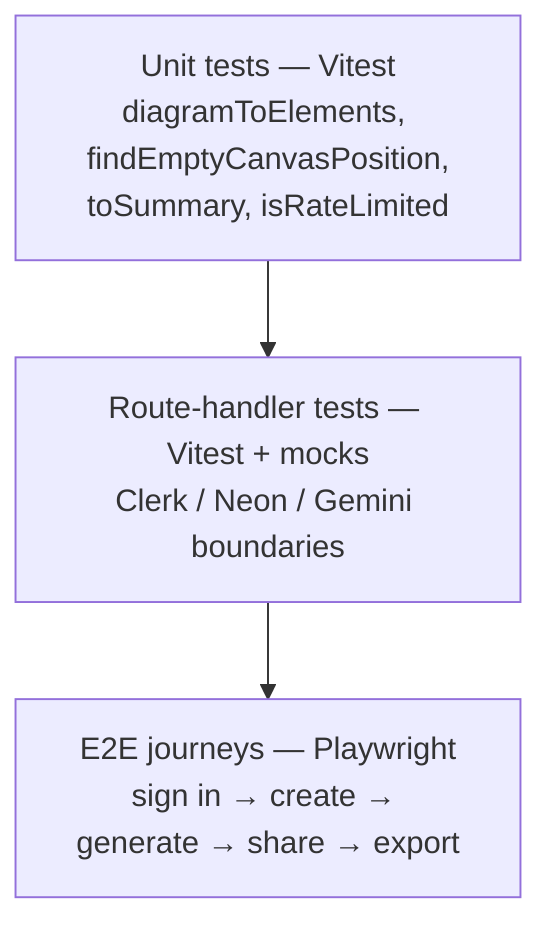

# Chapter 17 — Testing Strategy

**Goal:** You can state exactly what automated verification exists today (almost nothing), explain what should be tested first and why, and describe a proposed test suite without claiming it is already in the repository.

---

## 17.1 Evidence: what exists today

Start with the uncomfortable fact. **There is no automated test suite in this repository.**

- `package.json:5-13` defines scripts for `dev`, `build`, `start`, `lint`, `db:generate`, `db:push`, and `db:studio`. There is no `test`, `test:watch`, or `test:e2e` entry.
- A repository-wide search for `*.test.*` and `*.spec.*` files returns no files. There is no `__tests__` directory.
- There is no `.github/workflows` directory, so no CI pipeline runs lint or build on a pull request.
- `package.json:39-49` (devDependencies) contains no Vitest, Jest, Playwright, Cypress, or testing-library package.
- `eslint.config.mjs:1-18` is the only automated quality gate: ESLint 9 flat config with `nextVitals` and `nextTs`. `npm run build` additionally type-checks through Next.js and `tsconfig.json:7` (`"strict": true`).

Here is the complete script list, verbatim from `package.json:5-13`:

```json
  "scripts": {
    "dev": "next dev",
    "build": "next build",
    "start": "next start",
    "lint": "eslint .",
    "db:generate": "drizzle-kit generate",
    "db:push": "drizzle-kit push",
    "db:studio": "drizzle-kit studio"
  },
```

**Status label:** `[EVIDENCE GAP]` — verification today is **manual** plus lint/build. The file `.planning/codebase/TESTING.md` *recommends* Vitest and Playwright, but its own header says `last_mapped_commit: 16423a0`, and it explicitly says "Not detected (No test runner currently installed)" and "No test files exist in the codebase." Treat that file as a historical audit, not as implemented infrastructure.

Why this matters in an interview: an honest "I have not written tests yet, here is the exact order I would add them" is a stronger answer than an invented coverage percentage.

---

## 17.2 Beginner model: the test pyramid

Think of tests as three layers. The bottom layer is cheap, fast, and numerous; the top layer is slow and expensive but proves the whole product works.



In professional terms: **unit tests** exercise pure functions with no I/O; **integration tests** exercise a route handler with its external boundaries replaced by test doubles; **end-to-end (E2E) tests** drive a real browser against a running app. The pyramid shape is a cost heuristic: a unit test fails in milliseconds and tells you exactly which line broke; an E2E test may fail because of a Clerk redirect, a slow Gemini call, or a flaky canvas render.

Everything from this point on is `[SUGGESTED IMPROVEMENT]`. **None of the code below is in the repository.**

---

## 17.3 Unit tests for pure logic

The highest-value targets are functions that already have no network or DOM dependency.

### `diagramToElements` — `lib/ai-canvas.ts:181-202`

```ts
  const offsetNodes = diagram.nodes.map((n) => ({
    ...n,
    x: n.x + originX,
    y: n.y + originY,
  }));
  const byId = new Map(offsetNodes.map((n) => [n.id, n]));

  const elements: AnyElement[] = [];
  for (const node of offsetNodes) elements.push(...makeNode(node));
  for (const conn of diagram.connections ?? []) {
    const from = byId.get(conn.fromId);
    const to = byId.get(conn.toId);
    if (from && to) elements.push(...makeArrow(from, to, conn.label));
  }

  return elements as unknown as ExcalidrawElement[];
```

**Line-level explanation:** the three-line `map` adds the placement origin to every node; `byId` is a lookup so connections resolve by id; `makeNode` (defined at `lib/ai-canvas.ts:89-100`) appends **two** elements per node (container + bound text); `makeArrow` (`:102-179`) appends an arrow and, when `conn.label` exists, a second text element; dangling connections are silently skipped by `if (from && to)`.

**What to assert:** element count for 2 nodes + 1 unlabelled connection is `5`; with a label it is `6`; the first element's `x`/`y` equals `node.x + originX`, `node.y + originY`; a connection referencing a missing id produces no arrow. Do **not** assert exact `id`, `seed`, or `versionNonce` — `rand()` at `lib/ai-canvas.ts:8` makes those random.

Proposed test (not in repo):

```ts
// PROPOSED — lib/ai-canvas.test.ts (does not exist in repo)
import { describe, it, expect } from "vitest";
import { diagramToElements } from "./ai-canvas";

it("offsets nodes and skips dangling connections", () => {
  const els = diagramToElements({
    title: "t", width: 1200, height: 800,
    nodes: [
      { id: "a", x: 0, y: 0, width: 100, height: 50, label: "A" },
      { id: "b", x: 200, y: 0, width: 100, height: 50, label: "B" },
    ],
    connections: [{ fromId: "a", toId: "b" }],
  }, 10, 20);
  expect(els).toHaveLength(5);
  expect((els[0] as { x: number }).x).toBe(10);
});
```

### `findEmptyCanvasPosition` — `lib/ai-canvas.ts:304-319`

```ts
export function findEmptyCanvasPosition(
  elements: readonly AnyElement[],
): { x: number; y: number } {
  const live = elements.filter((el) => !el.isDeleted);
  if (live.length === 0) return { x: 100, y: 100 };

  let maxRight = -Infinity;
  let minTop = Infinity;
  for (const el of live) {
    const x = Number(el.x ?? 0);
    const y = Number(el.y ?? 0);
    const w = Number(el.width ?? 0);
    maxRight = Math.max(maxRight, x + w);
    minTop = Math.min(minTop, y);
  }
  return { x: maxRight + 150, y: minTop };
}
```

**Line-level explanation:** deleted elements are filtered out; an empty scene gets the fixed seed position `{100, 100}`; otherwise the function scans bounding boxes and returns a point 150px to the right of the rightmost edge, aligned to the topmost edge. It is a placement heuristic, **not** a collision solver.

**What to assert:** empty input → `{x:100,y:100}`; a deleted element at `x:10000` is ignored; elements `{x:10,w:90}` and `{x:50,w:200}` → `x = 250 + 150 = 400`, `y = min top`.

### `toSummary` — `lib/boards.ts:29-41`

```ts
function toSummary(row: SummaryRow): BoardSummary {
  return {
    id: row.id,
    title: row.title,
    thumbnail: row.thumbnail ?? null,
    favorited: row.favorited ?? false,
    archived: row.archivedAt !== null,
    deleted: row.deletedAt !== null,
    trashed: row.deletedAt !== null,
    createdAt: row.createdAt.toISOString(),
    updatedAt: row.updatedAt.toISOString(),
  };
}
```

**What to assert:** `archived`/`deleted`/`trashed` are derived from nullable timestamps; `thumbnail` and `favorited` get safe defaults; dates become ISO strings. This mapper is the contract between the dashboard API and `BoardCard` in `components/dashboard/board-list.tsx:265-371`.

### `isRateLimited` — `app/api/ai/route.ts:31-43`

```ts
function isRateLimited(userId: string): boolean {
  const now = Date.now();
  const timestamps = (aiRateMap.get(userId) ?? []).filter(
    (t) => now - t < AI_RATE_WINDOW_MS,
  );
  if (timestamps.length >= AI_RATE_LIMIT) {
    aiRateMap.set(userId, timestamps);
    return true;
  }
  timestamps.push(now);
  aiRateMap.set(userId, timestamps);
  return false;
}
```

**Status label:** `[EVIDENCE GAP]` — this function is **not exported**, so a true unit test cannot import it today. Two options: (a) test it indirectly through `POST /api/ai` (more realistic), or (b) export it and a `resetRateLimitForTests()` helper as a proposed source change. With fake timers, assert 10 calls return `false`, the 11th returns `true`, timestamps older than `AI_RATE_WINDOW_MS` (60_000 at `:29`) are discarded, and user A's calls do not block user B.

---

## 17.4 API route tests with mocks

Route handlers import three external boundaries: `auth()` from `@clerk/nextjs/server` (`lib/user.ts:1-7`), `getDb()` from `@/db` (`db/index.ts:20-25`), and `GoogleGenAI` (`app/api/ai/route.ts:115`). Integration tests should replace all three, never call real services.

Proposed mocks (not in repo):

```ts
// PROPOSED — test/setup.ts (does not exist in repo)
vi.mock("@clerk/nextjs/server", () => ({
  auth: vi.fn().mockResolvedValue({ userId: "u1" }),
  currentUser: vi.fn().mockResolvedValue(null),
}));
vi.mock("@/db", () => {
  const returning = vi.fn().mockResolvedValue([{ credit: 2 }]);
  const chain = {
    set: vi.fn().mockReturnThis(),
    where: vi.fn().mockReturnThis(),
    returning,
  };
  return { getDb: () => ({ update: () => chain }), schema: { users: {} } };
});
```

**What to assert per route:**

| Route (exact file) | Request | Assertion | Source of the rule |
| --- | --- | --- | --- |
| `app/api/boards/route.ts` POST | mocked balance `0` | `402`, no board inserted | `if (!deducted)` at `:45-53` |
| `app/api/boards/route.ts` POST | mocked balance `1` | `201`, returned `credit: 0`, `UPDATE ... WHERE credit > 0` called | `:39-43` |
| `app/api/boards/[id]/route.ts` PATCH | `{share:"enable"}` | token matches `/^[0-9a-f]{32}$/` | `randomUUID().replace(/-/g, "")` at `:55-57` |
| `app/api/boards/[id]/route.ts` PATCH | `{share:"disable"}` | `shareToken: null` (revocation) | `:58-60` |
| `app/api/boards/[id]/route.ts` PATCH | thumbnail of 2,000,001 chars | thumbnail key absent from update | `<= 2_000_000` at `:48` |
| `app/api/ai/route.ts` POST | 11 rapid calls | `429` on the 11th | `isRateLimited` at `:53-58` |
| `app/api/ai/route.ts` POST | Gemini `text: ""` | `502` **and** a `credit + 1` refund call | `:127-138` |
| `app/api/ai/route.ts` POST | Gemini throws | `500`, best-effort refund invoked | `:157-169` |

Mock the Gemini SDK at the module boundary, not the network: `vi.mock("@google/genai", ...)` with `models.generateContent` returning controlled `text`. This lets you force the empty-response and thrown-error branches deterministically. The prompt/canvas rules are plain data in `lib/ai-tools.ts:67-77` and can be asserted as strings passed into `generateContent`.

**Honest limitation:** mocking Drizzle's fluent chain means the test verifies *call shape*, not real SQL. A second layer of tests against a disposable Postgres database would be needed to prove the atomic `UPDATE ... WHERE credit > 0` actually prevents double-spend. `[SUGGESTED IMPROVEMENT]`

---

## 17.5 End-to-end journeys

One E2E suite should cover the paths a user can actually see. Use Clerk test-mode credentials and intercept `/api/ai` with Playwright's route stubbing so Gemini keys are never needed in CI.

1. **Create → save → reload:** sign in, click **New board** in `components/dashboard/board-list.tsx:91-113`, assert credit badge drops from 3 to 2, draw or inject an element, wait for "Saved" (`components/whiteboard/workspace-header.tsx:125-159`), reload, assert the element persists. Also assert the PATCH body contains `appState: {}` — that is the literal value sent at `components/whiteboard/whiteboard-canvas.tsx:78`.
2. **Generate → insert:** open the AI panel, stub `POST /api/ai` with a two-node diagram, click Generate, assert placeholder ids from `PLACEHOLDER_IDS` (`lib/ai-canvas.ts:204-211`) disappear and new rectangles appear (`assistant-panel.tsx:62-113`).
3. **Share → revoke:** enable share, read the 32-hex token from the PATCH response, open `/share/<token>` in a fresh context, assert "Read-only" header and `viewModeEnabled` (`components/whiteboard/shared-whiteboard.tsx:32-51`), then disable share and assert the old URL returns 404 (`app/share/[token]/page.tsx:18`).

Canvas-heavy assertions are the flakiest part of the suite; keep them to one smoke test and put the detailed geometry checks in the unit layer. `[SUGGESTED IMPROVEMENT]`

---

## 17.6 Priority, CI, and interview-safe wording

| Priority | Test target | Type | Risk it retires | Effort |
| --- | --- | --- | --- | --- |
| P0 | `diagramToElements`, `findEmptyCanvasPosition` | Unit | Broken AI scenes silently inserted | S |
| P0 | Credit debit/refund branches in `app/api/ai/route.ts` | Integration | Users charged for failures | M |
| P0 | Ownership filter in `getBoard(userId, id)` (`lib/boards.ts:74-90`) | Integration | Cross-user board access | M |
| P1 | `toSummary`, share-token generation/revocation | Unit + integration | Dashboard contract drift | S |
| P1 | Create → autosave → share → revoke smoke | E2E | Broken browser wiring | L |
| P2 | Geometry collision invariants, rate-limit window expiry | Unit | Layout regressions, limiter drift | M |
| P2 | Real Postgres integration tests | Integration | Mocked-chain false confidence | L |

A proposed CI pipeline (not present in this repo) would run `npm ci`, `npm run lint`, `npm run build`, `npx vitest run`, and `npx playwright test` on every pull request. Today `npm run lint` and `npm run build` are the only repeatable checks available locally.

**Interview-safe wording:** *"There is no automated test suite in this project yet — the repo has no test script and no test files. My current verification is manual plus `npm run lint` and `npm run build`. If I were extending it, I'd start with unit tests for the pure AI-to-canvas converter and the DTO mappers, then route-handler tests with Clerk/Neon/Gemini mocked, and finally a small Playwright smoke journey. I would not claim coverage I don't have."* This answer is honest, specific, and demonstrates you know where the risk lives. Related discussion: Chapter 16 — Error Handling and Validation and Chapter 21 — Technical Limitations and Future Enhancements.

---

## 17.7 Revision summary

- `[EVIDENCE GAP]` No `test` script in `package.json:5-13`, no test/spec files, no CI workflows, no test runner in devDependencies.
- Today's only automated gates are `npm run lint` (ESLint 9 config) and `npm run build` (strict TypeScript via `tsconfig.json:7`).
- `[SUGGESTED IMPROVEMENT]` Unit-test `diagramToElements`, `findEmptyCanvasPosition`, `toSummary`, and `isRateLimited` — the last one needs exporting or route-level testing.
- `[SUGGESTED IMPROVEMENT]` Integration-test route handlers with Clerk auth, the Neon `getDb()` chain, and the Gemini SDK mocked at module boundaries.
- `[SUGGESTED IMPROVEMENT]` E2E: create → autosave (assert `appState: {}`) → generate with a stubbed AI response → share → revoke → 404.
- Prioritise atomic credit debit/refund branches and ownership filtering before cosmetic coverage; mocks prove call shape, not real SQL semantics.
- Interview answer: admit no tests exist, name the exact files you would test, and never quote an invented coverage number.

## 17.8 Knowledge checks

1. Which three package-level facts prove that no automated test suite exists, and where are they in the repository?
2. Why should `diagramToElements` assertions check element *counts* and offsets but not `seed` or `id` values?
3. What prevents `isRateLimited` from being unit-tested directly today, and what are the two proposed workarounds?
4. Which two branches of `app/api/ai/route.ts` must assert a `credit + 1` refund, and what status code does each return?
5. Why is a mocked Drizzle chain insufficient to prove the atomic credit decrement works?

## 17.9 Practical exercises

1. **Evidence audit:** Open `package.json`, `eslint.config.mjs`, and the repository file tree. Write a five-line report listing the exact verification commands available today and the two categories of checks that are completely absent.
2. **Test design:** Write (do not run) a proposed Vitest file for `findEmptyCanvasPosition` with three cases: empty scene, deleted outlier element, and two overlapping elements. For each case, state the expected `{x, y}` and cite the source lines that justify it.
3. **Interview rehearsal:** Record a 45-second answer to "What is your testing strategy?" that includes the words "no automated tests yet", names two real files worth testing, and ends with a proposed CI command list.

## 17.10 Interview questions

1. How do you currently verify that a Gemini failure refunds the credit, given there are no tests?
2. Which function in `lib/ai-canvas.ts` would you test first, and what invariant makes it worth testing?
3. How would you test `POST /api/ai` without a real Gemini API key or a real database?
4. What would you assert in an E2E test of the share-link revoke flow, and which file implements the 404 behaviour?
5. If you added Vitest tomorrow, what would you *not* claim until you had measured it?
