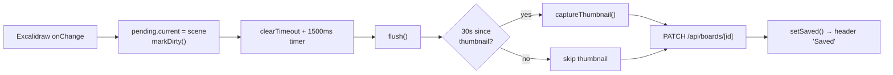

# Chapter 18 — Performance and Optimization

**Goal:** You can separate the performance work that is actually in the source from the caching, indexing, pagination, and observability work that is still missing, and explain each tradeoff without exaggerating.

---

## 18.1 Beginner framing: what "fast" meant here

For a canvas app, performance is not one number. It is four different costs:

1. **Bytes over the wire** — how much data the dashboard downloads.
2. **Main-thread work** — how long the browser spends rendering and encoding images.
3. **Request frequency** — how often autosave calls the API.
4. **Startup cost** — how much JavaScript must load before the canvas appears.

The code makes deliberate choices in all four areas. In professional terms these are **payload projection**, **throttling/debouncing**, **code splitting**, and **connection reuse**. What it does *not* have is a caching layer, pagination, secondary indexes, an image CDN, bundle analysis, or monitoring. `[EVIDENCE GAP]`

---

## 18.2 The save path: debounce + throttle + guard

The most important performance mechanism is in `components/whiteboard/whiteboard-canvas.tsx`.

```ts
const AUTOSAVE_DELAY = 1500;
const THUMBNAIL_THROTTLE_MS = 30_000;
```
(`components/whiteboard/whiteboard-canvas.tsx:10-11`)

`handleChange` (`:71-86`) stores the latest scene in `pending.current`, marks the store dirty, clears the previous timer, and schedules `flush()` 1500ms later. That is **debouncing**: a burst of drawing produces one API call, not one per mouse move. `flush()` (`:35-69`) decides whether to capture a thumbnail:

```ts
      const now = Date.now();
      const shouldCaptureThumbnail =
        currentApi &&
        (forceThumbnail ||
          lastThumbnailTime.current === 0 ||
          now - lastThumbnailTime.current > THUMBNAIL_THROTTLE_MS);

      let thumbnail: string | null | undefined = undefined;
      if (shouldCaptureThumbnail && currentApi) {
        thumbnail = await captureThumbnail(currentApi);
        lastThumbnailTime.current = now;
      }
```
(`components/whiteboard/whiteboard-canvas.tsx:42-53`)

**Line-level explanation:** the first save (`lastThumbnailTime.current === 0`) always captures; after that, captures are at most once per 30 seconds unless `forceThumbnail` is passed. The unmount cleanup at `:88-93` calls `void flush(true)`, so leaving the page forces a final preview. `beforeunload` is wired in `components/whiteboard/workspace.tsx:42-50` only while `dirty` is true.



### Thumbnail size controls

`captureThumbnail` in `lib/export.ts:137-169` renders a PNG at quality `0.7` and caps the long edge:

```ts
      quality: 0.7,
      exportPadding: 16,
      getDimensions: (width: number, height: number) => {
        const max = 400;
        const scale = Math.min(max / width, max / height, 1);
        return {
          width: Math.round(width * scale),
          height: Math.round(height * scale),
          scale,
        };
      },
```
(`lib/export.ts:154-165`)

The server adds a second ceiling in `PATCH /api/boards/[id]`:

```ts
    if (typeof body.thumbnail === "string") {
      // 2MB ceiling on base64 thumbnail to protect database storage
      if (body.thumbnail.length <= 2_000_000) {
        update.thumbnail = body.thumbnail;
      }
    } else if (body.thumbnail === null) {
      update.thumbnail = null;
    }
```
(`app/api/boards/[id]/route.ts:46-53`)

**Tradeoffs to say out loud:** the 400px cap keeps previews small but makes large boards look soft; the 2MB guard **silently drops** an oversized thumbnail with no error to the client; the 30s throttle means the dashboard preview can be up to half a minute stale. `[IMPLEMENTED]` with those costs.

---

## 18.3 Payload projection on the dashboard

`lib/boards.ts:5-16` selects an explicit column set instead of `SELECT *`:

```ts
// Select only the columns dashboard needs — avoids transferring potentially
// megabytes of base64 thumbnail data per page load.
const summaryColumns = {
  id: schema.whiteboards.id,
  title: schema.whiteboards.title,
  thumbnail: schema.whiteboards.thumbnail,
  favorited: schema.whiteboards.favorited,
  deletedAt: schema.whiteboards.deletedAt,
  archivedAt: schema.whiteboards.archivedAt,
  createdAt: schema.whiteboards.createdAt,
  updatedAt: schema.whiteboards.updatedAt,
};
```

`listBoards` uses it at `lib/boards.ts:57-63` with `.select(summaryColumns)...orderBy(desc(...updatedAt))`, then maps rows through `toSummary` (`:29-41`).

**Important honesty note `[PARTIAL]`:** the comment says the select avoids transferring megabytes of thumbnails, but `thumbnail` **is still one of the selected columns** (`:10`). What is avoided is the full `elements`, `appState`, `files`, `shareToken`, and `userId` JSONB payload; thumbnail bytes are reduced by the 400px/2MB caps, not eliminated. Do not claim "no thumbnails are downloaded" — `BoardCard` renders `` at `components/dashboard/board-list.tsx:339-345`, so they must be.

Search and favorites are also client-side: `filteredBoards` uses `useMemo` at `components/dashboard/board-list.tsx:133-142`. That is cheap for small lists but does not scale — see §18.6.

---

## 18.4 Startup cost: dynamic imports and singletons

Excalidraw is never server-rendered. `components/whiteboard/excalidraw-wrapper.tsx:8-25`:

```ts
export const Excalidraw = dynamic(
  () =>
    import("@excalidraw/excalidraw").then((mod) => {
      const Comp = mod.Excalidraw as unknown as React.ComponentType<
        ExcalidrawProps
      >;
      return { default: Comp };
    }),
  {
    ssr: false,
    loading: () => (
      <div className="flex h-full w-full items-center justify-center gap-2 text-sm text-muted-foreground">
        <Loader2 className="size-4 animate-spin" />
        Loading canvas…
      </div>
    ),
  },
);
```

The public share view repeats the pattern at `components/whiteboard/shared-whiteboard.tsx:8-11`. PDF generation is split out too: `lib/export.ts:110` uses `const { jsPDF } = await import("jspdf");` only when the user clicks PDF (`components/whiteboard/workspace-header.tsx:56-57`). **Why:** Excalidraw and jsPDF are large and browser-only; keeping them out of the initial bundle makes the landing page and dashboard load less JavaScript. The tradeoff is a visible "Loading canvas…" state and a delay on first PDF export. `[IMPLEMENTED]`

Database setup is cached in `db/index.ts:18-25`:

```ts
let cached: Database | null = null;

export function getDb(): Database {
  if (!cached) {
    cached = createDatabase();
  }
  return cached;
}
```

`neon(url)` + `drizzle(...)` is constructed once per server process instead of on every request. `[IMPLEMENTED]` In a serverless model each warm instance keeps its own singleton; cold starts still pay the construction cost.

Animation cleanup matters for long sessions. `components/landing/landing-motion.tsx:327-337` removes listeners, the GSAP ticker callback, Lenis, the GSAP context, and all ScrollTriggers:

```ts
      return () => {
        window.removeEventListener("load", refresh);
        window.clearTimeout(t);
        menuBtn?.removeEventListener("click", onOpen);
        menuClose?.removeEventListener("click", onClose);
        lenis.off("scroll", onScroll);
        gsap.ticker.remove(raf);
        lenis.destroy();
        ctx.revert();
        ScrollTrigger.getAll().forEach((s) => s.kill());
      };
```

Without this, route changes would leave extra RAF loops and scroll listeners running. `[IMPLEMENTED]`

Finally, user provisioning is lazy: `getDbUserOrUpsert` (`lib/user.ts:56-60`) reads first and only inserts when absent, while `AppProvider` (`app/provider.tsx:19-28`) kicks off `POST /api/user` after sign-in so the credit badge fills in without blocking render:

```ts
export async function getDbUserOrUpsert(): Promise<User> {
  const existing = await getDbUser();
  if (existing) return existing;
  return upsertDbUser();
}
```
(`lib/user.ts:56-60`) `[IMPLEMENTED]`

---

## 18.5 Before / after table

The left column is a **teaching counterfactual** — a naive version that is *not* in this repository. The right column is what the current source actually does.

| Concern | Naive approach (not in repo) | Current source | Evidence |
| --- | --- | --- | --- |
| Thumbnail capture | Every `onChange` tick | Debounce 1500ms + throttle 30s + forced flush on unmount | `whiteboard-canvas.tsx:10-11,42-53,88-93` |
| Thumbnail bytes | Full-resolution PNG data URL | 400px long edge, quality 0.7, 2MB server cap | `lib/export.ts:154-165`; `api/boards/[id]/route.ts:46-53` |
| Dashboard payload | `select()` all columns | `summaryColumns` projection (thumbnail still included) | `lib/boards.ts:5-16,57-63` |
| Canvas JS | Static import, SSR attempted | `next/dynamic`, `ssr: false`, loading spinner | `excalidraw-wrapper.tsx:8-25` |
| PDF JS | Top-level `import { jsPDF }` | `await import("jspdf")` on click | `lib/export.ts:110` |
| DB client | New `neon()` per request | Module-level cached `getDb()` | `db/index.ts:18-25` |
| Motion listeners | No cleanup | Full teardown on unmount | `landing-motion.tsx:327-337` |

---

## 18.6 What is not implemented

| Missing capability | Concrete evidence | Consequence |
| --- | --- | --- |
| Caching layer | `package.json:14-50` has no Redis/Upstash; `aiRateMap` is a plain `Map` at `app/api/ai/route.ts:25-29` | Rate limit resets on restart and is per-instance |
| Pagination | `listBoards` at `lib/boards.ts:57-63` has no `.limit()`/offset; `filteredBoards` slices nothing at `board-list.tsx:133-142` | Every board is fetched and filtered in the browser |
| Indexes on `updatedAt` / `userId` | `db/schema.ts:1-43` imports no `index` and calls none; only primary key, `email` unique, `shareToken` unique, FK cascade | `WHERE user_id = ? ORDER BY updated_at DESC` has no supporting index |
| Image CDN | `thumbnail` is a `text` column at `db/schema.ts:32`; `captureThumbnail` returns `blobToDataUrl(...)` at `lib/export.ts:166` | Base64 lives inside Postgres and is re-sent on every dashboard load |
| Bundle analysis | No `@next/bundle-analyzer`, no `analyze` script in `package.json` | No measured JS budget; claims about bundle size would be guesses |
| Monitoring / APM | No Sentry/analytics dependency; failures use `console.error`, e.g. `app/api/ai/route.ts:165` and `app/api/boards/route.ts:21` | No latency percentiles, error rates, or alerting |

All of the above are `[EVIDENCE GAP]` in the sense that they are absent, not partially built. `[SUGGESTED IMPROVEMENT]` would be: add `index("whiteboards_user_updated_idx").on(table.userId, table.updatedAt)` in `db/schema.ts`; add `limit`/cursor args to `listBoards`; move thumbnails to object storage and store a URL; add `@next/bundle-analyzer` and a size budget; add structured logging with request IDs and a real error tracker. Related reading: Chapter 11 — Database and Chapter 21 — Technical Limitations and Future Enhancements.

---

## 18.7 Revision summary

- `[IMPLEMENTED]` Autosave is debounced 1500ms and thumbnails are throttled to one per 30s in `components/whiteboard/whiteboard-canvas.tsx:10-11,42-53`.
- `[IMPLEMENTED]` Thumbnails are capped at 400px (`lib/export.ts:154-165`) and 2MB (`app/api/boards/[id]/route.ts:46-53`); oversized values are silently ignored.
- `[PARTIAL]` `summaryColumns` avoids heavy scene JSONB, but still selects the base64 `thumbnail` column (`lib/boards.ts:5-16`).
- `[IMPLEMENTED]` Excalidraw and jsPDF are dynamically imported; the DB client is cached; GSAP/Lenis listeners are torn down; user upsert is lazy.
- `[EVIDENCE GAP]` No caching layer, pagination, `updatedAt`/`userId` indexes, image CDN, bundle analysis, or monitoring exists.
- The main tradeoffs: stale previews for up to 30s, soft image previews, loading spinners, and last-write-wins saves.
- Never quote measured performance numbers — there is no bundle analyzer or APM in the repository.

## 18.8 Knowledge checks

1. What are the two constants at `whiteboard-canvas.tsx:10-11`, and which one limits API call frequency versus image encoding frequency?
2. Why does `captureThumbnail` compute `scale = Math.min(max / width, max / height, 1)` instead of upscaling small boards?
3. Which heavy fields does `summaryColumns` avoid, and which heavy field does it still include?
4. Name two places using dynamic imports and explain the user-visible cost of each.
5. Which missing database feature would most directly help `listBoards`'s `WHERE user_id = ? ORDER BY updated_at DESC` query?

## 18.9 Practical exercises

1. **Trace the throttle:** Draw a timeline of ten canvas changes over 10 seconds. Mark when `flush()` runs and on which ticks a thumbnail is captured, using only `whiteboard-canvas.tsx:10-11,35-93` as evidence.
2. **Payload estimate:** Using `lib/boards.ts:5-16` and `db/schema.ts:20-43`, list every column a `SELECT *` would return that `summaryColumns` does not, and explain why each omitted column is or is not needed by `BoardCard`.
3. **Proposal write-up:** Write a one-page improvement plan for adding `userId + updatedAt` indexing and pagination. Name the exact files to change and one regression risk for each.

## 18.10 Interview questions

1. How does the app avoid hammering the API while someone draws continuously?
2. Why is the dashboard thumbnail still in the list query, and what would you do about it?
3. What are the downsides of the 30-second thumbnail throttle and the 2MB guard?
4. How would you prove that dynamic imports improved first load without guessing?
5. Why does an in-memory rate limiter stop working when you run two server instances?
