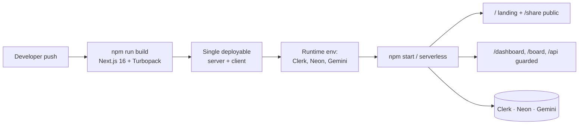

# Chapter 19 — Deployment and DevOps

**Goal:** You can describe exactly what the repository provides for deployment today, explain why the existing Next.js 16 setup is Vercel-friendly, and propose CI, migrations, health checks, rollback, and observability without pretending any of them already exist.

---

## 19.1 Beginner view: what "deploying" means for this app

This project is a **single full-stack application**, not a frontend plus a separate backend. Next.js renders server components, runs the five route handlers, and serves the client bundles from one deployment. The only external systems are Clerk (identity), Neon Postgres (data), and Gemini (generation).

To get it running you need three things: the code built (`npm run build`), the environment variables supplied, and the database schema pushed. That is essentially the whole deployment story in the current repository. Everything after §19.4 is a proposal. `[EVIDENCE GAP]`

---

## 19.2 Evidence: scripts, config, and files that exist

### Scripts — `package.json:5-13`

```json
  "scripts": {
    "dev": "next dev",
    "build": "next build",
    "start": "next start",
    "lint": "eslint .",
    "db:generate": "drizzle-kit generate",
    "db:push": "drizzle-kit push",
    "db:studio": "drizzle-kit studio"
  },
```

`dev` runs Turbopack development; `build` produces the production artifact; `start` serves it; `lint` is the only quality script. There is **no** `test`, `db:migrate`, `analyze`, `deploy`, or `typecheck` script. Note that `README.md:66-71` instructs readers to run `npm run db:migrate`, but that script does not exist in `package.json`. `[EVIDENCE GAP]`

### Framework and headers — `next.config.ts:3-24`

```ts
const securityHeaders = [
  { key: "X-Content-Type-Options", value: "nosniff" },
  { key: "X-Frame-Options", value: "DENY" },
  { key: "Referrer-Policy", value: "strict-origin-when-cross-origin" },
  { key: "Permissions-Policy", value: "camera=(), microphone=(), geolocation=()" },
];

const nextConfig: NextConfig = {
  experimental: {
    agentUpgrade: "security",
  },
  turbopack: {
    rules: {
      "*.css": {
        loaders: ["@tailwindcss/turbopack"],
        as: "*.css",
      },
    },
  },
  async headers() {
    return [{ source: "/(.*)", headers: securityHeaders }];
  },
};
```

The `/(.*)` source applies the four headers to **every** route. `X-Frame-Options: DENY` is worth noting because Excalidraw is embedded in the same app, not in an iframe. `[IMPLEMENTED]`

### Middleware and crawl policy

`proxy.ts:1-10` exports `clerkMiddleware()` and a matcher that excludes `_next` and static file extensions while including `/api` and `/trpc`. In Next.js 16 this file replaces `middleware.ts` (also noted in `README.md:108`). `public/robots.txt:1-7`:

```txt
User-agent: *
Allow: /
Disallow: /api/
Disallow: /dashboard
Disallow: /board/
Disallow: /sign-in
Disallow: /sign-up
```

Observation, not a claim of intent: `/share/` is **not** disallowed, so public share URLs are crawlable. `[EVIDENCE GAP]` — no document explains whether that is deliberate.

### Environment contract

`.env.example:1-12` lists `NEXT_PUBLIC_CLERK_PUBLISHABLE_KEY`, `CLERK_SECRET_KEY`, `NEXT_PUBLIC_CLERK_SIGN_IN_URL`, `NEXT_PUBLIC_CLERK_SIGN_UP_URL`, `DATABASE_URL`, `GEMINI_API_KEY`, and `GEMINI_MODEL`. `README.md:43-50` additionally documents `NEXT_PUBLIC_APP_URL`, which the root layout uses for `metadataBase` at `app/layout.tsx:24-27`. That variable is missing from `.env.example`. `[EVIDENCE GAP]`

Configuration fails loudly at runtime when the database is absent — `db/index.ts:7-13`:

```ts
function createDatabase() {
  const url = process.env.DATABASE_URL;
  if (!url) {
    throw new Error(
      "DATABASE_URL is not set. Add it to .env.local (see .env.example).",
    );
  }
```

`app/api/ai/route.ts:81-87` similarly returns `503` when `GEMINI_API_KEY` is missing. `[IMPLEMENTED]`

### Drizzle config

`drizzle.config.ts:4-14` loads `.env.local` via dotenv and points at `./drizzle` as migration output:

```ts
loadEnv({ path: ".env.local" });

export default defineConfig({
  schema: "./db/schema.ts",
  out: "./drizzle",
  dialect: "postgresql",
  dbCredentials: {
    url: process.env.DATABASE_URL ?? "postgresql://localhost:5432/placeholder",
  },
  strict: true,
  verbose: true,
});
```

There is **no** `drizzle/` directory with committed migration SQL. Setup relies on `npm run db:push`. `[EVIDENCE GAP]`

### What is absent

A repository-wide check finds no `vercel.json`, no `.github/workflows`, no `Dockerfile`, no `LICENSE` file, and no monitoring/analytics package. `README.md:113-115` says "License: MIT", but no license text is committed. `[EVIDENCE GAP]`

---

## 19.3 Why the current setup is deployment-friendly



**Why one artifact helps:** there is no API base URL to configure, no CORS setup, and no separate scaling policy for the backend. Server components read cookies through Clerk and query Neon directly on the server; client components call same-origin `/api/*` paths.

**Why Neon serverless helps:** `db/index.ts:14-15` uses `neon(url)` with the `drizzle-orm/neon-http` driver (`:2`). HTTP-based Postgres avoids holding persistent sockets open in short-lived serverless functions.

**Why the env split matters (professional terminology):** variables prefixed `NEXT_PUBLIC_` are inlined into the client bundle **at build time**; secret variables like `CLERK_SECRET_KEY`, `DATABASE_URL`, and `GEMINI_API_KEY` must stay server-only and be present at runtime. Rotating a publishable key or `NEXT_PUBLIC_APP_URL` therefore requires a rebuild, while rotating a secret key does not. `[IMPLEMENTED]` structure; `[SUGGESTED IMPROVEMENT]` documented procedure.

---

## 19.4 Environment management today vs. proposed

| Variable | Used in | Prefix / visibility | Set when |
| --- | --- | --- | --- |
| `NEXT_PUBLIC_CLERK_PUBLISHABLE_KEY` | `app/layout.tsx` `ClerkProvider` | Public, build-time | Build |
| `CLERK_SECRET_KEY` | Clerk server SDK, `proxy.ts`, `lib/user.ts` | Secret, runtime | Deploy/runtime |
| `DATABASE_URL` | `db/index.ts:8` | Secret, runtime | Runtime |
| `GEMINI_API_KEY` | `app/api/ai/route.ts:81,115` | Secret, runtime | Runtime |
| `GEMINI_MODEL` | `app/api/ai/route.ts:22` (defaults to `gemini-2.5-flash`) | Server runtime | Runtime |
| `NEXT_PUBLIC_APP_URL` | `app/layout.tsx:25-27` metadata base | Public, build-time; missing from `.env.example` | Build |

`[SUGGESTED IMPROVEMENT]` — keep separate value sets for development, preview, and production; never reuse a production Neon URL in preview; rotate the Clerk keys noted in `README.md:111` if they were previously exposed; add `NEXT_PUBLIC_APP_URL` to `.env.example`.

---

## 19.5 Proposed CI pipeline

`[SUGGESTED IMPROVEMENT]` — the following workflow **does not exist** in the repository. It is an example of what would close the gap described in Chapter 17 — Testing Strategy.

```yaml
# PROPOSED — .github/workflows/ci.yml (does not exist in repo)
name: ci
on: [push, pull_request]
jobs:
  verify:
    runs-on: ubuntu-latest
    steps:
      - uses: actions/checkout@v4
      - uses: actions/setup-node@v4
        with: { node-version: 20, cache: npm }
      - run: npm ci
      - run: npm run lint
      - run: npm run build
      - run: npx vitest run
      - run: npx playwright test
```

Two caveats: `npx vitest run` and `npx playwright test` would fail today because those packages are not installed (see `package.json:39-49`); and `npm run build` may need placeholder public Clerk values in CI because `ClerkProvider` is in the root layout (`app/layout.tsx:42`). The pipeline should be introduced incrementally: lint + build first, then tests as they are written.

---

## 19.6 Database migration strategy

`db:push` (`drizzle-kit push`) compares `db/schema.ts` to the live database and applies changes directly. It is convenient for a solo project with no committed migration history — which is the current state. `db:generate` writes SQL files into `./drizzle` per `drizzle.config.ts:8`; those files can be reviewed, versioned, and applied reproducibly. `[IMPLEMENTED]` scripts; `[SUGGESTED IMPROVEMENT]` process.

| Step | Current repo | Proposed production flow |
| --- | --- | --- |
| Change schema | Edit `db/schema.ts` | Edit `db/schema.ts` |
| Generate SQL | `npm run db:generate` (manual) | CI checks that generated SQL is committed |
| Apply | `npm run db:push` per `README.md:60-64` | `drizzle-kit migrate` in a release step; add `db:migrate` script |
| Rollback | None | Require backward-compatible migrations (expand → migrate → contract) |

A concrete inconsistency to fix: `README.md:69-70` tells users to run `npm run db:migrate`, but no such script is defined. Either add `"db:migrate": "drizzle-kit migrate"` or remove that instruction.

---

## 19.7 Health checks, rollback, observability

**Health check `[SUGGESTED IMPROVEMENT]`.** There is no `/api/health` route today — the API tree contains only `user`, `ai`, `boards`, `boards/[id]`, and `boards/[id]/action`. A minimal proposed check would verify env presence and a trivial DB query:

```ts
// PROPOSED — app/api/health/route.ts (does not exist in repo)
import { NextResponse } from "next/server";
import { getDb } from "@/db";

export async function GET() {
  try {
    if (!process.env.DATABASE_URL) throw new Error("DATABASE_URL missing");
    await getDb().execute({ sql: "select 1" } as never);
    return NextResponse.json({ ok: true });
  } catch {
    return NextResponse.json({ ok: false }, { status: 503 });
  }
}
```

Do not expose Gemini or Clerk secrets in that response. `public/robots.txt` would also need a `Disallow: /api/health` line if the endpoint is added.

**Rollback `[SUGGESTED IMPROVEMENT]`.** A platform such as Vercel can roll back an application deployment to a previous build, but that does not reverse a database schema change. Because no migrations are committed today, the practical rollback is "redeploy the previous artifact and re-run the matching `db:push`". A mature flow would commit migrations and only ship additive changes first. No automated rollback exists.

**Observability `[EVIDENCE GAP]`.** Runtime diagnostics are `console.error` calls, e.g. `app/api/ai/route.ts:165`, `app/api/boards/route.ts:21`, and `app/api/user/route.ts:12`. There is no request ID, no structured log schema, no error tracker, and no latency metric. `[SUGGESTED IMPROVEMENT]` add a request-id middleware wrapper, structured JSON logs with route/status/duration, and an error-reporting SDK; instrument `POST /api/ai` around the Gemini call at `app/api/ai/route.ts:115-125` to measure generation latency honestly.

---

## 19.8 Revision summary

- `[IMPLEMENTED]` `package.json:5-13` provides `dev`, `build`, `start`, `lint`, `db:generate`, `db:push`, `db:studio`; there is no test, deploy, or `db:migrate` script.
- `[IMPLEMENTED]` Next.js 16.4.6 with Turbopack, `proxy.ts` Clerk middleware, and `next.config.ts` security headers applies to every route.
- `[IMPLEMENTED]` Neon HTTP via `drizzle-orm/neon-http` suits serverless; public vs secret env vars have different build/runtime timing.
- `[EVIDENCE GAP]` No `vercel.json`, CI workflow, LICENSE, committed migrations, health endpoint, or monitoring exists; `robots.txt` does not disallow `/share/`.
- `[EVIDENCE GAP]` `NEXT_PUBLIC_APP_URL` is documented in `README.md` and used in `app/layout.tsx:25-27` but missing from `.env.example`; `README.md` references a non-existent `db:migrate` script.
- `[SUGGESTED IMPROVEMENT]` CI should add lint/build first, then tests; production schema changes should use committed SQL migrations with backward-compatible steps.
- `[SUGGESTED IMPROVEMENT]` Add `/api/health`, structured logs with request IDs, Gemini latency instrumentation, and a documented rollback procedure.

## 19.9 Knowledge checks

1. Which three deployment-related scripts are missing from `package.json`, and which README lines reference one of them?
2. Why do `NEXT_PUBLIC_*` variables require a rebuild while `CLERK_SECRET_KEY` does not?
3. What does `next.config.ts` apply to `/(.*)`, and why is that scope broader than just `/api`?
4. What is the practical difference between `db:push` and `db:generate` in this repository?
5. Name two specific pieces of evidence that no monitoring exists and describe the first signal you would add.

## 19.10 Practical exercises

1. **Env audit:** Compare `.env.example:1-12` with `README.md:43-50` and `app/layout.tsx:24-27`. Produce a corrected `.env.example` list with a comment marking which values are build-time public and which are runtime secrets.
2. **Pipeline design:** Write the proposed `ci.yml` from §19.5, then annotate each step with the exact local command it mirrors and the reason it should run before deployment.
3. **Rollback scenario:** Describe what happens if a deploy adds a required column via `db:push` and then the application artifact is rolled back. Write the migration rule that would have prevented the incident.

## 19.11 Interview questions

1. Walk me through the exact steps you would take to deploy this repository to a Vercel-style platform.
2. How do you keep Clerk and Gemini secrets out of the client bundle?
3. Why is the in-memory rate limiter a deployment concern rather than only a code concern?
4. What is the difference between rolling back the app and rolling back the database here?
5. Which observability signal would you add first, and which file would you instrument?
