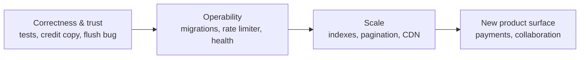

# Chapter 21 — Technical Limitations and Future Enhancements

**Goal:** You can give an honest, source-grounded inventory of what this project does not do, separate "missing" from "partly built", and propose a prioritised roadmap naming the exact files each change would touch.

---

## 21.1 Beginner framing: limitation vs. tradeoff vs. gap

Three words get confused:

- A **tradeoff** is a deliberate choice with a cost (400px thumbnails save bytes but look soft).
- A **limitation** is a capability the app does not have (no multiplayer).
- An **evidence gap** is something we cannot verify from the repository (no deployment history, no performance measurements).

This chapter labels every item `[IMPLEMENTED]`, `[PARTIAL]`, `[SUGGESTED IMPROVEMENT]`, or `[EVIDENCE GAP]`. "No X" claims were checked against `package.json`, the file tree, and the relevant modules — not assumed.

---

## 21.2 Catalogue of current limitations

### 1. No realtime collaboration; last-write-wins

`[IMPLEMENTED]` single-user autosave; `[PARTIAL]` durability under concurrent editors.

`package.json:14-38` has no WebSocket, Yjs, Liveblocks, or CRDT dependency. Every edit becomes a full-scene PATCH in `components/whiteboard/whiteboard-canvas.tsx:55-64`; the server overwrites `elements`, `appState`, and `files` in `app/api/boards/[id]/route.ts:41-45`. Two tabs editing the same board will overwrite each other — the last PATCH wins. This is a design limitation, not a bug in the code.

### 2. `appState` is not persisted on save

`[IMPLEMENTED]` behaviour; `[PARTIAL]` persistence.

`components/whiteboard/whiteboard-canvas.tsx:71-78` explicitly discards the incoming app state:

```ts
      void appState;
      pending.current = { elements, appState: {}, files };
```

The PATCH therefore sends `appState: {}` at `:60`. On load, `initialData` does spread `board.appState` (`:117-125`), and `lib/boards.ts:113` maps the stored column, but every autosave replaces it with an empty object. View background, grid, and zoom selections do not round-trip. A safe fix must strip ephemeral keys (collaborators, selected element ids) rather than blindly storing the whole object — `handleApi` already injects `collaborators: new Map()` at `:121`.

### 3. Share links have no expiry or password

`[IMPLEMENTED]` revocable token; `[PARTIAL]` access control.

`db/schema.ts:33` has only `shareToken: text("share_token").unique()`. There is no `shareExpiresAt`, no password hash, no per-recipient token. `patch` enables/disables with `randomUUID().replace(/-/g, "")` and nulling at `app/api/boards/[id]/route.ts:55-60`; `app/share/[token]/page.tsx:18` only rejects missing or deleted boards. Anyone holding the 32-hex URL keeps access until the owner disables sharing. The stale `.planning/codebase/CONCERNS.md:37-42` records the same gap; revocation exists, expiry does not.

### 4. In-memory rate limit resets on restart and fails multi-instance

`[IMPLEMENTED]` limiter; `[PARTIAL]` correctness across deployments.

`app/api/ai/route.ts:25-29` declares:

```ts
// ponytail: simple in-memory sliding-window rate limiter per userId.
// Ceiling: resets on deploy / restart. Upgrade to Redis if running multi-instance.
const aiRateMap = new Map<string, number[]>();
const AI_RATE_LIMIT = 10; // requests
const AI_RATE_WINDOW_MS = 60_000; // per minute
```

The code itself documents the limitation. Two serverless instances keep two maps, so a user gets 10 requests per instance; a redeploy resets the window. Note also that the limiter is **not** a billing control — credits are the real gate (`:89-103`).

### 5. No payments or top-ups

`[EVIDENCE GAP]` — no billing exists.

`lib/pricing.ts:15-75` defines `PLANS` and `CREDIT_PACKS` as display data only. `package.json` has no Stripe dependency, and there is no webhook route under `app/api/`. Credits are seeded by `db/schema.ts:14` (`credit: integer("credit").notNull().default(3)`) and never replenished by any code path. Once exhausted, both `POST /api/boards` (`402` at `app/api/boards/route.ts:45-53`) and `POST /api/ai` (`402` at `app/api/ai/route.ts:98-103`) block the user.

### 6. Marketing copy conflicts with credit spending

`[EVIDENCE GAP]` — inconsistent product rule.

`app/page.tsx:115` says "3 AI generations a month", `:170` says "One credit is one AI-generated scene", and `lib/pricing.ts:26` repeats the 3-generation claim. But `db/schema.ts:14` seeds one shared pool of 3 credits, and **board creation also subtracts one** (`app/api/boards/route.ts:38-43`). A user who creates three boards has zero credits left for AI. Either the copy or the billing rule must change; this needs a product decision, not a code guess.

### 7. No automated tests, CI, or monitoring

`[EVIDENCE GAP]` — verified absence.

`package.json:5-13` has no test script; no `*.test.*`/`*.spec.*` files exist; `.github/workflows` is absent; no Sentry/analytics dependency is installed. Diagnostics are `console.error` calls such as `app/api/ai/route.ts:165`. This is covered in detail in Chapter 17 — Testing Strategy and Chapter 19 — Deployment and DevOps. It is the single biggest credibility gap in an otherwise carefully engineered codebase.

### 8. No committed migrations

`[EVIDENCE GAP]` — tooling configured, output missing.

`drizzle.config.ts:8` sets `out: "./drizzle"`, but no `drizzle/` directory exists. Setup relies on `npm run db:push` (`README.md:60-64`). `README.md:69-70` references `npm run db:migrate`, which is not defined in `package.json:5-13`. There is no reproducible schema history and no safe rollback path for production.

### 9. No LICENSE file

`[EVIDENCE GAP]` — documentation contradicts the file tree.

`README.md:113-115` states "License: MIT", but no `LICENSE` file is committed. Until one is added, the legal status is ambiguous regardless of the README line. This is a small fix with a large perceived-quality payoff.

### 10. No pagination and no supporting indexes

`[IMPLEMENTED]` full-list query; `[PARTIAL]` scalability.

`lib/boards.ts:57-63` selects summaries with `.orderBy(desc(schema.whiteboards.updatedAt))` but no `.limit()`, offset, or cursor. `components/dashboard/board-list.tsx:133-142` filters the entire array in memory. `db/schema.ts:1-43` imports no `index`, so there is no composite index for `WHERE user_id = ? ORDER BY updated_at DESC`. Only the primary keys, `email` unique, `shareToken` unique, and FK cascade exist.

### 11. Base64 thumbnails stored in the database

`[IMPLEMENTED]` with bounds; `[PARTIAL]` storage design.

`db/schema.ts:32` declares `thumbnail: text("thumbnail")`. `lib/export.ts:166` returns `blobToDataUrl(blob)`, so a PNG data URL is written into Postgres. The 400px cap (`:154-165`) and 2MB guard (`app/api/boards/[id]/route.ts:46-53`) bound the damage, and `lib/boards.ts:5-16` avoids selecting the heavy scene JSONB — but the base64 string is still selected for the dashboard and re-sent on every list fetch. There is no object storage or CDN dependency in `package.json`.

### 12. AI element geometry is not validated

`[PARTIAL]` — prompt rules only.

`lib/ai-tools.ts:67-77` asks for 1200–1400px width, ≤25 nodes, 40px spacing, short labels, and arrows referencing real ids. `RESPONSE_SCHEMA` (`:103-142`) validates *types*, not geometry or id referential integrity. `diagramToElements` at `lib/ai-canvas.ts:181-202` trusts node coordinates and silently skips connections whose ids do not resolve. A model can still emit negative widths, off-canvas nodes, or overlapping rectangles and the converter will draw them.

---

## 21.3 Prioritised roadmap



| Priority | Gap | Effort | Impact | Exact files to touch |
| --- | --- | --- | --- | --- |
| P0 | Automated tests + CI | M | H | `package.json`, `lib/ai-canvas.test.ts` (new), route tests (new), `.github/workflows/ci.yml` (new) |
| P0 | Align credit copy with dual spend | S | H | `app/page.tsx`, `lib/pricing.ts`, `README.md`; decide policy in `app/api/boards/route.ts`, `app/api/ai/route.ts`, `db/schema.ts` |
| P0 | Verify/fix forced unmount flush | S | H | `components/whiteboard/whiteboard-canvas.tsx`, proposed test in Chapter 17 — Testing Strategy |
| P1 | External rate limiter | M | H | `app/api/ai/route.ts`, `package.json`, `.env.example`, Chapter 19 deployment env docs |
| P1 | Committed migrations + `db:migrate` | M | H | `drizzle.config.ts`, `package.json`, `README.md`, generated `drizzle/*.sql` (new) |
| P1 | Indexes + cursor pagination | M | H | `db/schema.ts`, `lib/boards.ts`, `app/api/boards/route.ts`, `components/dashboard/board-list.tsx` |
| P1 | Health check + structured logs | M | M | `app/api/health/route.ts` (new), route handlers, `public/robots.txt` |
| P2 | Safe `appState` subset persistence | M | M | `components/whiteboard/whiteboard-canvas.tsx`, `lib/types.ts`, `app/api/boards/[id]/route.ts` |
| P2 | Thumbnails to object storage | L | M | `lib/export.ts`, `db/schema.ts`, `app/api/boards/[id]/route.ts`, `components/dashboard/board-list.tsx` |
| P2 | Share expiry / password | M | M | `db/schema.ts`, `app/api/boards/[id]/route.ts`, `app/share/[token]/page.tsx`, `components/whiteboard/workspace-header.tsx` |
| P2 | Geometry validation + layout pass | M | M | `lib/ai-canvas.ts`, `lib/ai-tools.ts`, proposed unit tests |
| P3 | Add LICENSE | S | L | `LICENSE` (new), `README.md` |
| P3 | Payments / top-ups | L | H | `lib/pricing.ts`, new checkout + webhook routes, `db/schema.ts`, `.env.example` |
| P3 | Realtime collaboration | L | H | `components/whiteboard/whiteboard-canvas.tsx`, new sync service, `db/schema.ts`, `lib/whiteboard-store.ts` |

Effort key: S = hours, M = days, L = a project of its own. Impact key: H = changes trust or scale materially, M = meaningful quality gain, L = hygiene.

---

## 21.4 How to talk about this in an interview

Do not hide the list; frame it as an audit you performed yourself. `[SUGGESTED IMPROVEMENT]` wording:

> "The app deliberately stops at single-user editing: autosave is last-write-wins, there's no multiplayer, no billing, and no automated tests yet. I know the gap precisely — the credit copy also says three AI generations while board creation spends from the same pool. My next step would be tests and CI, then fixing that product-rule mismatch, then operational work like committed migrations and a durable rate limiter. I'd only claim payments or collaboration after actually building them."

That answer works because every clause maps to a file: `whiteboard-canvas.tsx:78`, `lib/pricing.ts:26`, `db/schema.ts:14`, `app/api/boards/route.ts:38-43`, `app/api/ai/route.ts:25-29`. It also avoids two common traps: claiming "production-ready" without monitoring, and promising features that are only marketing copy. Related reflection: Chapter 20 — Challenges Faced and Solutions and Chapter 22 — Project Explanation for Interviews.

---

## 21.5 Revision summary

- `[IMPLEMENTED]` Single-user autosave works, but there is no realtime collaboration or conflict resolution; concurrent tabs are last-write-wins.
- `[IMPLEMENTED]` `appState: {}` is sent on every autosave (`whiteboard-canvas.tsx:78`), so canvas view state does not round-trip.
- `[PARTIAL]` Share tokens are revocable 32-hex capability URLs with no expiry, password, or per-recipient identity.
- `[PARTIAL]` The AI rate limiter is an in-memory `Map` that resets on restart and is duplicated per server instance; credits remain the real hard gate.
- `[EVIDENCE GAP]` No payments, no committed migrations, no `LICENSE`, no tests/CI/monitoring, no pagination/indexes, and no image CDN.
- `[EVIDENCE GAP]` Marketing says "3 AI generations" while board creation and AI generation both spend from one 3-credit pool.
- `[PARTIAL]` AI geometry is guided by prompt rules and a JSON schema but never validated for overlap or bounds before elements are inserted.

## 21.6 Knowledge checks

1. Which single line in `whiteboard-canvas.tsx` proves that app state is not persisted, and why is storing the raw object unsafe?
2. Why does the in-memory limiter fail both after a redeploy and when two instances run?
3. Quote the marketing line that conflicts with board-creation credit spend and name the schema line that seeds the shared pool.
4. What is the difference between `PARTIAL` and `EVIDENCE GAP`? Give one example of each from this chapter.
5. Which three P0 items should precede collaboration work, and why?

## 21.7 Practical exercises

1. **Gap audit:** Pick five limitations from §21.2. For each, record the exact file path and line range that proves it, and write one sentence separating the current behaviour from the proposed improvement.
2. **Policy decision:** Write a short product note resolving the "3 AI generations" conflict. Choose either "board creation is free" or "credits are AI-only", then list the exact files you would change under each option.
3. **Roadmap defence:** Defend the P0/P1 ordering in §21.3 to a skeptical reviewer. Explain why tests and credit-copy correctness come before CDNs or collaboration.

## 21.8 Interview questions

1. What is the most important capability this project deliberately does not have, and why?
2. How would you make the rate limiter correct across serverless instances?
3. What happens today when a user exhausts all three credits, and what is missing to let them continue?
4. Why can't you simply persist Excalidraw's entire `appState` object?
5. If you had one week to improve this codebase, which three items from the roadmap would you ship and how would you measure success?
