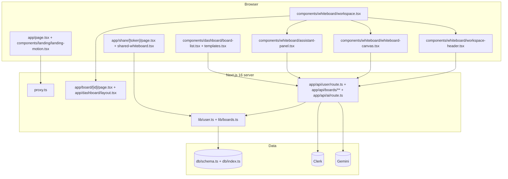

# Chapter 22 — Project Explanation for Interviews

**Goal:** By the end of this chapter you can give four natural introductions (30 seconds, 1 minute, 3 minutes, 5 minutes) that are fully supported by this repository, know exactly where to point when the interviewer says "go deeper", and know which impressive-sounding claims you must *not* make.

---

## 22.1 Speak naturally, but keep the facts fixed

Beginner version: an interview introduction is a short story with a beginning (problem), a middle (what you built and how), and an end (what it can and cannot do). You may change your *tone* — relaxed for a recruiter, precise for a senior engineer — but you may not change the *facts*. The facts live in specific files.

Professional version: treat your narrative as a claim set with source provenance. [IMPLEMENTED] claims come from a visible symbol in a file. [PARTIAL] claims are visible but incomplete. [EVIDENCE GAP] claims are absent from the repository and must not be asserted.

| What you say | Label | Grounding (exact file → symbol) |
| --- | --- | --- |
| "Prompts become editable canvas elements" | [IMPLEMENTED] | `lib/ai-canvas.ts` → `diagramToElements` |
| "Boards autosave" | [IMPLEMENTED] | `components/whiteboard/whiteboard-canvas.tsx` → `handleChange`, `flush` |
| "Share links can be revoked" | [IMPLEMENTED] | `app/api/boards/[id]/route.ts` → `PATCH`, `share: "enable" \| "disable"` |
| "Plans/prices are configurable" | [PARTIAL] | `lib/pricing.ts` → `PLANS`, `CREDIT_PACKS` (display data only) |
| "Why I chose Gemini over OpenAI" | [EVIDENCE GAP] | No decision record in the repo; say what is in the code, not a fictional comparison |

Related grounding: Chapter 1 for the one-sentence pitch, Chapter 5 for the architecture map, Chapter 21 for what is missing.

---

## 22.2 The four introductions

### 22.2.1 The 30-second version

> "AI Whiteboard is a full-stack app where you describe a diagram in plain English and get **editable** shapes on an Excalidraw canvas — not an image. I used Next.js 16 with React 19, Gemini with a strict JSON response schema, Neon Postgres through Drizzle, and Clerk for auth. Around the generation core I built the boring-but-important SaaS parts: autosave with thumbnails, board organization with archive and trash, revocable read-only share links, PNG/SVG/PDF export, and credits that are deducted atomically and refunded when generation fails."

**Why this works:** it names one differentiator (structured, editable output) before listing technologies. Grounding: `package.json` → dependencies (`next`, `@excalidraw/excalidraw`, `@google/genai`, `@clerk/nextjs`, `drizzle-orm`, `@neondatabase/serverless`); `lib/ai-canvas.ts` → `diagramToElements`; `app/api/ai/route.ts` → `POST`.

### 22.2.2 The 1-minute version

> "The product has three surfaces: a marketing landing page, an authenticated dashboard and board editor, and a public read-only share page. The interesting flow starts in `AssistantPanel`: you pick one of six tools — diagram, flowchart, architecture, web mockup, mobile mockup, or mind map — type a prompt, and the app first drops a visual placeholder on the canvas while `POST /api/ai` does the work. That route applies a per-user sliding-window limiter, takes one credit with a single conditional SQL update, calls Gemini with `responseMimeType: application/json` and a response schema, validates that nodes came back, and converts the result with `diagramToElements` into real Excalidraw rectangles, text, and bound arrows. Editing then flows through a 1.5-second debounced autosave into JSONB. Board creation also spends one credit, and every board query is scoped to the signed-in Clerk user."

Grounding: `components/whiteboard/assistant-panel.tsx` → `handleGenerate`; `lib/ai-tools.ts` → `AI_TOOLS`, `CANVAS_RULES`, `RESPONSE_SCHEMA`; `app/api/ai/route.ts` → `isRateLimited`, `POST`; `components/whiteboard/whiteboard-canvas.tsx` → `AUTOSAVE_DELAY`; `lib/boards.ts` → `getBoard`.

### 22.2.3 The 3-minute version

> "I started from one design decision: the AI should produce **data**, not pixels. Excalidraw owns an element model, so `lib/ai-canvas.ts` builds elements with ids, seeds, versions, bindings and text containers. The model is constrained by `RESPONSE_SCHEMA` in `lib/ai-tools.ts` — a node has `id`, `x`, `y`, `width`, `height`, `label`, and an optional shape — and by `CANVAS_RULES`, which caps scenes at 25 nodes and requires arrows to reference existing node ids.
>
> The server is a Next.js App Router monolith. Server components guard `/dashboard` and `/board/[id]` with `auth()` and load board data directly; route handlers under `app/api/` handle mutations; `lib/user.ts` bridges a Clerk `userId` into a local `users` row on first use. There are two tables: `users` with a default of 3 credits, and `whiteboards` with JSONB `elements`, `app_state`, and `files`, plus nullable `deleted_at`/`archived_at` for soft lifecycles and a unique `share_token`.
>
> The two places where concurrency matters both use the same pattern — one conditional update. The exact code is:

```ts
// app/api/boards/route.ts (POST)
const [deducted] = await db
  .update(schema.users)
  .set({ credit: sql`${schema.users.credit} - 1` })
  .where(and(eq(schema.users.id, user.id), gt(schema.users.credit, 0)))
  .returning({ credit: schema.users.credit });

if (!deducted) {
```

Line-level explanation: the `WHERE credit > 0` predicate and the decrement happen in one statement, so the database arbitrates concurrent requests; `RETURNING` gives the new balance for the response; an empty result means the user is out of credits and the route returns 402. [IMPLEMENTED] `app/api/boards/route.ts` → `POST`.

> "AI generation uses the same debit before calling Gemini, then refunds on every failure path — empty text, no nodes, or a thrown error. Autosave is deliberately noisy-tolerant: `onChange` stores a pending snapshot and restarts a timer; a thumbnail is captured at most once every 30 seconds; unmount flushes immediately. Sharing generates a 32-character hex token and the public page renders Excalidraw with `viewModeEnabled`; turning sharing off nulls the token, which is what makes the link revocable."

Grounding for the last paragraph: `app/api/ai/route.ts` → `POST`; `components/whiteboard/whiteboard-canvas.tsx` → `handleChange`, `flush`; `app/api/boards/[id]/route.ts` → `PATCH`; `app/share/[token]/page.tsx` → `SharePage`; `components/whiteboard/shared-whiteboard.tsx` → `SharedWhiteboard`.

### 22.2.4 The 5-minute version

Use the 3-minute version, then add four concrete layers:

1. **Client boundary.** Excalidraw cannot be server-rendered, so `components/whiteboard/excalidraw-wrapper.tsx` → `Excalidraw` uses `next/dynamic` with `ssr: false` and a typed `ExcalidrawProps`. [IMPLEMENTED]
2. **Ownership.** `lib/boards.ts` → `getBoard(userId, boardId)` puts ownership in the SQL predicate:

```ts
// lib/boards.ts
const [row] = await db
  .select()
  .from(schema.whiteboards)
  .where(
    and(
      eq(schema.whiteboards.id, boardId),
      eq(schema.whiteboards.userId, userId),
    ),
  )
  .limit(1);
return row ?? null;
```

Line-level explanation: both conditions are in one `and(...)`; a guessed board id from another account returns no row, which routes return as 404. [IMPLEMENTED]

3. **Performance shape.** `lib/boards.ts` → `summaryColumns` selects eight dashboard fields instead of `SELECT *`, avoiding base64 thumbnails in list payloads; `lib/export.ts` → `exportBoardToPdf` dynamically imports `jspdf`. [IMPLEMENTED]
4. **Honest boundaries.** `package.json` has no test script; there is no CI workflow, monitoring SDK, payment provider, or multiplayer transport. [EVIDENCE GAP] See Chapter 17, Chapter 19, and Chapter 21.

Close with: "So the system is a compact full-stack monolith, not a distributed platform. Its engineering value is in the generation pipeline and in the correctness details around credits, ownership, and persistence."

---

## 22.3 When the interviewer says "go deeper"

Beginner rule: answer with a *path*, not a guess. Say the file, name the function, then explain one line of code. Professional rule: state the invariant you are protecting.

| Prompt you will hear | Say this first | Then show | Invariant protected |
| --- | --- | --- | --- |
| "Why is generation editable?" | "The model returns a `DiagramResult` with nodes and connections." | `lib/ai-tools.ts` → `DiagramResult`; `lib/ai-canvas.ts` → `diagramToElements` | Consumers can mutate native elements |
| "How do you stop double-spend?" | "The check and decrement are one SQL statement." | `app/api/ai/route.ts` → `POST`, lines with `sql\`${users.credit} - 1\`` | Balance cannot go negative under concurrency |
| "What if Gemini fails after charging?" | "Every failure branch refunds." | `app/api/ai/route.ts` → `POST` refund blocks | User is not billed for unusable output |

Verbatim refund branch:

```ts
// app/api/ai/route.ts (POST, catch block)
} catch (err) {
  // Refund on failure so users aren't charged for errors.
  await db
    .update(users)
    .set({ credit: sql`${users.credit} + 1` })
    .where(eq(users.id, userId))
    .catch(() => {}); // best-effort refund

  console.error("AI generation failed:", err);
```

Line-level explanation: the refund is best-effort (`.catch(() => {})`) so a database hiccup does not mask the generation error; the earlier branches for empty `text` and empty `nodes` refund explicitly with 502. [IMPLEMENTED] `app/api/ai/route.ts` → `POST`.

For autosave, quote the exact normalization choice:

```ts
// components/whiteboard/whiteboard-canvas.tsx (handleChange)
void appState;
pending.current = { elements, appState: {}, files };
markDirty();
if (timer.current) clearTimeout(timer.current);
timer.current = setTimeout(() => {
  void flush();
}, AUTOSAVE_DELAY);
```

Line-level explanation: `void appState` intentionally discards transient UI state (viewport, selection) and stores `appState: {}`; `AUTOSAVE_DELAY` is `1500` ms at line 10; `markDirty` drives the unsaved indicator and `beforeunload` guard in `components/whiteboard/workspace.tsx` → `WhiteboardWorkspace`. [IMPLEMENTED]

---

## 22.4 One-page mental map (exact filenames)



| Layer | Files you must be able to name | One-line job |
| --- | --- | --- |
| Shell | `app/layout.tsx`, `app/provider.tsx`, `proxy.ts` | Clerk provider, user bootstrap, middleware |
| Marketing | `app/page.tsx`, `app/landing.css`, `components/landing/landing-motion.tsx` | GSAP/Lenis presentation only |
| Dashboard | `app/dashboard/layout.tsx`, `components/dashboard/board-list.tsx`, `components/dashboard/templates.tsx` | Auth guard, CRUD UI, template deep-links |
| Editor | `components/whiteboard/whiteboard-canvas.tsx`, `assistant-panel.tsx`, `workspace-header.tsx`, `excalidraw-wrapper.tsx` | Canvas, AI, share/export UI, client boundary |
| API | `app/api/user/route.ts`, `app/api/boards/route.ts`, `app/api/boards/[id]/route.ts`, `app/api/boards/[id]/action/route.ts`, `app/api/ai/route.ts` | Five route handlers |
| Domain helpers | `lib/user.ts`, `lib/boards.ts`, `lib/ai-tools.ts`, `lib/ai-canvas.ts`, `lib/export.ts` | Identity, queries, prompts, conversion, files |
| Data | `db/schema.ts`, `db/index.ts`, `lib/types.ts`, `lib/store.ts`, `lib/whiteboard-store.ts` | Tables, cached client, DTOs, Zustand stores |

---

## 22.5 Do-not-claim list

| Do not say | Why not | Say instead |
| --- | --- | --- |
| "We have unit/E2E tests and CI" | [EVIDENCE GAP] `package.json` → `scripts` has no test entry; no workflow files exist | "No automated tests yet; Chapter 17 proposes a strategy." |
| "Stripe handles subscriptions" | [EVIDENCE GAP] no payment dependency or webhook route; `lib/pricing.ts` → `PLANS` is data | "Pricing is marketing copy; credits are local DB integers." |
| "Multiple people edit together in real time" | [EVIDENCE GAP] no websocket/CRDT; `components/whiteboard/whiteboard-canvas.tsx` stores `collaborators: new Map()` | "Single-user boards with a read-only share view." |
| "Share links expire" | [EVIDENCE GAP] `db/schema.ts` → `whiteboards.shareToken` has no expiry column | "Tokens are revocable by nulling the field." |
| "AI is fine-tuned / uses RAG" | [EVIDENCE GAP] `app/api/ai/route.ts` sends a prompt and schema only | "Prompt presets plus structured output." |
| "Production monitoring and analytics are wired" | [EVIDENCE GAP] errors use `console.error` in route handlers | "Logging is console-based." |
| "Non-atomic credit updates" | [PARTIAL] stale `.planning/codebase/*.md` says this, but current `app/api/boards/route.ts` uses conditional `UPDATE` | Quote the current code; treat planning docs as historical |
| "I chose these libraries after a formal benchmark" | [EVIDENCE GAP] no ADR/benchmark in repo | Describe fit *reasoned from code*, not a fictional study |

Also: never repeat any previously exposed Clerk key values. Say "keys must be rotated if exposed", which is documented in `README.md` → Notes.

---

## 22.6 Practising the delivery

1. **Beginner pass (20 seconds):** product, not architecture. "Describe a diagram, get editable shapes."
2. **Professional pass:** add constraints. Mention `RESPONSE_SCHEMA`, atomic `UPDATE`, ownership in query, debounce.
3. **Why pass:** for every feature, attach a reason visible in code — JSONB because Excalidraw owns the shape; client-only canvas because it needs browser APIs; summary columns because thumbnails are base64.
4. **Boundary pass:** end with one honest limitation. This builds trust more than another feature.

Recommended cross-references for the next reading session: Chapter 5 (system boundaries), Chapter 13 (security claims), Chapter 18 (performance claims), Chapter 23 (full Q&A), Chapter 26 (cheat sheet).

---

## 22.7 Revision summary

- The facts are fixed; only tone is flexible. Every claim maps to a file and symbol.
- 30-second pitch: editable AI output + SaaS plumbing + credits with refunds.
- 1-minute pitch adds three surfaces, six AI tools, 1.5s autosave, and ownership-scoped queries.
- 3/5-minute pitches add exact mechanisms: conditional `UPDATE`, refunds, JSONB, revocable token, client-only Excalidraw.
- The mental map has seven layers: shell, marketing, dashboard, editor, API, helpers, data.
- Do-not-claim list protects against tests, payments, multiplayer, expiry, RAG, and monitoring claims.
- Go deeper by naming a file, a symbol, and one line — then state the invariant.

## 22.8 Knowledge checks

1. Which file and function prove that AI output becomes editable Excalidraw elements rather than an image?
2. What exact SQL shape makes board creation and AI generation resistant to concurrent double-spend, and where is it used twice?
3. Where is `appState: {}` written during autosave, and why is the app state discarded?
4. Which field makes share links revocable, and which route sets it to `null`?
5. Name three claims in the do-not-claim list and the evidence that forbids each.

## 22.9 Practical exercises

1. **Four-timing drill:** record yourself giving all four introductions. For each sentence, write the file path that supports it in the margin. Delete any sentence you cannot ground.
2. **Go-deeper drill:** pair with a friend who asks only "why?". Answer five times using only these patterns: file → symbol → line → invariant. Start with `app/api/ai/route.ts` → `POST`.
3. **Claim audit:** open `docs/PORTFOLIO_AND_INTERVIEW.md` and rewrite three resume bullets that sound stronger than the code supports, adding the exact source file and label ([IMPLEMENTED] / [PARTIAL] / [EVIDENCE GAP]) beside each.

## 22.10 Interview questions

1. "Give your 30-second introduction, then tell me which single sentence you would remove if the interviewer looked skeptical."
2. "Walk me through the mental map without a diagram, starting at `app/layout.tsx` and ending at `db/schema.ts`."
3. "When asked how credits work, how do you explain the difference between board creation and AI generation?"
4. "Which of your claims are [PARTIAL] or [EVIDENCE GAP], and how do you phrase them honestly?"
5. "If I challenge 'why Gemini?', what code-grounded answer do you give instead of inventing a benchmark?"
