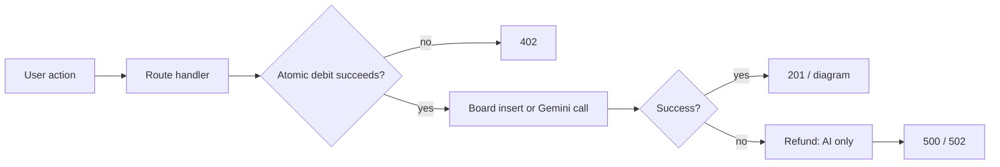

# Chapter 24 — Advanced Cross-Questioning

**Goal:** Survive senior-level pressure questions by connecting every design choice to source code, an alternative, a failure mode, and an honest limitation — without inventing maturity this repository does not have.

---

## 24.1 The rules of senior cross-examination

Beginner explanation: a senior interviewer does not want the feature list. They want to know what breaks, what you traded away, and whether your explanation matches the code.

Professional explanation: treat each answer as a claim with four parts — **mechanism** (which symbol implements it), **invariant** (what property it protects), **alternative** (what you did not choose and why), and **failure mode** (what happens when an assumption breaks). If a part is not in the repository, mark it [EVIDENCE GAP] rather than filling it with a story.

| Interviewer move | Safe response pattern | Grounding |
| --- | --- | --- |
| "Why this library?" | Describe observed fit, not a fictional benchmark | `package.json` → dependencies; `lib/ai-tools.ts` → `RESPONSE_SCHEMA` |
| "What if the model is down?" | Walk the failure branch | `app/api/ai/route.ts` → `POST` refunds + 500 |
| "What if two users edit?" | State what exists, then the gap | `whiteboard-canvas.tsx` → `flush` last write wins [PARTIAL] |
| "Show me the tradeoff" | Name the cost of a chosen optimisation | `lib/boards.ts` → `summaryColumns` vs. no element queries |
| "Is it production ready?" | Separate deploy-ready from production-grade | `next.config.ts` → headers; no tests/CI [EVIDENCE GAP] |

Cross-references: Chapter 18 for optimisation claims, Chapter 20 for problems solved, Chapter 21 for limitations, Chapter 25 for rebuild decisions.

---

## 24.2 Technology choices under pressure

**Q: "Why Excalidraw instead of building a canvas?"**

[IMPLEMENTED] `components/whiteboard/excalidraw-wrapper.tsx` → `Excalidraw` and `lib/export.ts` → `exportToBlob`/`exportToSvg` show that drawing primitives, the element model, files, and exporters are borrowed. The alternative — a custom canvas — would require hit-testing, text editing, binding, undo, and image handling. The tradeoff: we inherit Excalidraw's release cycle and its client-only constraint (`ssr: false`).

**Pressure: "So you didn't build the hard part?"** Correct. The hard part I built is the *bridge*: `lib/ai-tools.ts` → `RESPONSE_SCHEMA` constrains the model, and `lib/ai-canvas.ts` → `diagramToElements` emits fields Excalidraw expects (`seed`, `version`, `versionNonce`, `boundElements`, `startBinding`, `endBinding`). Writing those by hand is where scenes either render or silently break.

**Q: "Why Gemini and not another model?"**

[IMPLEMENTED] `app/api/ai/route.ts` → `POST` uses `new GoogleGenAI(...)` with `responseMimeType: "application/json"` and `responseSchema: RESPONSE_SCHEMA`. [EVIDENCE GAP] There is no ADR or benchmark in the repo, so I will not claim a comparison. The code-grounded reason is that the selected client supports schema-constrained generation, which reduces post-processing to `JSON.parse` plus a `nodes.length` check.

**Pressure: "What if the schema is ignored?"** The route refunds and returns 502 for empty `text`, empty `nodes`, or a thrown parse/generation error ([IMPLEMENTED] `app/api/ai/route.ts` → `POST`). It does not repair partially malformed nodes — that is a real limitation [SUGGESTED IMPROVEMENT].

**Q: "Why Drizzle and Neon together?"**

[IMPLEMENTED] `db/index.ts` → `createDatabase` returns `drizzle({ client: neon(url), schema })`; `db/schema.ts` is typed with `$inferSelect`/`$inferInsert`. The alternative — a traditional pooled Postgres driver — would need long-lived sockets, which are awkward in serverless functions. Cost: HTTP round-trips and no committed migration history (`drizzle.config.ts` → `out: "./drizzle"`, but no generated directory) [EVIDENCE GAP].

---

## 24.3 Architecture and data interrogation

**Q: "Why keep business rules in route handlers instead of services?"**

[IMPLEMENTED] `app/api/boards/[id]/action/route.ts` → `POST` validates the action list and writes the update in one file; `lib/user.ts` and `lib/boards.ts` hold the reusable parts. With five endpoints, an extra service layer would add indirection. [SUGGESTED IMPROVEMENT] once credits, sharing, and lifecycle rules grow, extract a service so policy is testable without HTTP.

**Pressure: "Then how do you unit test policy?"** Today you mostly cannot [EVIDENCE GAP]; that is exactly why extraction is the first improvement. `isRateLimited` in `app/api/ai/route.ts` is a pure-ish function but is not exported, so it is not directly testable.

**Q: "Why JSONB for the whole scene?"**

[IMPLEMENTED] `db/schema.ts` → `whiteboards.elements`, `appState`, `files`; `lib/boards.ts` → `boardToData`. The scene is an aggregate with internal references (text-to-container, arrow-to-node). Normalising it would require re-creating Excalidraw's invariants in SQL. The cost: no server-side "find all boards containing a rectangle labelled X" query, and large rows on save.

**Pressure: "Is `elements` unbounded?"** Practically yes. There is a 2 MB thumbnail ceiling in `app/api/boards/[id]/route.ts` → `PATCH`, but no equivalent cap on `elements` or `files` [EVIDENCE GAP]. An AI scene is capped at 25 nodes by `lib/ai-tools.ts` → `CANVAS_RULES`, but a human can draw far more.

**Q: "Why does board creation cost a credit?"**

[IMPLEMENTED] `app/api/boards/route.ts` → `POST` debits before inserting. This is a product rule visible in code, not a technical necessity; `lib/pricing.ts` → `PLANS[free].features` says "3 AI generations / month", which conflicts with the two spending paths [PARTIAL]. Honest answer: "The copy and the code disagree; the code charges for both."



Notice the asymmetry in the diagram: board creation has no refund branch in `app/api/boards/route.ts` → `POST`, whereas AI generation refunds in `app/api/ai/route.ts` → `POST`. [SUGGESTED IMPROVEMENT] wrap debit + insert in a transaction.

---

## 24.4 Component failure modes

| Component | Failure | What the code does | Residual risk |
| --- | --- | --- | --- |
| Clerk session expires | `auth()` returns no `userId` | `lib/user.ts` → `requireUserId` throws `UnauthorizedError`; routes return 401 | Client stores may still show stale credit until refetch |
| `DATABASE_URL` missing | `neon(url)` cannot be created | `db/index.ts` → `createDatabase` throws explicit error; `app/provider.tsx` catches user bootstrap failure | Dashboard shows a helpful error string from `board-list.tsx` → `fetchBoards` |
| Gemini unavailable | SDK throws | `app/api/ai/route.ts` → `POST` refunds, logs, returns 500 | No retry/backoff [EVIDENCE GAP] |
| Gemini returns empty/invalid data | `text` falsy or `nodes` empty | Explicit refund + 502 in `POST` | No schema repair |
| Model returns dangling arrow ids | `diagramToElements` silently skips connections where `from`/`to` missing | `lib/ai-canvas.ts` → `diagramToElements` loop | Scene still renders, but a relationship is lost [PARTIAL] |
| Thumbnail export fails | `captureThumbnail` catches | `lib/export.ts` returns `null` | Save continues without preview |
| Autosave request fails | `fetch` rejects or non-2xx | `whiteboard-canvas.tsx` → `flush` catch sets `setSaving(false)`; `setSaved()` is not called | Dirty state remains; no queue/retry [EVIDENCE GAP] |
| Share token guessed | `getBoardByShareToken` looks up exact string | 32-hex unique token in `db/schema.ts` | Token never expires; revocation is manual |

Verbatim rate-limiter code and its own warning:

```ts
// app/api/ai/route.ts
// ponytail: simple in-memory sliding-window rate limiter per userId.
// Ceiling: resets on deploy / restart. Upgrade to Redis if running multi-instance.
const aiRateMap = new Map<string, number[]>();
const AI_RATE_LIMIT = 10; // requests
const AI_RATE_WINDOW_MS = 60_000; // per minute

function isRateLimited(userId: string): boolean {
  const now = Date.now();
  const timestamps = (aiRateMap.get(userId) ?? []).filter(
    (t) => now - t < AI_RATE_WINDOW_MS,
  );
  if (timestamps.length >= AI_RATE_LIMIT) {
    aiRateMap.set(userId, timestamps);
    return true;
  }
  timestamps.push(now);
  aiRateMap.set(userId, timestamps);
  return false;
}
```

Line-level explanation: the map is per Node process; timestamps are pruned on each call; the limit is 10 per 60,000 ms. Two serverless instances mean two independent budgets — a senior interviewer will spot this immediately, and the code comment admits it. [PARTIAL]

---

## 24.5 "You have 100,000 users tomorrow"

**Q: "What breaks first?"**

1. **Rate limiting** — `isRateLimited` is process-local. Replace with a shared store (Redis) keyed by `userId`; keep the same sliding-window shape.
2. **Gemini calls** — `app/api/ai/route.ts` → `POST` awaits the model inside the request. At scale, add a queue and job status; deduct on enqueue, refund on terminal failure.
3. **Credit hotspots** — `users.credit` updates are atomic per row, so a single popular user is fine, but there is no ledger. [SUGGESTED IMPROVEMENT] append credit events and derive balance.
4. **Autosave write volume** — `whiteboard-canvas.tsx` → `flush` writes the full JSONB document. Add per-board coalescing, scene deltas, and object storage for `files`.
5. **Dashboard payloads** — `lib/boards.ts` → `summaryColumns` already helps, but thumbnails are inline base64. Move them to object storage and serve URLs.
6. **Observability** — errors are `console.error` in route handlers [EVIDENCE GAP]; add structured logs, traces, and alerts.

**Pressure: "Would you shard Postgres?"** Not first. The schema has only two tables and owner-scoped queries; Neon handles the storage layer. I would fix shared rate limits, queueing, and payload size before sharding. [SUGGESTED IMPROVEMENT]

**Pressure: "Would you keep Next.js?"** [EVIDENCE GAP] no migration plan exists. Code suggests keeping it: server pages already do auth and data loading, and route handlers centralise mutations. If generation became long-running, I would extract only that worker, not the whole app.

**Pressure: "Is `getDb` singleton safe in serverless?"** `db/index.ts` → `getDb` caches one `Database` per process instance; each warm instance gets its own client, and Neon's HTTP client is stateless. The cache avoids reconstructing the client per call; it is not a global cross-instance singleton. [IMPLEMENTED]

---

## 24.6 Security cross-examination

**Q: "Name the real security boundary."** Clerk identifies the user; ownership is enforced in SQL by `lib/boards.ts` → `getBoard` and every mutation's `and(eq(id, ...), eq(userId, ...))`. That is the boundary that prevents cross-tenant reads. [IMPLEMENTED]

**Pressure: "Is a share token authentication?"** It is a capability URL, not a user session. `app/share/[token]/page.tsx` → `SharePage` deliberately skips `auth()` and renders `viewModeEnabled` in `components/whiteboard/shared-whiteboard.tsx`. It grants one capability (view one board), not account access. Revocation is `share: "disable"` → `shareToken = null` in `app/api/boards/[id]/route.ts` → `PATCH`.

**Pressure: "What about token rotation?"** [EVIDENCE GAP] no rotation job; generation only happens when no token exists (`if (body.share === "enable" && !board.shareToken)`). Re-enabling after disable creates a new random token, which is an implicit rotation path. [IMPLEMENTED]

**Pressure: "What about XSS via AI labels?"** React and Excalidraw render labels as text, not HTML (`lib/ai-canvas.ts` → `makeText` sets `text: node.label`). Exported SVG goes through `XMLSerializer` in `lib/export.ts` → `exportBoardToSvg`. No `dangerouslySetInnerHTML` is present in the editor path [EVIDENCE GAP for a formal sanitisation audit].

**Pressure: "Secrets?"** `.env.example` lists names; `README.md` warns to rotate exposed Clerk keys. I will not repeat key values. `next.config.ts` → `securityHeaders` adds four browser-level headers. Missing: CSRF tokens, secret scanning, and rate limits on non-AI routes [EVIDENCE GAP / SUGGESTED IMPROVEMENT].

---

## 24.7 Performance cross-examination

| Optimisation | Exact evidence | What it buys | Cost / caveat |
| --- | --- | --- | --- |
| Summary-column select | `lib/boards.ts` → `summaryColumns` (8 fields) | Avoids base64 thumbnails in list responses | Two mapping helpers to maintain |
| Debounced autosave | `whiteboard-canvas.tsx` → `AUTOSAVE_DELAY = 1500` | Coalesces continuous `onChange` | Up to 1.5 s of loss window before unmount |
| Thumbnail throttle | `THUMBNAIL_THROTTLE_MS = 30_000` | Caps expensive exports | Preview may be stale for up to 30 s |
| Thumbnail size cap | `PATCH`: `body.thumbnail.length <= 2_000_000` | Bounds DB row growth | Over-limit thumbnails are silently ignored |
| Client-only canvas | `excalidraw-wrapper.tsx` → `dynamic(..., { ssr: false })` | No SSR crashes, smaller initial server work | Blank-ish first paint with spinner |
| Lazy PDF | `lib/export.ts` → `await import("jspdf")` | Keeps jsPDF out of initial bundle | First PDF export has load latency |
| Cached DB client | `db/index.ts` → `getDb` | No repeated client construction | Per-process cache only |

Verbatim summary projection:

```ts
// lib/boards.ts
const summaryColumns = {
  id: schema.whiteboards.id,
  title: schema.whiteboards.title,
  thumbnail: schema.whiteboards.thumbnail,
  favorited: schema.whiteboards.favorited,
  deletedAt: schema.whiteboards.deletedAt,
  archivedAt: schema.whiteboards.archivedAt,
  createdAt: schema.whiteboards.createdAt,
  updatedAt: schema.whiteboards.updatedAt,
};
```

Line-level explanation: the projection omits `elements`, `appState`, and `files` — the largest columns — while still carrying enough data for cards and scope booleans derived in `toSummary`. [IMPLEMENTED]

**Pressure: "Where are your measurements?"** [EVIDENCE GAP] There are none committed. Do not claim Lighthouse scores or latency numbers; describe mechanisms and propose measuring them (Chapter 18).

---

## 24.8 Rebuild choices and honest gaps

If rebuilding today, which decisions would I keep and which would I change?

| Decision | Keep or change | Why, grounded in code |
| --- | --- | --- |
| Excalidraw + converter | Keep | `lib/ai-canvas.ts` → `diagramToElements` already produces editable scenes |
| Schema-constrained Gemini output | Keep | `RESPONSE_SCHEMA` in `lib/ai-tools.ts` makes conversion deterministic |
| Atomic credit decrement | Keep, add transaction | `POST /api/boards` debits before insert without rollback |
| AI refunds | Keep, add ledger | Current refund is best-effort in `app/api/ai/route.ts` |
| In-memory rate limiter | Change | The source comment itself recommends Redis for multi-instance |
| `appState: {}` autosave | Keep | `whiteboard-canvas.tsx` deliberately drops transient state |
| Capability share token | Keep, add expiry | `db/schema.ts` has no expiry column |
| No tests/CI | Change | [EVIDENCE GAP] verification is manual today |

### Honest gaps section

- [EVIDENCE GAP] **No automated tests or CI** — `package.json` → `scripts`; no workflow files.
- [EVIDENCE GAP] **No payments** — `lib/pricing.ts` → `PLANS` is display data; no webhook route.
- [EVIDENCE GAP] **No multiplayer/CRDT** — single `userId` owner, `collaborators: new Map()` in `whiteboard-canvas.tsx`.
- [EVIDENCE GAP] **No monitoring/analytics** — `console.error` in route handlers only.
- [EVIDENCE GAP] **No expiry on share tokens** — only revocation.
- [EVIDENCE GAP] **No committed migrations or deployment config** — `drizzle.config.ts` → `out: "./drizzle"`; no `drizzle/` directory, no `vercel.json`.
- [PARTIAL] **Pricing copy vs. behaviour** — "3 AI generations / month" in `lib/pricing.ts` vs. two debit paths.
- [PARTIAL] **Conflict handling** — last-write-wins autosave; no version precondition.
- [EVIDENCE GAP] **No measured performance numbers** — mechanisms exist, metrics do not.
- [EVIDENCE GAP] **Stale `.planning/codebase/*.md`** — predates hardening; do not quote its bug list as current.

Final senior answer template: "Here is the mechanism, here is the invariant, here is what I traded away, here is how it fails, and here is exactly what I would change next." That answer is credible because every clause can be checked in the repository.

---

## 24.9 Revision summary

- Senior answers need mechanism, invariant, alternative, and failure mode — not feature lists.
- Excalidraw and Gemini were chosen for capability and constrained output; no benchmark is recorded.
- JSONB fits an aggregate scene but blocks content queries and caps are incomplete.
- Board creation debits without a refund/transaction branch; AI generation refunds on all model failure paths.
- The in-memory `isRateLimited` map is the first component to fail at 100k users.
- Sharing is a revocable capability token, not authentication, sessions, or expiry.
- Optimisations are real (summary columns, debounce, throttle, lazy import) but unmeasured.

## 24.10 Knowledge checks

1. Which two failure branches in `app/api/ai/route.ts` return 502 and refund, and what does the catch block do differently?
2. Why is `isRateLimited` process-local, and which line in the source admits the scaling ceiling?
3. What is the difference between a revocable token and an expiring token in `db/schema.ts`?
4. Which performance optimisation removes the largest columns from dashboard responses, and what are those columns?
5. Name four [EVIDENCE GAP] items that must appear in an "honest gaps" answer.

## 24.11 Practical exercises

1. **Pressure loop:** take Q "Why Gemini?" and answer it four times: beginner, mechanism, alternative, failure mode. Then have a partner interrupt with "What if the schema is ignored?" each time.
2. **Failure-mode table expansion:** add three rows to the table in 24.4 using `app/provider.tsx`, `lib/export.ts`, and `app/share/[token]/page.tsx`. Include exact symbols.
3. **Scale design sketch:** draw a Mermaid diagram replacing `aiRateMap` with a shared store and adding a generation queue. Label which existing files would change.

## 24.12 Interview questions

1. "If the AI returns an arrow with a dangling `toId`, what happens in `diagramToElements`, and would you call that a bug?"
2. "Why is a 2 MB thumbnail cap not the same as bounding total board storage?"
3. "Which line of code proves the rate limiter is unsafe across multiple instances?"
4. "Explain why revoking a share link is different from expiring it, using the schema."
5. "What would you extract into a service first if you had to add unit tests, and why?"
