# Chapter 25 — Rebuilding the Project From Scratch

**Goal:** Rebuild AI Whiteboard in 12 ordered milestones, each with the concepts to learn first, the exact files to create, a small source-derived skeleton, a manual test, common mistakes, and the interview concept it proves.

---

## 25.1 Rules for the rebuild

Beginner explanation: do not start by typing code. For each milestone, first understand the idea, then create the file, then paste a small faithful skeleton from the current repository, then test by hand.

Professional explanation: this is a dependency-ordered reconstruction. Data schema precedes queries, queries precede routes, routes precede UI, and hardening comes last. Every skeleton below is copied or trimmed from an existing file in this repository; there is no invented framework feature. Labels mark what is actually implemented versus what remains a gap.

```mermaid
flowchart LR
  M0["M0 scaffold"] --> M1["M1 schema + DB"]
  M1 --> M2["M2 auth bridge"]
  M2 --> M3["M3 board APIs"]
  M3 --> M4["M4 dashboard"]
  M4 --> M5["M5 canvas wrapper"]
  M5 --> M6["M6 autosave"]
  M6 --> M7["M7 AI schema + converter"]
  M7 --> M8["M8 AI panel"]
  M8 --> M9["M9 sharing"]
  M9 --> M10["M10 exports"]
  M10 --> M11["M11 landing motion"]
  M11 --> M12["M12 hardening"]
```



---

## 25.2 Milestones

### M0 — Scaffold and configuration

**Concepts:** App Router routes, TypeScript strict mode, environment variables, global headers.

**Files to create:** `package.json`, `tsconfig.json`, `next.config.ts`, `.env.example`, `app/layout.tsx`, `app/provider.tsx`, `proxy.ts`, `app/globals.css`.

**Skeleton** (verbatim from `next.config.ts` → `securityHeaders` and `headers()`):

```ts
const securityHeaders = [
  { key: "X-Content-Type-Options", value: "nosniff" },
  { key: "X-Frame-Options", value: "DENY" },
  { key: "Referrer-Policy", value: "strict-origin-when-cross-origin" },
  { key: "Permissions-Policy", value: "camera=(), microphone=(), geolocation=()" },
];
```

**Why:** headers apply to every route; `proxy.ts` → `clerkMiddleware()` must exist because Next.js 16 uses it instead of `middleware.ts`. `app/layout.tsx` wraps children in `ClerkProvider`, `AppProvider`, and `Toaster`.

**Expected output:** `npm run dev` serves a blank styled page; `npm run lint` and `npm run build` pass.

**Manual test:** Visit `/` and check response headers in DevTools; confirm `X-Frame-Options: DENY`.

**Common mistakes:** expecting `middleware.ts` to work; placing Clerk hooks outside `ClerkProvider`; committing real key values.

**Interview concept:** deployment/config boundary — Chapter 4 and Chapter 19.

### M1 — Schema and database client

**Concepts:** relational modelling, nullable timestamps as lifecycle state, JSONB documents, cached client.

**Files to create:** `db/schema.ts`, `db/index.ts`, `drizzle.config.ts`, `lib/types.ts`.

**Skeleton** (from `db/schema.ts` → `whiteboards`):

```ts
export const whiteboards = pgTable("whiteboards", {
  id: text("id").primaryKey(),
  userId: text("user_id")
    .notNull()
    .references(() => users.id, { onDelete: "cascade" }),
  title: text("title").notNull(),
  elements: jsonb("elements").$type<unknown[]>().notNull().default([]),
  appState: jsonb("app_state").$type<Record<string, unknown>>().notNull().default({}),
  files: jsonb("files")
```

**Why:** `elements`, `appState`, and `files` are owned by Excalidraw, so they are stored as documents; `deletedAt`/`archivedAt` enable soft lifecycles; `shareToken` is unique.

**Expected output:** `npm run db:push` creates `users` and `whiteboards`; `getDb()` throws a clear error if `DATABASE_URL` is absent.

**Manual test:** Run `npm run db:studio`, insert a user with `credit = 3`, insert a board referencing that id.

**Common mistakes:** forgetting `onDelete: "cascade"`; using `SELECT *` in list views later; treating `.planning/codebase/*.md` as current.

**Interview concept:** database design — Chapter 11.

### M2 — Auth bridge

**Concepts:** identity vs. local user row, lazy provisioning, authorization errors.

**Files to create:** `lib/user.ts`, `app/api/user/route.ts`, sign-in/sign-up catch-all pages.

**Skeleton** (from `lib/user.ts` → `requireUserId`):

```ts
export async function requireUserId(): Promise<string> {
  const { userId } = await auth();
  if (!userId) {
    throw new UnauthorizedError();
  }
  return userId;
}
```

**Why:** Clerk owns sessions; our database needs a matching row with credits. `upsertDbUser()` uses `onConflictDoUpdate` so first login and later profile changes converge.

**Expected output:** signing in triggers `app/provider.tsx` → `POST /api/user`; `CreditBadge` shows 3.

**Manual test:** Sign in with a fresh account; inspect `users` for one row with that Clerk `id`.

**Common mistakes:** trusting client-sent user ids; duplicating upsert logic in every route.

**Interview concept:** authentication and ownership — Chapter 13.

### M3 — Board APIs

**Concepts:** ownership in the query predicate, atomic credit decrement, soft delete, action endpoints.

**Files to create:** `lib/boards.ts`, `app/api/boards/route.ts`, `app/api/boards/[id]/route.ts`, `app/api/boards/[id]/action/route.ts`.

**Skeleton** (from `app/api/boards/route.ts` → `POST`):

```ts
const [deducted] = await db
  .update(schema.users)
  .set({ credit: sql`${schema.users.credit} - 1` })
  .where(and(eq(schema.users.id, user.id), gt(schema.users.credit, 0)))
  .returning({ credit: schema.users.credit });

if (!deducted) {
  return NextResponse.json(
    {
      error:
        "You've used all your board credits. Upgrade to create more whiteboards.",
    },
    { status: 402 },
  );
}
```

**Why:** the conditional update prevents two concurrent creates from spending one credit twice. `getBoard(userId, id)` puts ownership in SQL; `PATCH` generates the share token and enforces the 2 MB thumbnail ceiling.

**Expected output:** `GET /api/boards?scope=active` returns summaries; `POST` returns 201 with decremented credit; `DELETE ?permanent=1` really deletes.

**Manual test:** With `credit = 1`, click New board twice in the UI or use two parallel `curl` requests: expect 201 then 402.

**Common mistakes:** reading balance then updating separately; returning raw rows with base64 thumbnails; forgetting `isNull(deletedAt)` for active scope.

**Interview concept:** API semantics — Chapter 12, backend — Chapter 10.

### M4 — Dashboard

**Concepts:** client data fetching, derived filters, optimistic removals, loading/empty states.

**Files to create:** `app/dashboard/layout.tsx`, `app/dashboard/page.tsx`, `components/dashboard/board-list.tsx`, `components/dashboard/templates.tsx`, `components/dashboard/credit-badge.tsx`.

**Skeleton** (from `board-list.tsx` → `fetchBoards`):

```ts
const res = await fetch(`/api/boards?scope=${nextScope}`);
if (!res.ok) throw new Error(`Request failed (${res.status})`);
const data = await res.json();
setBoards(data.boards);
if (typeof data.credit === "number") setCredit(data.credit);
setError(null);
```

**Why:** dashboard state is derived from the API, not duplicated in the DB; `useMemo` applies favorites and title search locally. `templates.tsx` → `start` deep-links with `?template=&prompt=`.

**Expected output:** board grid with Active/Archived/Trash tabs, search, favorites toggle, template dialog.

**Manual test:** Create three boards, favorite one, archive one, search by title, restore from trash.

**Common mistakes:** refetching on every keystroke; losing `scopeRef` when actions complete; showing an empty page instead of skeletons.

**Interview concept:** frontend state — Chapter 9, data flow — Chapter 15.

### M5 — Canvas wrapper

**Concepts:** client-only boundary, imperative API, typed props, initial scene restore.

**Files to create:** `components/whiteboard/excalidraw-wrapper.tsx`, `app/board/[id]/page.tsx`, `components/whiteboard/workspace.tsx`.

**Skeleton** (from `excalidraw-wrapper.tsx`):

```ts
export const Excalidraw = dynamic(
  () =>
    import("@excalidraw/excalidraw").then((mod) => {
      const Comp = mod.Excalidraw as unknown as React.ComponentType<
        ExcalidrawProps
      >;
      return { default: Comp };
    }),
  {
    ssr: false,
```

**Why:** Excalidraw needs browser APIs. `app/board/[id]/page.tsx` → `BoardPage` checks `auth()`, loads with `getBoard`, and calls `notFound()` if missing or deleted.

**Expected output:** opening a board shows the saved scene; the header shows title and save status.

**Manual test:** Draw a rectangle, reload, confirm it persists after autosave lands.

**Common mistakes:** importing Excalidraw directly in a server component; forgetting `collaborators: new Map()` in `initialData.appState`.

**Interview concept:** frontend architecture — Chapter 9, patterns — Chapter 8.

### M6 — Autosave engine

**Concepts:** debounce vs. throttle, pending snapshot, flush on unmount, unsaved guard.

**Files to create/modify:** `components/whiteboard/whiteboard-canvas.tsx`, `lib/whiteboard-store.ts`, `components/whiteboard/workspace-header.tsx`.

**Skeleton** (verbatim from `whiteboard-canvas.tsx` constants):

```ts
const AUTOSAVE_DELAY = 1500;
const THUMBNAIL_THROTTLE_MS = 30_000;
```

**Why:** `handleChange` stores `appState: {}`, marks dirty, and restarts the 1.5 s timer; `flush` captures a thumbnail at most every 30 s and `PATCH`es the board. `setSaved()` clears the dirty flag.

**Expected output:** header cycles through "Unsaved changes" → "Saving…" → "Saved"; dashboard card gets a preview.

**Manual test:** Draw continuously for 10 seconds, stop, watch one PATCH in the Network tab; navigate away and confirm a final flush.

**Common mistakes:** sending full `appState`; capturing a thumbnail on every change; ignoring failed PATCH responses.

**Interview concept:** performance — Chapter 18, error handling — Chapter 16.

### M7 — AI schema and converter

**Concepts:** structured output, prompt presets, deterministic translation, element invariants.

**Files to create:** `lib/ai-tools.ts`, `lib/ai-canvas.ts`.

**Skeleton** (from `lib/ai-tools.ts` → `CANVAS_RULES`):

```ts
export const CANVAS_RULES = `You are an expert diagram generator that outputs Excalidraw-compatible scenes.

Canvas generation rules:
- The scene width should be roughly 1200-1400 pixels, height around 800 pixels.
- Do NOT exceed 25 nodes total. Prefer fewer, clearer nodes.
- Every node must have unique id, x, y, width, height, and a short label.
- Nodes must not overlap; leave at least 40px of horizontal and vertical spacing.
```

**Why:** `RESPONSE_SCHEMA` constrains Gemini; `DiagramResult` types the payload; `diagramToElements` builds containers, text, and arrows with `boundElements` and `startBinding`/`endBinding`. `findEmptyCanvasPosition` places new scenes to the right of existing art.

**Expected output:** a pure function call `diagramToElements(diagram)` returns an array renderable by Excalidraw.

**Manual test:** In a scratch script or browser console, pass a two-node diagram with one connection and verify shape, text, and arrow are present.

**Common mistakes:** using AI labels as HTML; forgetting `seed`/`versionNonce`; dropping arrows whose ids do not exist (the converter silently ignores them).

**Interview concept:** AI pipeline — Chapter 14, patterns — Chapter 8.

### M8 — AI generation route and panel

**Concepts:** server-side secret, rate limit, atomic debit, refund, optimistic placeholder.

**Files to create:** `app/api/ai/route.ts`, `components/whiteboard/assistant-panel.tsx`.

**Skeleton** (from `app/api/ai/route.ts` → `POST` failure branch):

```ts
const text = response.text;
if (!text) {
  // Refund the credit on model failure.
  await db
    .update(users)
    .set({ credit: sql`${users.credit} + 1` })
    .where(eq(users.id, userId));
```

**Why:** generation costs one credit, refunded on empty `text`, empty `nodes`, or thrown errors; 429 comes from `isRateLimited` before any model call. The panel inserts `buildPlaceholderElements` while waiting and removes them on success or failure.

**Expected output:** typing "onboarding flow with email verification" produces editable shapes and a decremented credit badge.

**Manual test:** Generate once; then set `GEMINI_MODEL` to an invalid value and confirm 500 plus a refunded credit.

**Common mistakes:** exposing `GEMINI_API_KEY` to the client; forgetting the refund on the empty-nodes path; leaving placeholders behind.

**Interview concept:** end-to-end flow — Chapter 15, error handling — Chapter 16.

### M9 — Sharing

**Concepts:** capability URL, unique token, read-only rendering, revocation.

**Files to create/modify:** `app/api/boards/[id]/route.ts` (share fields), `app/share/[token]/page.tsx`, `components/whiteboard/shared-whiteboard.tsx`, `workspace-header.tsx` → `toggleShare`.

**Skeleton** (from `app/api/boards/[id]/route.ts` → `PATCH`):

```ts
if (body.share === "enable" && !board.shareToken) {
  update.shareToken = randomUUID().replace(/-/g, "");
}
if (body.share === "disable") {
  update.shareToken = null;
}
```

**Why:** `randomUUID().replace(/-/g, "")` gives 32 hex characters; the unique column prevents collisions; nulling the token revokes instantly. `SharePage` 404s for missing/deleted boards; the shared canvas uses `viewModeEnabled`.

**Expected output:** Share copies `/share/<32-hex>`; Unshare invalidates it.

**Manual test:** Open the link in a private window; try dragging a shape (should be blocked); disable sharing and reload (404).

**Common mistakes:** treating the token as a session; adding expiry fields not in the schema; rendering the editable workspace on the public route.

**Interview concept:** security — Chapter 13, feature implementation — Chapter 14.

### M10 — Exports

**Concepts:** scene-based export, blob/data URL lifecycle, lazy loading, filename sanitation.

**Files to create:** `lib/export.ts`; wire buttons in `workspace-header.tsx` → `handleExport`.

**Skeleton** (from `lib/export.ts` → `exportBoardToPng`):

```ts
const blob = await exportToBlob({
  elements,
  files,
  appState: {
    ...appState,
    exportWithDarkMode: false,
    exportBackground: true,
  },
  mimeType: "image/png",
```

**Why:** exporters come from Excalidraw and consume the live scene. PDF builds a PNG blob, converts to a data URL, then dynamically imports `jspdf`. `captureThumbnail` reuses the same machinery at 400 px.

**Expected output:** PNG/SVG/PDF download with a sanitized filename.

**Manual test:** Add an image, export all three formats, open each file.

**Common mistakes:** revoking the object URL too early; forgetting `URL.revokeObjectURL`; bundling jsPDF eagerly.

**Interview concept:** performance — Chapter 18, features — Chapter 14.

### M11 — Landing motion and design system

**Concepts:** scoped CSS, GSAP timelines, ScrollTrigger, Lenis, reduced-motion fallback, cleanup.

**Files to create:** `app/page.tsx`, `app/landing.css`, `components/landing/landing-motion.tsx`, `components/landing/*`.

**Skeleton** (from `landing-motion.tsx` → `reduceMotion`):

```ts
function reduceMotion() {
  return (
    typeof window !== "undefined" &&
    window.matchMedia("(prefers-reduced-motion: reduce)").matches
  );
}
```

**Why:** `LandingMotion` queries the `.ev` root, sets up Lenis, registers GSAP timelines, and cleans up listeners on unmount. The landing page is presentation; it does not own product logic.

**Expected output:** scroll choreography, menu animation, and a readable static page when reduced motion is requested.

**Manual test:** Load `/` with reduced-motion enabled in OS settings; verify content is visible and no animation injures readability.

**Common mistakes:** animating before the `.ev` root exists; forgetting `gsap.context()` cleanup; using the landing red accent inconsistently.

**Interview concept:** frontend — Chapter 9, limitations — Chapter 21.

### M12 — Hardening pass

**Concepts:** correctness under concurrency, input limits, observability gaps, testing gaps.

**Files to modify:** `app/api/boards/route.ts`, `app/api/boards/[id]/route.ts`, `app/api/ai/route.ts`, `next.config.ts`, `package.json` (only when adding real tests).

**Skeleton** (from `app/api/ai/route.ts` → `POST` validation):

```ts
const userInput = (body.userInput ?? "").trim();
if (!userInput) {
  return NextResponse.json(
    { error: "Describe what you want to generate." },
    { status: 400 },
  );
}
if (userInput.length > MAX_PROMPT_LENGTH) {
```

**Why:** the route caps prompts at 4,000 characters, rate-limits to 10/minute, debits atomically, and refunds failures. `PATCH` caps thumbnails at 2 MB. [SUGGESTED IMPROVEMENT] add a transaction around board debit+insert, tests, CI, monitoring, and shared rate-limit state.

**Expected output:** the full feature set in Chapter 1 works; known gaps are documented, not hidden.

**Manual test:** Re-run every milestone's manual test plus the 402/429/refund cases; run `npm run lint` and `npm run build`.

**Common mistakes:** claiming tests/CI/monitoring exist; chasing stale `.planning/codebase/*.md` bugs already fixed; skipping the refund branch.

**Interview concept:** challenges — Chapter 20, limitations — Chapter 21, final recall — Chapter 26.

---

## 25.3 Rebuild order summary

| Order | Milestone | Precondition | Key proof file |
| --- | --- | --- | --- |
| 1 | M0 scaffold | none | `next.config.ts`, `proxy.ts` |
| 2 | M1 schema | M0 | `db/schema.ts` |
| 3 | M2 auth bridge | M1 | `lib/user.ts` |
| 4 | M3 board APIs | M2 | `app/api/boards/route.ts` |
| 5 | M4 dashboard | M3 | `components/dashboard/board-list.tsx` |
| 6 | M5 canvas wrapper | M3 | `excalidraw-wrapper.tsx` |
| 7 | M6 autosave | M5 | `whiteboard-canvas.tsx` |
| 8 | M7 AI schema/converter | M1 | `lib/ai-tools.ts`, `lib/ai-canvas.ts` |
| 9 | M8 AI route/panel | M6 + M7 | `app/api/ai/route.ts` |
| 10 | M9 sharing | M3 | `app/share/[token]/page.tsx` |
| 11 | M10 exports | M5 | `lib/export.ts` |
| 12 | M11 landing | M0 | `components/landing/landing-motion.tsx` |
| 13 | M12 hardening | all | all routes |

---

## 25.4 Revision summary

- Rebuild in dependency order: config → schema → auth → APIs → UI → canvas → autosave → AI → share → exports → landing → hardening.
- The scene is a JSONB aggregate; never query inside it in this implementation.
- Both credit spends use one conditional `UPDATE ... WHERE credit > 0 RETURNING credit`.
- Autosave is 1.5 s debounce, 30 s thumbnail throttle, `appState: {}`, flush on unmount.
- AI output is constrained by `RESPONSE_SCHEMA` and rendered by `diagramToElements`.
- Share tokens are 32 hex characters, unique, revocable, and never expiring.
- Hardening means honest gaps: no tests, CI, monitoring, payments, multiplayer, or shared rate limit.

## 25.5 Knowledge checks

1. Why must M1 (schema) precede M3 (board APIs), and which file proves it?
2. Which exact snippet in M3 prevents double-spend, and what status code follows a failed debit?
3. What does `handleChange` store in `pending.current` for `appState`, and why?
4. Which two functions in `lib/ai-canvas.ts` create the visual placeholder and choose its position?
5. What happens in `db/schema.ts` when sharing is disabled, and why is that "revocation"?

## 25.6 Practical exercises

1. **Milestone cascade:** create a fresh branch copy and implement M0–M3 only. Verify the two-request credit test before touching any UI.
2. **Skeleton reconstruction:** from memory, rewrite the `CANVAS_RULES` constant and `RESPONSE_SCHEMA` shape, then diff against `lib/ai-tools.ts`. Fix every mismatch.
3. **Failure rehearsal:** for M8, simulate Gemini failure three ways (empty key, invalid model, empty nodes) and record the status code and credit movement for each.

## 25.7 Interview questions

1. "If you rebuilt this, why would you define `db/schema.ts` before any route handler?"
2. "Which milestone introduces the client-only boundary, and how would you explain `ssr: false`?"
3. "Why is the AI converter a separate milestone from the AI route?"
4. "How would you prove autosave works without looking at the database directly?"
5. "Which hardening item would you refuse to claim as done, and which file proves your answer?"
