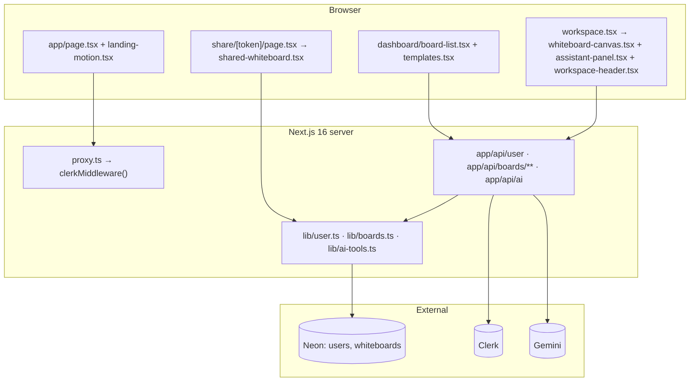

# Chapter 26 — Final Revision Notes and Cheat Sheet

**Goal:** Give you a single-page recall sheet for the whole project: architecture, exact file/function index, rules, codes, env vars, commands, snippets, one-line answers, a "if asked X say Y" table, and a final 26-chapter checklist.

---

## 26.1 One-page architecture

Beginner version: the browser shows pages; the server checks who you are and changes data; Postgres stores boards; Clerk handles login; Gemini writes diagram data.

Professional version: a Next.js 16 App Router monolith with three surfaces and five route handlers. [IMPLEMENTED] Surface files: `app/page.tsx` (public landing), `app/dashboard/layout.tsx` + `components/dashboard/board-list.tsx` (authenticated app), `app/share/[token]/page.tsx` (public read-only). Server helpers: `lib/user.ts`, `lib/boards.ts`. Data: `db/schema.ts` (two tables), `db/index.ts` (cached Neon/Drizzle client). Integrations: Clerk, Gemini.



Key boundary: `components/whiteboard/excalidraw-wrapper.tsx` → `Excalidraw` is `dynamic(..., { ssr: false })`, so the canvas exists only in the browser. [IMPLEMENTED]

---

## 26.2 Exact file/function index

| Area | File → symbol | What it proves |
| --- | --- | --- |
| Shell | `app/layout.tsx` → `RootLayout` | `ClerkProvider`, fonts, metadata, `Toaster`, `AppProvider` |
| Bootstrap | `app/provider.tsx` → `AppProvider` | `POST /api/user` on sign-in; graceful DB failure |
| Middleware | `proxy.ts` → `clerkMiddleware` | Next.js 16 middleware filename |
| Config | `next.config.ts` → `securityHeaders`, `headers()` | Four security headers on `/(.*)` |
| Schema | `db/schema.ts` → `users`, `whiteboards` | Credits default 3; JSONB scene; soft-delete timestamps; unique token |
| DB client | `db/index.ts` → `createDatabase`, `getDb` | Fail-fast `DATABASE_URL`; per-process cached client |
| Identity | `lib/user.ts` → `requireUserId`, `upsertDbUser`, `getDbUserOrUpsert` | Clerk id → local row |
| Queries | `lib/boards.ts` → `listBoards`, `getBoard`, `getBoardByShareToken`, `toSummary`, `boardToData` | Ownership in SQL; summary projection; DTO mapping |
| Types | `lib/types.ts` → `BoardSummary`, `BoardData` | Wire shapes |
| Prompts | `lib/ai-tools.ts` → `AI_TOOLS`, `CANVAS_RULES`, `RESPONSE_SCHEMA`, `DiagramResult` | Six tools; ≤25 nodes; constrained JSON |
| Converter | `lib/ai-canvas.ts` → `diagramToElements`, `makeNode`, `makeArrow`, `buildPlaceholderElements`, `findEmptyCanvasPosition` | AI JSON → editable elements |
| Autosave | `components/whiteboard/whiteboard-canvas.tsx` → `handleChange`, `flush`, `handleApi` | 1.5 s debounce; 30 s thumbnail throttle; `appState: {}` |
| Editor UI | `components/whiteboard/workspace.tsx`, `workspace-header.tsx`, `assistant-panel.tsx` | Dirty guard; title/favorite/share/export; generation panel |
| Stores | `lib/store.ts` → `useUserStore`; `lib/whiteboard-store.ts` → `useWhiteboardStore` | Credit and editor signals |
| Exports | `lib/export.ts` → `exportBoardToPng`, `exportBoardToSvg`, `exportBoardToPdf`, `captureThumbnail` | Excalidraw exporters; lazy jsPDF |
| API | `app/api/user/route.ts`, `app/api/boards/route.ts`, `app/api/boards/[id]/route.ts`, `app/api/boards/[id]/action/route.ts`, `app/api/ai/route.ts` | Five handlers |
| Motion | `components/landing/landing-motion.tsx` → `LandingMotion`, `reduceMotion` | GSAP/Lenis; reduced-motion branch |

---

## 26.3 Rules you must recite exactly

### Credits and ownership [IMPLEMENTED]

| Rule | Source |
| --- | --- |
| New user starts with 3 credits | `db/schema.ts` → `users.credit` default `3` |
| Board creation spends exactly 1 credit atomically | `app/api/boards/route.ts` → `POST` |
| AI generation spends exactly 1 credit atomically | `app/api/ai/route.ts` → `POST` |
| AI failures refund the credit | `app/api/ai/route.ts` → `POST` (empty text, empty nodes, catch) |
| Every board read/write is owner-scoped | `lib/boards.ts` → `getBoard`; mutation `WHERE` clauses |
| Share token is 32 hex chars, unique, revocable, no expiry | `db/schema.ts` → `shareToken`; `app/api/boards/[id]/route.ts` → `PATCH` |
| Pricing plans are display data only | `lib/pricing.ts` → `PLANS`, `CREDIT_PACKS` |

Canonical atomic pattern (verbatim, `app/api/boards/route.ts` → `POST`):

```ts
const [deducted] = await db
  .update(schema.users)
  .set({ credit: sql`${schema.users.credit} - 1` })
  .where(and(eq(schema.users.id, user.id), gt(schema.users.credit, 0)))
  .returning({ credit: schema.users.credit });

if (!deducted) {
```

### Rate limiting [PARTIAL]

`app/api/ai/route.ts` → `isRateLimited`: 10 requests per 60,000 ms per user, stored in `aiRateMap`, process-local and reset on restart; the source comment recommends Redis for multi-instance.

### Autosave [IMPLEMENTED]

`components/whiteboard/whiteboard-canvas.tsx` → `AUTOSAVE_DELAY = 1500`, `THUMBNAIL_THROTTLE_MS = 30_000`, `handleChange` sets `pending.current = { elements, appState: {}, files }`, `flush` PATCHes `/api/boards/${board.id}`, unmount flushes with `flush(true)`.

### Status codes

| Code | Meaning | File → symbol |
| --- | --- | --- |
| 200 | Successful GET/PATCH/POST user, action, AI | route handlers |
| 201 | Board created | `app/api/boards/route.ts` → `POST` |
| 400 | Invalid board id/action, invalid JSON, empty/long prompt | `[id]/route.ts`, `action/route.ts`, `api/ai/route.ts` |
| 401 | No Clerk user | `lib/user.ts` → `UnauthorizedError`, route catches |
| 402 | No credits | boards `POST`, ai `POST` |
| 404 | Board missing, foreign owner, trashed board | `getBoard` callers, `SharePage` |
| 429 | Rate limited | `app/api/ai/route.ts` → `POST` |
| 500 | Generic/internal or Gemini failure | all route catches; ai `POST` |
| 502 | Empty model text or no nodes | `app/api/ai/route.ts` → `POST` |
| 503 | `GEMINI_API_KEY` missing | `app/api/ai/route.ts` → `POST` |

### Environment variables [IMPLEMENTED]

From `.env.example` and `README.md`: `NEXT_PUBLIC_CLERK_PUBLISHABLE_KEY`, `CLERK_SECRET_KEY`, `NEXT_PUBLIC_CLERK_SIGN_IN_URL`, `NEXT_PUBLIC_CLERK_SIGN_UP_URL`, `DATABASE_URL`, `GEMINI_API_KEY`, `GEMINI_MODEL`, and `NEXT_PUBLIC_APP_URL` (used in `app/layout.tsx` → `metadataBase`). Never write key values in docs; rotate exposed Clerk keys per `README.md` → Notes.

### Commands

From `package.json` → `scripts`: `npm install`, `npm run dev`, `npm run build`, `npm run start`, `npm run lint`, `npm run db:generate`, `npm run db:push`, `npm run db:studio`. Note: `README.md` mentions `npm run db:migrate`, but that script is **not** in `package.json` [EVIDENCE GAP].

---

## 26.4 Key snippets worth memorising

**Ownership in the query** (`lib/boards.ts` → `getBoard`):

```ts
const [row] = await db
  .select()
  .from(schema.whiteboards)
  .where(
    and(
      eq(schema.whiteboards.id, boardId),
      eq(schema.whiteboards.userId, userId),
    ),
  )
  .limit(1);
return row ?? null;
```

**Share token generation** (`app/api/boards/[id]/route.ts` → `PATCH`):

```ts
if (body.share === "enable" && !board.shareToken) {
  update.shareToken = randomUUID().replace(/-/g, "");
}
if (body.share === "disable") {
  update.shareToken = null;
}
```

**Failure refund** (`app/api/ai/route.ts` → `POST`):

```ts
await db
  .update(users)
  .set({ credit: sql`${users.credit} + 1` })
  .where(eq(users.id, userId))
  .catch(() => {}); // best-effort refund
```

**Schema-constrained generation** (`app/api/ai/route.ts` → `POST`):

```ts
const response = await ai.models.generateContent({
  model: MODEL,
  contents: finalPrompt,
  config: {
    responseMimeType: "application/json",
    responseSchema: RESPONSE_SCHEMA as unknown as Record<string, unknown> & {
```

---

## 26.5 Common interview answers in one line each

- **What is it?** Prompts become editable Excalidraw elements via Gemini structured output (`lib/ai-canvas.ts` → `diagramToElements`).
- **Why JSONB?** The scene is an Excalidraw-owned aggregate; we never query inside it (`db/schema.ts` → `whiteboards.elements`).
- **Why atomic credits?** One conditional `UPDATE` stops concurrent double-spend (`app/api/boards/route.ts`, `app/api/ai/route.ts`).
- **What if AI fails?** Refund on empty text, empty nodes, or thrown error (`app/api/ai/route.ts` → `POST`).
- **How is ownership enforced?** `getBoard(userId, id)` and owner-scoped `WHERE` clauses (`lib/boards.ts`).
- **How does sharing work?** Revocable 32-hex capability token, read-only view (`app/api/boards/[id]/route.ts`, `shared-whiteboard.tsx`).
- **How does autosave work?** 1.5 s debounce, 30 s thumbnail throttle, `appState: {}` (`whiteboard-canvas.tsx`).
- **Why client-only Excalidraw?** Browser APIs required; `dynamic(..., { ssr: false })` (`excalidraw-wrapper.tsx`).
- **How do exports work?** Excalidraw exporters; PDF via lazy `jspdf` (`lib/export.ts`).
- **Tests?** None automated; lint/build/manual only (`package.json` → `scripts`) [EVIDENCE GAP].
- **Payments?** No; `lib/pricing.ts` is display data [EVIDENCE GAP].
- **Multiplayer?** No; single owner plus read-only share [EVIDENCE GAP].
- **Monitoring?** `console.error` in route handlers only [EVIDENCE GAP].
- **Scale first fix?** Replace process-local `isRateLimited` with shared state (`app/api/ai/route.ts`) [SUGGESTED IMPROVEMENT].

---

## 26.6 "If asked X, say Y"

| If asked | Say |
| --- | --- |
| "Is the AI output an image?" | "No — `diagramToElements` creates shapes, text, and bound arrows." |
| "Does board creation cost credits?" | "Yes, one, atomically, in `POST /api/boards`." |
| "Do AI failures cost credits?" | "No; `POST /api/ai` refunds on every failure branch." |
| "Why 404 instead of 403?" | "Foreign ids return no row from `getBoard`, and callers use `notFound()`." |
| "Can a shared viewer edit?" | "No; `SharedWhiteboard` uses `viewModeEnabled`." |
| "Do links expire?" | "No; they are revoked by nulling `shareToken`." |
| "Why is `appState` empty on save?" | "`handleChange` explicitly stores `{}` to drop transient UI state." |
| "Where are tests?" | "There are none; I verify with lint, build, and manual flows." |
| "Where is Stripe?" | "Nowhere; pricing is static data in `lib/pricing.ts`." |
| "Why those libraries?" | "Code-grounded fit only; no benchmark or ADR is committed." |
| "Is `.planning/codebase/*.md` reliable?" | "No; it predates hardening and is stale." |
| "Any measured performance numbers?" | "None committed; I describe mechanisms, not invented metrics." |

---

## 26.7 Final 26-chapter checklist

| # | Chapter | Recall anchor |
| --- | --- | --- |
| 1 | Project Overview | Product, scope, 30-second pitch |
| 2 | Problem Statement | Blank canvas + non-editable AI output |
| 3 | Requirements | Features visible in code vs. inferred |
| 4 | Technology Stack | Versions in `package.json`, why from code |
| 5 | System Architecture | Three layers, five route handlers |
| 6 | Folder Structure | `app/`, `components/`, `lib/`, `db/` |
| 7 | Development Methodology | Iterative hardening, no ADRs |
| 8 | Design Patterns | Singleton, DTO, debounce, capability token |
| 9 | Frontend | RSC + client islands, `ssr: false` |
| 10 | Backend | Routes, helpers, error mapping |
| 11 | Database | Two tables, JSONB, soft deletes |
| 12 | API Documentation | Verbs, payloads, status codes |
| 13 | Authentication and Security | Clerk, ownership, headers, share token |
| 14 | Feature-by-Feature | Boards, AI, autosave, share, exports |
| 15 | End-to-End Data Flow | Sign-in → create → generate → save → share |
| 16 | Error Handling and Validation | 400/401/402/404/429/500/502/503 |
| 17 | Testing Strategy | Current manual verification; proposed tests |
| 18 | Performance and Optimization | Summary columns, debounce, throttle, lazy import |
| 19 | Deployment and DevOps | Scripts, headers, missing CI/monitoring |
| 20 | Challenges and Solutions | Double-spend, refunds, autosave noise, client-only canvas |
| 21 | Limitations and Future Enhancements | No tests, payments, multiplayer, expiry, metrics |
| 22 | Project Explanation for Interviews | Four introductions, do-not-claim list |
| 23 | Technical Interview Questions and Answers | 13 categories, six-field answer format |
| 24 | Advanced Cross-Questioning | Mechanism, invariant, alternative, failure mode |
| 25 | Rebuilding from Scratch | 13 milestones M0–M12 |
| 26 | Final Revision and Cheat Sheet | This sheet |

Read Chapters 22–24 the morning of an interview; use Chapter 25 only if you need to reconstruct; use this chapter in the last ten minutes.

---

## 26.8 Revision summary

- Architecture: Next.js 16 monolith, three surfaces, five route handlers, two tables.
- Highest-value symbols: `getDb`, `getBoard`, `requireUserId`, `POST` (both credit paths), `diagramToElements`, `handleChange`.
- Credits: 3 initial; board creation −1; AI generation −1; AI failure refunds; atomic conditional update.
- Autosave: 1,500 ms debounce, 30,000 ms thumbnail throttle, `appState: {}`, flush on unmount.
- Sharing: 32-hex unique token, revocable, no expiry, `viewModeEnabled`.
- Honest gaps: no tests/CI/monitoring/payments/multiplayer/measurements; stale planning docs.
- Answer style: file → symbol → line → invariant → limitation.

## 26.9 Knowledge checks

1. Which two route handlers spend a credit, and what single SQL shape protects both?
2. What are the exact values of `AUTOSAVE_DELAY` and `THUMBNAIL_THROTTLE_MS`, and which function sends the PATCH?
3. What status codes distinguish "no credits", "too many requests", and "bad model output"?
4. Which four environment variable names are required for auth, database, and AI, and which file lists them?
5. Name three do-not-claim items and the file that proves each is absent.

## 26.10 Practical exercises

1. **Blind recall:** close this file and write the one-page architecture from memory; then diff against 26.1 and fix omissions.
2. **Status-code drill:** for each code in 26.3, name the file, symbol, and triggering condition without looking.
3. **Interview simulation:** answer five questions from 26.6 in under 15 seconds each, then give the file/symbol proof for each.

## 26.11 Interview questions

1. "Recite the credit rules in 20 seconds, including the refund paths."
2. "Which single line of code best demonstrates authorization in this project?"
3. "How do you answer 'what would you fix first' without contradicting what is implemented?"
4. "Explain the difference between `appState: {}` and storing the full Excalidraw app state."
5. "Give your final one-sentence summary of the project using the words 'editable', 'atomic', and 'revocable'."
